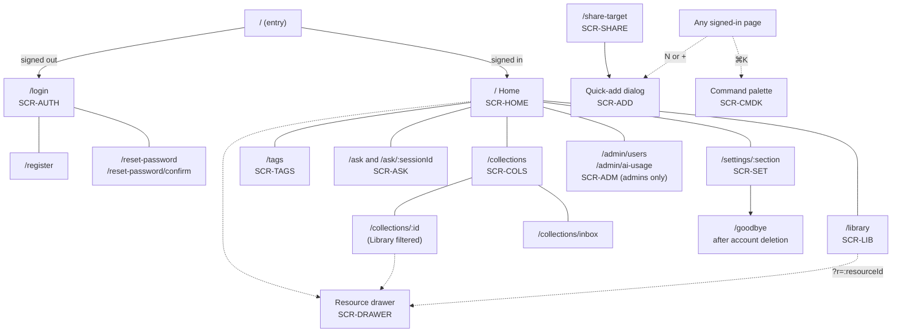

# Knowledge Hub — UI/UX Design Plan

| | |
|---|---|
| **Document** | 03 — UI/UX design plan |
| **Version** | 0.1 (draft) |
| **Date** | 2026-11-02 |
| **Author** | Lahiru Dissanayake |
| **Status** | Draft for review |
| **Companion documents** | [01 — SRS](01-software-requirements-specification.md) · [02 — System architecture](02-system-architecture.md) |

Requirement IDs (`FR-…`, `NFR-…`) refer to Doc 01; endpoints and error codes refer to Doc 02 §8.
Screen IDs (`SCR-…`) are the ones used in the SRS traceability matrix.

---

## Contents

1. [Design principles](#1-design-principles)
2. [Research and personas](#2-research-and-personas)
3. [Information architecture and sitemap](#3-information-architecture-and-sitemap)
4. [Navigation](#4-navigation)
5. [Key screens](#5-key-screens)
6. [Interaction patterns](#6-interaction-patterns)
7. [Design system](#7-design-system)
8. [Responsive behaviour](#8-responsive-behaviour)
9. [Accessibility](#9-accessibility)
10. [Content and microcopy](#10-content-and-microcopy)
11. [Onboarding](#11-onboarding)
12. [Frontend technical design](#12-frontend-technical-design)
13. [Validation](#13-validation)
14. [Open issues](#14-open-issues)

---

## 1. Design principles

| # | Principle | What it means in practice | Measured by |
|---|---|---|---|
| P1 | **Capture in under 5 seconds** | One field first (the URL); everything else is optional or filled in for you; Enter saves | NFR-USA-04 |
| P2 | **Find anything fast** | Search is always one key away (`/`, `⌘K`); filters live in the URL; semantic search when words fail | Search success rate (§13) |
| P3 | **AI helps without getting in the way** | AI output is always labelled, editable and optional; it never applies changes on its own; when AI is down, the app still works | FR-AI-09, FR-AI-11 |
| P4 | **Calm and content-first** | Neutral surfaces, one accent colour, the resource's own title and image lead; no badges or counters unless they help a decision | Design review |
| P5 | **Keyboard-friendly** | Every action has a keyboard path; common actions have shortcuts | NFR-USA-02 |
| P6 | **Forgiving** | Undo instead of "Are you sure?"; nothing is lost silently | §6 |

When principles conflict, the order above decides: speed of capture first, calmness last.

---

## 2. Research and personas

### 2.1 Personas

Summarised from SRS §2.4.

| | **Nimali — university student** | **Kasun — self-taught developer** |
|---|---|---|
| Saves | Lecture PDFs, YouTube explainers, blog posts | Courses, GitHub repositories, documentation |
| Device | Laptop in class, phone on the bus | Desktop in the evening, phone at work |
| Main job | "Keep everything for one module together so I can revise." | "Build a learning path and find that one article again." |
| Pain | Forgets why she saved something | Manual filing takes too long |
| Success | Asks "what did I save about B-trees?" and gets an answer with sources | Finds "the article about connection pooling" without its title |

### 2.2 Jobs to be done

1. **When** I find something useful, **I want to** save it in a moment, **so that** I don't break
   my flow.
2. **When** I come back to a topic, **I want to** see everything I saved on it, **so that** I can
   pick up where I left off.
3. **When** I half-remember a resource, **I want to** find it by what it was about, **so that** I
   don't need its exact title.
4. **When** I'm studying, **I want to** ask questions across my saved material, **so that** I learn
   from it instead of re-reading it all.
5. **When** I stop using the app, **I want to** take my data with me or delete it, **so that** I stay
   in control.

### 2.3 Main journey

| Stage | Capture | Organise | Retrieve | Learn |
|---|---|---|---|---|
| **User action** | Paste a link (quick-add, share menu) | Pick a collection, accept tags | Search, filter, browse a collection | Read the summary, ask a question, open related items |
| **Feeling today** | Rushed; "I'll sort it later" | Tedious; never happens | Frustrated; "I know I saved it" | Overwhelmed by a long list |
| **Knowledge Hub answer** | One-field quick-add, live preview, Enter to save | Suggested tags (existing first), optional collection, Inbox as a safe default | Instant keyword search, semantic switch, URL-synced filters | Labelled summary, Ask with citations, related resources |
| **Screens** | SCR-ADD, SCR-SHARE | SCR-ADD, SCR-DRAWER, SCR-COLS | SCR-LIB, SCR-CMDK | SCR-DRAWER, SCR-ASK |

### 2.4 Pain points of today's tools

| Tool | What works | What hurts | Design response |
|---|---|---|---|
| Browser bookmarks | Zero friction to save | Folders only, no search inside content, no context | Same speed of capture, plus metadata and search |
| Notion (as a link database) | Flexible, notes next to links | Slow to capture; you build and maintain the system yourself | Opinionated structure: collections + tags, nothing to set up |
| Raindrop.io | Good library layout, quick add | Organising is still manual | Keep the layout ideas; let AI suggest tags |
| Pocket (shut down by Mozilla in 2025) | Read-later habit | Became a pile; service is gone | Inbox with gentle prompts; export always available |

Related products studied for ideas are listed in SRS §1.4.

---

## 3. Information architecture and sitemap

### 3.1 Sitemap

The app opens straight to sign-in, or to Home when signed in. There is no public landing page in v1.



- **The resource drawer is a URL state** (`?r=<id>`) on top of whatever page is open. The link can be
  shared to another tab, and the browser Back button closes it.
- **A collection page is the Library with a fixed collection filter**, so both use the same
  components and behaviour.
- **Settings sections:** `profile`, `appearance`, `ai`, `data` (export), `account` (password,
  danger zone).

### 3.2 Screens to requirements

Every Must requirement with a user-facing part appears on at least one screen.

| Screen | Purpose | Requirements |
|---|---|---|
| SCR-AUTH | Sign in, register, reset password | FR-AUTH-01, 02, 06, 10 |
| SCR-HOME | Dashboard and onboarding | FR-DASH-01–05 |
| SCR-LIB | Browse, search, filter, bulk actions | FR-RES-02, 04, 09, 10, 12; FR-SRCH-01–05; FR-AI-05, FR-AI-09; FR-META-03 |
| SCR-ADD | Quick-add | FR-RES-01, 05–07, 11; FR-META-02, 04; FR-AI-04, FR-AI-09; FR-TAG-01 |
| SCR-DRAWER | Resource detail and editing | FR-RES-02–10; FR-META-03; FR-AI-02, 03, 04, 07, 11 |
| SCR-COLS | Collections list and collection pages | FR-COL-01–05; FR-RES-06 |
| SCR-TAGS | Tags manager | FR-TAG-02–05 |
| SCR-ASK | Ask your library | FR-AI-06, 08–11 |
| SCR-SET | Settings | FR-AUTH-03, 05, 07–09; FR-AI-10, 12; FR-EXP-01, 02 |
| SCR-ADM | Admin | FR-ADM-01–04 |
| SCR-CMDK | Command palette | FR-SRCH-01, navigation, quick actions |
| SCR-SHARE | PWA share target | FR-RES-13 |

---

## 4. Navigation

### 4.1 Desktop and tablet (≥ 768 px)

```
┌──────────────────────────────────────────────────────────────────────────────┐
│ ☰  Knowledge Hub   [ 🔍 Search your library…              ⌘K ]   [+ Add]  (L) │  top bar
├───────────────────┬──────────────────────────────────────────────────────────┤
│ ⌂  Home           │                                                          │
│ ▤  Library        │                                                          │
│ ✦  Ask            │                    page content                          │
│                   │                                                          │
│ COLLECTIONS    +  │                                                          │
│ 📌 📘 Databases 12│                                                          │
│    🎓 Algorithms 8│                                                          │
│    📥 Inbox      5│                                                          │
│                   │                                                          │
│ TAGS              │                                                          │
│ # postgres     9  │                                                          │
│ # react        6  │                                                          │
│ Manage tags →     │                                                          │
│                   │                                                          │
│ ⚙  Settings       │                                                          │
└───────────────────┴──────────────────────────────────────────────────────────┘
```

- **Sidebar:** Home, Library, Ask; then collections (pinned first, with counts, `+` to create);
  the top tags (up to 8) with "Manage tags"; Settings (and Admin for admins) at the bottom. It
  collapses to an icon rail with `☰` or `[`; the state is remembered.
- **Top bar:** global search (focus with `/`), which shows keyword results as you type and
  "Ask about this…" as the last option; the **Add** button (`N`); the account menu (L = avatar
  initial) with theme, shortcuts and sign out.
- **Command palette (`⌘K` / `Ctrl+K`, SCR-CMDK):** search resources, run actions ("Add resource",
  "New collection", "Toggle theme", "Ask…") and jump to any page or collection.

### 4.2 Mobile (< 768 px)

```
┌──────────────────────────────┐
│ Library              🔍   (L) │
├──────────────────────────────┤
│                              │
│        page content          │
│                              │
│                         ╭──╮ │
│                         │+ │ │  floating Add button
│                         ╰──╯ │
├──────┬──────┬──────┬─────────┤
│  ⌂   │  ▤   │  ✦   │   ▦     │  bottom tab bar
│ Home │Library│ Ask │Collections│
└──────┴──────┴──────┴─────────┘
```

- Bottom tab bar: Home, Library, Ask, Collections. Tags and Settings are in the account menu.
- The floating `+` opens quick-add as a bottom sheet.
- The search icon opens a full-screen search view.

---

## 5. Key screens

Each screen lists its states. **Empty**, **loading**, **error** and **AI unavailable** are designed
for every screen (IR-02). Copy for these states is in §10.

### 5.1 Quick-add (SCR-ADD)

Opened with `N`, the **Add** button, the palette, or the share target. A dialog on desktop, a bottom
sheet on mobile.

```
┌─ Add a resource ──────────────────────────────────────────── ✕ ┐
│                                                                 │
│  URL                                                            │
│  [ https://www.npgsql.org/doc/performance.html               ]  │
│                                                                 │
│  ┌───────────────────────────────────────────────────────────┐  │
│  │ ▓▓▓▓▓▓▓  Performance | Npgsql Documentation               │  │
│  │ ▓ img ▓  npgsql.org · Article                              │  │
│  │ ▓▓▓▓▓▓▓  Tips for getting the best performance from…      │  │
│  └───────────────────────────────────────────────────────────┘  │
│                                                                 │
│  Tags   [postgres ✓] [dotnet ✓] (+ performance) (+ pooling) ✦  │
│         [ add a tag…                                         ]  │
│                                                                 │
│  Collection  [ 📥 Inbox                                   ▾ ]  │
│                                                                 │
│  ▸ More details (title, type, notes)                            │
│                                                                 │
│                                  [ Cancel ]   [ Save  ⏎ ]       │
└─────────────────────────────────────────────────────────────────┘
   [✓] = existing tag, accepted   (+ x) = suggestion, not applied   ✦ = AI suggestions
```

**Flow:** the URL field is focused and pre-filled from the clipboard **only** if the user grants
clipboard permission and the clipboard holds a URL (shown as a chip "Paste https://… ?"). Typing or
pasting a valid URL starts the preview (debounced 400 ms) and tag suggestions in parallel. Enter
saves from any field except notes. After saving, the dialog closes, the item appears at the top of
the list, and a toast says "Saved to Inbox · Undo · Open".

| State | Behaviour |
|---|---|
| Empty | Only the URL field and a hint: "Paste a link. We'll fill in the rest." |
| Loading preview | Skeleton card; Save is already enabled |
| Preview failed | Card shows the URL and "Couldn't load a preview. You can still save it." |
| Duplicate URL | Inline notice above the card: "You saved this on 12 Oct in Databases." [Open it] [Save anyway] |
| Invalid URL | Inline error under the field (§10.3); Save disabled |
| AI unavailable | No suggestion chips; small muted note "Tag suggestions are unavailable right now." |
| Suggestions off (FR-AI-12) | No chips, no note |
| Saving error | Toast with retry; the dialog stays open with the data |

### 5.2 Library (SCR-LIB)

```
┌──────────────────────────────────────────────────────────────────────────────┐
│ Library                                                     124 resources    │
│ [ 🔍 connection pooling                     ] ( Keyword | Semantic ✦ )       │
│ Type ▾  Tags ▾  Collection ▾  ☆ Favourites  Archived  Date ▾   Sort: Relevance ▾│
│ Active: [postgres ✕] [Article ✕]                          Clear all  ☰ ▦    │
├──────────────────────────────────────────────────────────────────────────────┤
│ ☐ │ 🌐 Performance | Npgsql Documentation              Article · npgsql.org │
│   │    Tips for getting the best performance from Npgsql…                    │
│   │    #postgres #dotnet                   📘 Databases · 2 days ago  ☆  ⋯  │
├───┼──────────────────────────────────────────────────────────────────────────┤
│ ☐ │ ▶ PgBouncer explained in 10 minutes                    Video · youtube.com│
│   │    ✦ "…pooling sits between the app and the database…"  (semantic snippet)│
│   │    #postgres                            📥 Inbox · 1 week ago      ★  ⋯  │
├───┴──────────────────────────────────────────────────────────────────────────┤
│                         ‹ Prev   Page 1 of 7   Next ›                        │
└──────────────────────────────────────────────────────────────────────────────┘

With items selected, the filter row is replaced by a bulk action bar:
│ 3 selected   [Move to…] [Add tags] [Remove tags] [Delete]          Cancel ✕ │
```

- **Filters and the query are URL search parameters** (`/library?q=…&type=article&tag=postgres`),
  so a filtered view can be bookmarked and Back works.
- **List (default) and grid** views; grid shows preview images, for visual collections (videos,
  courses).
- **Keyword / Semantic switch:** semantic mode shows the matching snippet with the AI mark (✦) and
  hides sort options that don't apply. Filters other than collection are not available in semantic
  mode in v1; they are shown disabled with a tooltip.
- **Pagination:** numbered pages (the API uses offset pagination); page size 20, changeable to 50 or
  100 in the list footer.
- **Pending metadata:** a row shows the URL with a subtle shimmer on the title until
  `metadata_status` is `ready` (refetched every 2 s for up to 30 s). Failed rows show "Couldn't
  fetch details · Retry".
- **Row actions (`⋯`):** open, edit, move to…, favourite, archive, copy link, delete.

| State | Behaviour |
|---|---|
| Empty library | Illustration-free empty state: "Your library is empty." [Add your first resource] and a hint about `N` |
| No results | "Nothing matches 'pooling' with these filters." [Clear filters] [Search by meaning instead] |
| Loading | 6 skeleton rows; filters stay usable |
| Error | Inline panel "Couldn't load your library." [Try again] |
| AI unavailable | Semantic option disabled with tooltip; if active, results switch to keyword with a banner "Semantic search is unavailable, showing keyword results." |

### 5.3 Resource detail drawer (SCR-DRAWER)

Opens from the right on desktop (480 px wide; at ≥ 1440 px it sits beside the list instead of over
it) and as a full-screen sheet on mobile.

```
┌─ Resource ─────────────────────────── ↗ Open   ⋯   ✕ ┐
│ ▓▓▓▓▓▓▓▓▓▓▓▓▓▓▓▓▓▓ preview image ▓▓▓▓▓▓▓▓▓▓▓▓▓▓▓▓▓▓ │
│ Performance | Npgsql Documentation        ✎         │
│ npgsql.org · Article ▾ · Saved 2 days ago      ☆    │
│ Collection [📘 Databases ▾]                          │
│ Tags [postgres ✕] [dotnet ✕] [+ add]                │
│      Suggested ✦ (+ pooling) (+ performance)        │
│                                                     │
│ SUMMARY                         ✦ AI-generated  ↻ ✎ │
│ ┌─────────────────────────────────────────────────┐ │
│ │ Explains how to tune Npgsql: connection pooling, │ │
│ │ prepared statements and batching…                │ │
│ └─────────────────────────────────────────────────┘ │
│                                                     │
│ NOTES                                  Saved ✓      │
│ [ Write  |  Preview ]                               │
│ ┌─────────────────────────────────────────────────┐ │
│ │ Use `Max Auto Prepare` for hot queries…          │ │
│ └─────────────────────────────────────────────────┘ │
│                                                     │
│ RELATED ✦                                           │
│ ▶ PgBouncer explained in 10 minutes                 │
│ 🌐 Neon connection pooling docs                     │
└─────────────────────────────────────────────────────┘
```

- **Summary label** follows `summary_source`: "✦ AI-generated", "Extracted from the page", or
  "Written by you". Actions: regenerate (↻), edit (✎), remove. Editing turns the label into
  "Written by you" (FR-AI-11).
- **Notes** autosave 1 second after typing stops and on blur, with a "Saving… / Saved ✓" status.
  If the server returns `409 edit_conflict`, a notice offers "Reload latest" or "Keep mine".
- **Title, type and URL** edit inline (✎). Changing the URL asks "Fetch new details for this link?"
- `J` / `K` move to the next or previous resource while the drawer is open.

| State | Behaviour |
|---|---|
| Loading | Skeleton of the layout |
| Metadata pending | Image area shimmer; "Fetching details…" under the title |
| No summary | "No summary yet." [Summarise ✦]; in the free profile with too little text: "This page doesn't have enough text to summarise." |
| Summarising | Button shows a spinner; the rest stays usable |
| Not found | "This resource doesn't exist or was deleted." [Close] (also shown for other users' IDs) |
| AI unavailable | Summarise and regenerate disabled with tooltip; Related section hidden; existing summary still shown |

### 5.4 Home (SCR-HOME)

```
┌──────────────────────────────────────────────────────────────────────────────┐
│ Good evening, Lahiru                                                          │
│                                                                              │
│ ┌ Get started ─────────────────────── 2 of 4 ┐                               │
│ │ ✓ Save your first resource                  │                               │
│ │ ✓ Create a collection                       │                     Dismiss  │
│ │ ○ Try a search          ○ Ask a question    │                               │
│ └─────────────────────────────────────────────┘                               │
│                                                                              │
│ ┌──────────┐ ┌──────────┐ ┌──────────┐ ┌──────────┐                          │
│ │ 124      │ │ 9        │ │ 37       │ │ 15       │                          │
│ │ resources│ │ collections│ │ tags   │ │ favourites│                         │
│ └──────────┘ └──────────┘ └──────────┘ └──────────┘                          │
│                                                                              │
│ Recently added                          By type                              │
│ 🌐 Performance | Npgsql…  2d            Article  ████████████ 52             │
│ ▶ PgBouncer explained…    1w            Video    ██████ 24                   │
│ 📄 B-tree lecture notes   1w            Repo     ████ 18                     │
│ ⌥ dotnet/aspire           2w            Website  ███ 14  · PDF ██ 9 · …      │
│ 🎓 EF Core course         2w                                                 │
│                                                                              │
│ Activity (last 12 weeks)   ▁▂▄▃▅▇▆▃▂▄▅▆                                       │
└──────────────────────────────────────────────────────────────────────────────┘
```

- Stat tiles link to the Library with the matching filter.
- **By type** is a horizontal bar chart with values written next to each bar (no colour-only
  meaning); clicking a bar filters the Library.
- **Activity** (Should) is a small column chart with an accessible table alternative.

| State | Behaviour |
|---|---|
| New user (empty) | Checklist expanded; stats show 0; "Recently added" replaced by a large [Add your first resource] |
| Loading | Skeleton tiles and lists |
| Error | Each panel fails on its own with [Try again] |

### 5.5 Ask (SCR-ASK)

```
┌───────────────────┬──────────────────────────────────────────────────────────┐
│ [+ New chat]      │ Scope: [ Whole library ▾ ]          ✦ Answers use AI     │
│                   ├──────────────────────────────────────────────────────────┤
│ Today             │                                                          │
│ • Connection pool…│  You                                                     │
│ Last week         │  How should I size my connection pool?                   │
│ • B-tree vs hash  │                                                          │
│ • Spaced repetit… │  ✦ Knowledge Hub                                         │
│                   │  Start small: a pool of about 10 connections per         │
│                   │  instance is usually enough [1]. With PgBouncer in       │
│                   │  transaction mode, many clients share few server         │
│                   │  connections [2].                                        │
│                   │  Sources: [1 Npgsql performance] [2 PgBouncer explained] │
│                   │                                       Copy · Retry       │
│                   ├──────────────────────────────────────────────────────────┤
│                   │ [ Ask about your library…                          ⏎ ]  │
│                   │ Try: "What did I save about indexing?"                   │
└───────────────────┴──────────────────────────────────────────────────────────┘
```

- **Streaming:** the answer appears as it is generated, with a **Stop** button in place of send.
  Citation chips appear when the answer finishes; clicking one opens the resource drawer.
- **Scope selector:** whole library or one collection (FR-AI-06).
- **Suggested questions** for a new chat come from the user's top tags and recent collections
  ("What did I save about postgres?").
- **Past chats** (Should) in the left column; rename and delete in each item's menu. On mobile the
  list is behind a "Chats" button.
- **Quota:** when 80 % of the daily chat quota is used, a quiet line under the composer says
  "8 questions left today".

| State | Behaviour |
|---|---|
| Nothing indexed yet | "Save a few resources first. Ask answers from your own library." [Add a resource] |
| New chat | Heading "Ask your library", 3 suggested questions |
| Waiting for first token | Typing indicator "Searching your library…" then "Writing…" |
| No relevant sources | The answer says so, with [Search the library instead] |
| Quota reached | Composer disabled: "You've reached today's limit. It resets at 00:00 UTC (in 3 h)." |
| AI unavailable | Composer disabled with banner "Ask is unavailable right now. Your library still works." [Try again] |
| Stream error | Partial answer kept, marked "Answer interrupted" [Retry] |

### 5.6 Collections (SCR-COLS)

```
┌──────────────────────────────────────────────────────────────────────────────┐
│ Collections                                              [+ New collection]  │
├──────────────────────────────────────────────────────────────────────────────┤
│ 📌 📘 Databases           12 resources   Notes on Postgres, indexing…    ⋯   │
│ 📌 🎓 Algorithms           8 resources   CS2001 module                    ⋯   │
│    🧠 Learning to learn    4 resources                                    ⋯   │
│    📥 Inbox                5 resources   Not in a collection yet              │
└──────────────────────────────────────────────────────────────────────────────┘
```

- Create and edit in a small dialog: name, description, emoji, colour.
- Reorder by drag **or** with "Move up / Move down" in the `⋯` menu (keyboard alternative,
  WCAG 2.5.7). Pin and unpin in the same menu.
- **Delete** opens the one confirm dialog in the app (§6.2):

```
┌─ Delete "Databases"? ─────────────────────────────────┐
│ It contains 12 resources. What should happen to them? │
│ (•) Move them to [ 📥 Inbox            ▾ ]            │
│ ( ) Delete them too                                    │
│                              [ Cancel ] [ Delete ]     │
└────────────────────────────────────────────────────────┘
```

- A **collection page** (`/collections/:id`) is the Library view with a header showing the
  collection's emoji, name, description and an Edit button.

| State | Behaviour |
|---|---|
| No collections | "Group related resources, for example one collection per course." [New collection]; Inbox is always listed |
| Empty collection | "Nothing here yet. Drag resources here or use 'Move to…'." |

### 5.7 Tags manager (SCR-TAGS)

```
┌──────────────────────────────────────────────────────────────────────────────┐
│ Tags                                   [ 🔍 Filter tags  ]   Sort: Most used ▾│
├──────────────────────────────────────────────────────────────────────────────┤
│ ☐ #postgres        9 resources                               Rename  ⋯       │
│ ☐ #postgresql      2 resources   Similar to #postgres → [Merge]  Rename  ⋯   │
│ ☐ #react           6 resources                               Rename  ⋯       │
│ ☐ #old-stuff       0 resources                               Rename  ⋯       │
├──────────────────────────────────────────────────────────────────────────────┤
│ 2 selected   [Merge into…]  [Delete]                                         │
└──────────────────────────────────────────────────────────────────────────────┘
```

- Rename inline; renaming to an existing tag offers "Merge into #postgres instead?" (`409
  tag_name_taken`).
- "Similar to" hints use simple string similarity (plurals, `-sql` endings), computed in the
  browser; no AI needed.
- Delete shows an undo toast; the tag is removed from its resources.

### 5.8 Settings (SCR-SET)

Sections in a left list (desktop) or a list page (mobile):

| Section | Contents |
|---|---|
| Profile | Display name, email (read-only in v1) |
| Appearance | Theme: System / Light / Dark; density: Comfortable / Compact; single-key shortcuts on/off (WCAG 2.1.4) |
| AI | "Summarise new resources automatically", "Suggest tags when adding", today's AI usage against limits, profile in use (Free or Claude) with what that means |
| Data | Export JSON, export CSV |
| Account | Change password; sign out; **Danger zone:** Delete account |

**Delete account** (UC-04): a page, not a small dialog, that lists what will be deleted, offers
"Export my data first", and asks for the password. The button reads "Delete my account and data".

### 5.9 Admin (SCR-ADM, Could)

- **Users:** table with email, name, role, joined, last sign-in, resources, status; search by email;
  Disable / Enable with a confirm dialog naming the user. Admins cannot disable themselves (the
  action is not shown on their own row).
- **AI usage:** per day for 30 days (column chart with table alternative) and per user (table):
  calls, tokens, estimated cost per operation.

### 5.10 Sign in, register and reset (SCR-AUTH)

```
┌─────────────────────────────────────┐
│           Knowledge Hub             │
│   Save, organise and learn from     │
│        what you find online.        │
│                                     │
│ Email     [                       ] │
│ Password  [                    👁 ] │
│                  Forgot password?   │
│ [            Sign in            ]   │
│                                     │
│ ─────────────  or  ──────────────   │
│ [ Continue with GitHub ] (Could)    │
│                                     │
│ New here? Create an account         │
└─────────────────────────────────────┘
```

- Fields allow paste and password managers (`autocomplete="email"`, `current-password`,
  `new-password`) — WCAG 3.3.8.
- Registration shows the password rule up front ("At least 12 characters") and checks it as the user
  types.
- Errors from `invalid_credentials`, `account_locked`, `account_disabled` and `rate_limited` use the
  copy in §10.3.

### 5.11 Command palette (SCR-CMDK)

```
┌─────────────────────────────────────────────────────────┐
│ 🔍 pool                                                 │
├─────────────────────────────────────────────────────────┤
│ RESOURCES                                               │
│   🌐 Performance | Npgsql Documentation       Databases │
│   ▶ PgBouncer explained in 10 minutes            Inbox  │
│ ACTIONS                                                 │
│   ✦ Ask "pool"                                          │
│   ✦ Search by meaning: "pool"                           │
│   +  Add resource                                    N  │
│ GO TO                                                   │
│   📘 Databases                                          │
└─────────────────────────────────────────────────────────┘
  ↑↓ to move · ⏎ to open · Esc to close
```

Built with the `cmdk`-based shadcn Command component (combobox and listbox roles). Results come from
keyword search (debounced 150 ms, top 5) plus static actions and pages.

---

## 6. Interaction patterns

### 6.1 Feedback and speed

| Pattern | Where | Detail |
|---|---|---|
| **Optimistic updates** | Favourite, archive, tag add/remove, move, rename, reorder, delete | Update the TanStack Query cache at once; roll back and show an error toast if the request fails |
| **Skeleton loaders** | Lists, drawer, dashboard | Shown only if loading takes > 300 ms, to avoid flashes |
| **Inline validation** | All forms | On blur, then live once a field has been touched; messages under the field, linked with `aria-describedby` |
| **Background progress** | Metadata, summaries | Shimmer on the affected field only; the rest of the item is usable |
| **Toasts** | Results of actions | Bottom-right (bottom-centre on mobile), 6 seconds (10 seconds when they offer Undo), paused on hover and focus, never the only place an error is shown for forms |

### 6.2 Undo instead of confirm

- Delete resource, bulk move, bulk tag, delete tag, remove summary: done at once, with a toast
  "Deleted 'PgBouncer explained' · **Undo**" (10 seconds). Resource deletes can also be undone later
  through the API's 7-day restore window (FR-RES-04).
- **Confirm dialogs only for:** deleting a collection (§5.6), bulk delete of more than 10 items,
  deleting the account, and admin disable.

### 6.3 Keyboard shortcuts

Single-key shortcuts work only when focus is not in a text field, and can be turned off in
Settings → Appearance (WCAG 2.1.4). `?` shows the list.

| Key | Action | Where |
|---|---|---|
| `⌘K` / `Ctrl+K` | Command palette | Everywhere |
| `/` | Focus search | Everywhere |
| `N` | Add resource | Everywhere |
| `J` / `K` | Next / previous item | Library, drawer |
| `Enter` or `O` | Open selected item in drawer | Library |
| `X` | Select / deselect item | Library |
| `F` | Favourite | Library, drawer |
| `E` | Archive | Library, drawer |
| `Delete` / `Backspace` | Delete (with undo) | Library, drawer |
| `[` | Collapse / expand sidebar | Everywhere |
| `Esc` | Close dialog, drawer or palette; clear selection | Everywhere |
| `?` | Show shortcuts | Everywhere |

### 6.4 Drag and drop

- Drag a resource row (or a selection) onto a collection in the sidebar to move it; the target
  highlights and the counts update optimistically.
- Every drag has a non-drag alternative: "Move to…" in the row menu and the bulk bar (WCAG 2.5.7).
- Built with `dnd-kit`, which has keyboard and screen-reader support.

### 6.5 AI patterns

- **Mark:** every AI-produced element carries the ✦ mark and the AI colour (§7.1), plus text
  ("AI-generated", "Suggested"), so meaning is not carried by colour or icon alone.
- **Suggest, never apply:** suggested tags are outlined chips with `+`; accepting one turns it into a
  normal tag chip. "Accept all" exists only when there are 2+ suggestions.
- **Explain the source:** summary labels distinguish AI-generated from extracted text.
- **Graceful absence:** when AI is unavailable, AI controls are disabled with a tooltip, never hidden
  without explanation, except the Related section, which is simply left out.

---

## 7. Design system

Built on **shadcn/ui** (Radix primitives, Tailwind CSS v4) with **Lucide** icons. Tokens are CSS
variables declared in Tailwind's `@theme`, with a dark set under `.dark` on `<html>`.

### 7.1 Colour

One neutral scale, one accent (teal), semantic colours, and a distinct AI hue (violet). Contrast
ratios were computed with the WCAG formula against the page background (`bg`) and the subtle
surface (`bg-subtle`).

**Light theme**

| Token | Value | Use | Contrast on `bg` / `bg-subtle` |
|---|---|---|---|
| `bg` | `#FFFFFF` | Page | — |
| `bg-subtle` | `#F4F4F5` | Sidebar, hovered rows, inputs | — |
| `text` | `#18181B` | Body text | 17.7 / 16.1 |
| `text-muted` | `#52525B` | Secondary text | 7.7 / 7.0 |
| `border` | `#D4D4D8` | Dividers (decorative) | 1.5 (decorative only) |
| `border-control` | `#71717A` | Input and checkbox outlines | 4.8 / 4.4 (≥ 3 required) |
| `accent` | `#0F766E` | Primary buttons, links, focus ring, selection | 5.5 / 5.0; white text on it 5.5 |
| `accent-subtle` | `#F0FDFA` | Selected row, active nav | accent text on it 5.3 |
| `ai` | `#6D28D9` | ✦ mark, AI labels, suggestion chips | 7.1 / 6.5 |
| `ai-subtle` | `#F5F3FF` | Summary box, AI chip background | ai text on it 6.5 |
| `success` | `#15803D` | Saved, done | 5.0 / 4.6 |
| `warning` | `#B45309` | Quota close, warnings | 5.0 / 4.6 |
| `danger` | `#B91C1C` | Errors, destructive buttons | 6.5 / 5.9; white text on it 6.5 |

**Dark theme**

| Token | Value | Contrast on `bg` (`#09090B`) / `bg-subtle` (`#18181B`) |
|---|---|---|
| `bg` / `bg-subtle` | `#09090B` / `#18181B` | — |
| `text` | `#FAFAFA` | 19.1 / 17.0 |
| `text-muted` | `#A1A1AA` | 7.8 / 6.9 |
| `border` | `#3F3F46` | decorative only |
| `border-control` | `#71717A` | 4.1 / 3.7 |
| `accent` | `#2DD4BF` (dark text `#09090B` on accent buttons, 10.7) | 10.7 / 9.5 |
| `ai` | `#A78BFA` | 7.3 / 6.5 |
| `ai-subtle` | `#2E1065` (ai text on it 5.6) | — |
| `success` / `warning` / `danger` | `#4ADE80` / `#FBBF24` / `#F87171` | 11.4 / 11.9 / 7.2 on `bg` |

Collection colours (FR-COL-02) are a fixed set of 8 named palette entries (`slate`, `teal`, `blue`,
`violet`, `rose`, `amber`, `green`, `orange`), each with a light and dark value, used only for the
small collection marker next to the emoji.

### 7.2 Typography

- **Typeface:** Geist Sans for UI and text; Geist Mono for URLs, code in notes and shortcuts.
  Self-hosted (no third-party font requests), `font-display: swap`.
- **Scale (px / line height):**

| Token | Size | Line height | Use |
|---|---|---|---|
| `text-xs` | 12 | 16 | Metadata, badges |
| `text-sm` | 14 | 20 | Secondary text, table cells, most UI |
| `text-base` | 16 | 24 | Body text, notes, inputs (16 px avoids zoom on iOS) |
| `text-lg` | 18 | 28 | Drawer title, card titles |
| `text-xl` | 20 | 28 | Section headings |
| `text-2xl` | 24 | 32 | Page titles |
| `text-3xl` | 32 | 40 | Home greeting, stat numbers |

- Weights: 400 regular, 500 medium (labels, buttons), 600 semibold (headings). Text supports 200 %
  zoom without loss (WCAG 1.4.4).

### 7.3 Spacing, radius, elevation, motion

| Group | Tokens |
|---|---|
| **Spacing** (4 px grid) | 0, 1 = 4, 2 = 8, 3 = 12, 4 = 16, 5 = 20, 6 = 24, 8 = 32, 10 = 40, 12 = 48, 16 = 64 px |
| **Radius** | `sm` 4 px (chips, inputs), `md` 8 px (buttons, cards), `lg` 12 px (dialogs, drawer), `full` (avatars, pills) |
| **Elevation** | `0` flat (lists); `1` cards on hover; `2` popovers, menus, drawer; `3` dialogs, palette. Dark theme uses lighter surfaces instead of stronger shadows |
| **Motion** | `fast` 150 ms (hover, chips), `base` 200 ms (menus, toasts), `slow` 250 ms (drawer, dialogs); easing `cubic-bezier(0.2, 0, 0, 1)`. Under `prefers-reduced-motion: reduce`, movement is replaced by a fade or removed; shimmer becomes a static tint |
| **Focus** | 2 px `accent` ring with 2 px offset, on every interactive element, via `:focus-visible` |
| **Density** | Comfortable (default) and Compact (rows 40 px instead of 56 px) |

### 7.4 Component inventory

| From shadcn/ui (Radix) | Custom (built on top) |
|---|---|
| Button, Input, Textarea, Label, Checkbox, Switch, Select | `ResourceRow`, `ResourceCard` (grid), `PreviewCard` (quick-add) |
| Dialog, Sheet (drawer and mobile sheets), Popover, Tooltip | `TagChip`, `TagInput` (combobox with create), `SuggestionChip` (AI) |
| DropdownMenu, Command (palette), Tabs, ToggleGroup | `AiBadge`, `SummaryBlock`, `CitationChip`, `ChatMessage`, `ChatComposer` |
| Toast (Sonner), Alert, Badge, Card, Skeleton | `FilterBar`, `ActiveFilters`, `BulkActionBar`, `Pagination` |
| Avatar, Separator, ScrollArea, Table, Progress | `EmptyState`, `ErrorPanel`, `AiUnavailableNotice`, `StatTile`, `BarChart` (small SVG, with table fallback) |
| | `Sidebar`, `TopBar`, `BottomTabBar`, `Fab`, `ShortcutHint`, `OnboardingChecklist` |

Each custom component gets a short usage note, states (default, hover, focus, disabled, loading,
error) and a story in Storybook-like isolation (Ladle or Storybook, decided when scaffolding).

---

## 8. Responsive behaviour

Breakpoints: **360** (smallest supported), **768** (tablet), **1024** (laptop), **1440** (wide).

| Screen | < 768 | 768–1023 | 1024–1439 | ≥ 1440 |
|---|---|---|---|---|
| Shell | Top bar + bottom tab bar + `+` button | Sidebar as icon rail; top bar | Full sidebar | Full sidebar |
| Library | List only (grid as 2 columns); filters in a bottom sheet behind "Filters (2)" | List or 2-column grid; filters wrap | Full filter bar; 3-column grid | 4-column grid |
| Drawer | Full-screen sheet with Back | Overlay, 480 px | Overlay, 480 px | Beside the list (list narrows) |
| Quick-add | Bottom sheet, full width | Dialog 560 px | Dialog 560 px | Dialog 560 px |
| Home | Tiles 2 × 2; panels stacked | Tiles in a row; panels stacked | Two-column panels | Two-column panels, max width 1200 px |
| Ask | Chat full width; "Chats" button opens history sheet | History collapsible | History column 260 px | History column 280 px; message column max 760 px |
| Tables (Tags, Admin) | Rows become cards | Table | Table | Table |

- No horizontal scrolling from 360 px to 1,920 px (NFR-USA-03); long URLs and titles truncate with
  an ellipsis and the full text in a tooltip and the drawer.
- Touch targets are at least 44 × 44 px on touch devices (NFR-USA-06), detected with
  `@media (pointer: coarse)`.
- **PWA (Could, FR-RES-13):** a web app manifest with icons, theme colour and a `share_target`
  (`GET /share-target?url=&title=&text=`). The share-target route reads the URL (or finds one in the
  shared text) and opens quick-add with it. Installable on Android and desktop Chrome/Edge; on iOS
  the share target is not available, which is acceptable for a Could.

---

## 9. Accessibility

Target: **WCAG 2.2 Level AA** (NFR-USA-01).

### 9.1 Checklist

| Area | Requirement | How |
|---|---|---|
| **Contrast** | Text ≥ 4.5:1, large text and UI parts ≥ 3:1 (1.4.3, 1.4.11) | Tokens in §7.1 checked; `border-control` for inputs |
| **No colour-only meaning** | (1.4.1) | AI marked with ✦ and text; errors with icon and text; charts with values and labels |
| **Focus visible and not hidden** | (2.4.7, 2.4.11) | 2 px ring; `scroll-padding` for the sticky top bar and bottom tab bar so focused items are never covered |
| **Keyboard** | All features (2.1.1); no traps (2.1.2) | Radix handles dialogs, menus and focus return; manual test script per release |
| **Character key shortcuts** | Can be turned off (2.1.4) | Settings → Appearance; inactive in text fields |
| **Dragging** | Non-drag alternative (2.5.7) | "Move to…", "Move up / down" |
| **Target size** | ≥ 24 × 24 px (2.5.8); 44 px on touch (NFR-USA-06) | Component sizes |
| **Landmarks and headings** | (1.3.1, 2.4.6) | `header`, `nav` (sidebar and tab bar labelled), `main`, one `h1` per page; skip link "Skip to content" |
| **Page titles** | (2.4.2) | "Library · Knowledge Hub", updated on route change; route changes announced through a polite live region |
| **Forms** | Labels, errors, help (3.3.1, 3.3.2) | Visible labels; errors in text, linked with `aria-describedby`, and focus moves to the first invalid field on submit |
| **Accessible authentication** | (3.3.8) | Paste and password managers allowed; no puzzles |
| **Redundant entry** | (3.3.7) | Quick-add keeps typed data after errors; the share target pre-fills |
| **Consistent help** | (3.2.6) | Shortcuts (`?`) and help link in the same place in the account menu |
| **Reflow and zoom** | (1.4.4, 1.4.10) | Works at 320 CSS px wide and 200 % zoom |
| **Motion** | (2.3.3) | `prefers-reduced-motion` respected (§7.3) |
| **Language** | (3.1.1) | `<html lang="en">` |

### 9.2 Component notes

- **Command palette:** a `dialog` containing a `combobox` input that controls a `listbox`;
  `aria-activedescendant` follows the highlighted option; groups are labelled.
- **Drawer:** a modal `dialog` on mobile and tablet with focus trapped and returned to the row that
  opened it. At ≥ 1440 px, beside the list, it is a labelled `complementary` region, not modal.
- **Chat:** the message list is a `log` region. While an answer streams, the message has
  `aria-busy="true"` and nothing is announced token by token; when it finishes, a polite live
  region says "Answer ready, 2 sources". The Stop button is reachable with `Tab` during streaming.
- **Toasts:** a polite live region (`role="status"`); errors use `role="alert"`. Toasts with Undo
  stay while focused, and the Undo action is also reachable through `⌘Z` / `Ctrl+Z` for 10 seconds.
- **Tag input:** a combobox with "Create '#foo'" as an option; chips are buttons labelled "Remove
  tag postgres".
- **Charts:** each chart has a visible title and a "Show as table" toggle.

### 9.3 Testing

- Automated: axe-core in Playwright on every SCR-* screen in light and dark themes, failing on
  serious or critical issues (T-E2E-A11Y-*).
- Manual each release: keyboard-only pass of the four use cases; NVDA + Firefox on Windows and
  VoiceOver + Safari on macOS or iOS for quick-add, library, drawer and Ask.

---

## 10. Content and microcopy

### 10.1 Voice

- **Plain and short.** Say what happened and what to do next. "Couldn't load a preview. You can still
  save it."
- **Friendly, not cute.** No exclamation marks in errors; no jokes when something failed.
- **Never blame the user.** "That link doesn't look right" rather than "Invalid input".
- **Sentence case** for everything, including buttons ("Save resource", not "Save Resource").
- **Verbs on buttons** that name the result: "Delete collection", "Move 3 resources".
- **Honest about AI.** Say when something was generated, and when AI is not available.

### 10.2 Empty states

| Where | Heading | Body | Action |
|---|---|---|---|
| Library (new user) | Your library is empty | Save links to articles, videos, courses and repos. We'll fetch the details. | Add your first resource · or press `N` |
| Library (no results) | Nothing matches | Try fewer filters, or search by meaning. | Clear filters · Search by meaning |
| Inbox | Inbox is clear | New resources without a collection land here. | — |
| Collection | Nothing here yet | Drag resources here or use "Move to…". | Add a resource |
| Tags | No tags yet | Tags appear when you add them to resources. | — |
| Ask (nothing indexed) | Ask needs something to read | Save a few resources and Ask will answer from them, with sources. | Add a resource |
| Ask (new chat) | Ask your library | Answers come from your saved resources and link to them. | Suggested questions |
| Related | (section hidden) | — | — |

### 10.3 Error messages from Problem Details

The web app maps the `code` field (Doc 02 §8.4) to text. Field errors from `validation_failed` use
the message for that field.

| Code | Message shown | Where |
|---|---|---|
| `validation_failed` | Field messages, for example "Enter a link that starts with http:// or https://" | Under fields |
| `invalid_credentials` | "That email and password don't match. Try again or reset your password." | Sign-in form |
| `account_locked` | "Too many attempts. Try again in {minutes} minutes, or reset your password." | Sign-in form |
| `account_disabled` | "This account has been disabled. Contact the administrator." | Sign-in form |
| `email_taken` | "There's already an account with this email. Sign in instead?" | Register form |
| `invalid_token` | "This reset link has expired or was already used. Request a new one." | Reset page |
| `unauthenticated` | (silent refresh; if that fails) "Your session ended. Sign in again to continue." | Sign-in page with return path |
| `csrf_failed` | "Something went wrong with this request. Reload the page and try again." | Toast |
| `not_found` | "This item doesn't exist or was deleted." | Drawer, page |
| `collection_name_taken` | "You already have a collection called '{name}'." | Collection dialog |
| `tag_name_taken` | "You already have #{name}. Merge the two tags instead?" [Merge] | Tags manager |
| `edit_conflict` | "These notes changed in another tab." [Reload latest] [Keep mine] | Drawer |
| `not_enough_content` | "This page doesn't have enough text to summarise." | Summary block |
| `rate_limited` | "You're going a bit fast. Try again in {seconds} seconds." | Toast or form |
| `ai_quota_exceeded` | "You've used today's AI limit. It resets {relative time}." | AI controls, Ask |
| `ai_unavailable` | "AI features are unavailable right now. Everything else still works." | Banner or inline |
| `service_unavailable` / `internal_error` / network error | "Something went wrong on our side. Try again in a moment." [Try again] (with the `trace_id` under "Details" for bug reports) | Error panel or toast |

### 10.4 AI disclosure text

| Place | Text |
|---|---|
| Summary label (AI) | "✦ AI-generated · may contain mistakes" (tooltip: "Written by {model} from this page's text. Edit it any time.") |
| Summary label (extracted) | "Extracted from the page" |
| Tag suggestions | "✦ Suggested tags" |
| Ask header | "✦ Answers use AI and come from your saved resources. Check the sources." |
| Settings → AI | "Free mode runs on this server and costs nothing; summaries are extracts from the page. Claude mode uses Anthropic's API for better summaries and answers. Your data is never used to train models." |

---

## 11. Onboarding

**First run (straight after registration):**

1. Land on Home with the **Get started** checklist expanded (FR-DASH-05): save your first resource,
   create a collection, try a search, ask a question. Each step links to the place to do it.
2. A one-line welcome above it: "Start by saving something you're reading right now."
3. Quick-add opens automatically **once**, with the hint "Paste a link". Closing it is fine; the
   checklist stays.
4. After the first save: toast "Saved. We're fetching the details and a summary." and the checklist
   ticks step 1.
5. After the third resource: a one-time tip "Group resources into a collection, for example one per
   course." with [New collection].
6. When all steps are done, the checklist shows "You're all set" and hides itself after the next
   visit. It can be dismissed at any time (stored in `preferences.onboarding_dismissed`).

**Optional sample data (Could):** "Add sample resources" on the empty Library adds 8 public learning
resources in a "Sample: Learning to learn" collection, which can be deleted in one action. This is
not in the SRS yet (see OI-U2).

Tips are never shown twice and never block the screen.

---

## 12. Frontend technical design

### 12.1 Stack

| Concern | Choice |
|---|---|
| Framework | React 19 + TypeScript (strict) + Vite; a single-page app with no server rendering (every screen is behind sign-in) |
| Routing | TanStack Router: file-based typed routes in `src/routes/`; search params validated with Zod (filters, `?r=` drawer) |
| Server state | TanStack Query: caching, refetch, optimistic updates |
| API client | `openapi-typescript` (types from `contracts/openapi.yaml`) + `openapi-fetch` |
| Forms | React Hook Form + Zod resolvers |
| UI | Tailwind CSS v4 + shadcn/ui + Lucide; `dnd-kit` for drag and drop; Sonner for toasts |
| Markdown | `react-markdown` with `rehype-sanitize`; raw HTML disabled |
| PWA | `vite-plugin-pwa` (manifest, share target; no offline data caching in v1) |
| Tests | Vitest + Testing Library (unit, component); MSW for API mocks; Playwright + `@axe-core/playwright` (E2E, accessibility) |
| Quality | ESLint, Prettier, `tsc --noEmit` in CI |

### 12.2 Folder structure

```
apps/web/src/
  routes/                 TanStack Router file routes (__root, _app layout, library, ask, …)
  features/
    resources/            ResourceRow, ResourceCard, drawer, quick-add, queries, mutations
    collections/          sidebar list, dialogs, delete flow
    tags/                 TagInput, tags manager
    search/               FilterBar, semantic switch, command palette
    ask/                  chat UI, SSE client
    dashboard/            tiles, charts, onboarding
    settings/             sections
    admin/                users, AI usage
    auth/                 sign-in, register, reset, session handling
  api/
    schema.d.ts           generated from contracts/openapi.yaml (do not edit)
    client.ts             openapi-fetch client + middleware (CSRF, refresh, errors)
    problems.ts           code → message map (§10.3)
  components/ui/          shadcn components
  components/             shared custom components (EmptyState, AiBadge, …)
  lib/                    shortcuts, formatting, URL helpers
  styles/                 tokens.css (@theme), globals.css
```

### 12.3 Data and state

- **Server data only in TanStack Query.** Query keys follow the API: `['resources', filters]`,
  `['resource', id]`, `['collections']`, `['tags']`, `['dashboard']`, `['chat', 'sessions']`,
  `['ai', 'status']`.
- **URL state** for anything that should survive a reload or be shareable: filters, sort, page,
  view mode, open drawer, chat session.
- **Local UI state** (selection, dialogs) in React state; no global store.
- **Preferences** (theme, density, shortcuts) come from `GET /me`; the theme is also kept in
  `localStorage` and applied by a small inline script in `index.html` before React loads, so there is
  no light-to-dark flash. (The CSP allows this script by hash.)
- **Optimistic mutation recipe:** cancel related queries → snapshot → update cache → on error, roll
  back and toast → on settle, invalidate `resources`, `collections` (counts), `tags` (counts) and
  `dashboard` as needed.
- **Pending metadata:** `useQuery(['resource', id], { refetchInterval: while pending, every 2 s, max
  30 s })`; list rows with pending items refetch the page the same way.
- **AI status:** `['ai', 'status']` polled every 60 s and on window focus; AI controls read it to
  decide their state.

### 12.4 API client middleware

1. **CSRF:** on start, call `GET /auth/csrf` if the `kh_csrf` cookie is missing; add `X-CSRF-Token` to
   every `POST`, `PUT`, `PATCH` and `DELETE`.
2. **Refresh:** on `401 unauthenticated`, run **one** `POST /auth/refresh` (single flight; other
   requests wait for it), then retry the original request once. If refresh fails, clear the query
   cache and go to `/login?next=<current path>`.
3. **Errors:** parse `application/problem+json` into a typed `ApiProblem` with `code`, `errors` and
   `trace_id`; components map it with `problems.ts`.

### 12.5 Chat streaming

`EventSource` only supports `GET`, so the chat uses `fetch` with a `ReadableStream` reader and a small
SSE parser (`event:` / `data:` lines, blank line ends an event). Tokens are appended to the message
in a `requestAnimationFrame` batch to keep rendering smooth. **Stop** calls `AbortController.abort()`.
A dropped connection keeps the partial text and shows Retry.

### 12.6 Same-origin setup

The browser talks only to one origin. In development, the Vite dev server proxies `/api` to the Core
API. In the demo, the static build is served by Vercel and `/api/*` is rewritten to the Core API
(Doc 02 §10.2). This keeps the `HttpOnly` cookies first-party, so third-party cookie rules don't
apply, and no CORS configuration is needed.

### 12.7 Errors and performance

- **Error boundaries:** one at the app root ("Something went wrong" with reload) and one per route,
  so a broken page keeps the shell and navigation working.
- **Code splitting:** each route is lazy-loaded; Ask, Admin and the Markdown renderer are separate
  chunks. Budget: initial JS ≤ 250 KB gzipped, checked in CI (NFR-PERF-09).
- **Images:** preview images are lazy-loaded with fixed aspect ratio boxes (no layout shift) and
  `referrerpolicy="no-referrer"`; a broken image falls back to the favicon or a type icon.
- **Contract-first development:** MSW handlers built from OpenAPI examples let the UI be built and
  tested before the endpoint exists (CON-01).

---

## 13. Validation

### 13.1 Design process

| Step | Output | Check |
|---|---|---|
| 1. Low-fidelity wireframes in Figma | The screens in §5 with all states, desktop and mobile | Walkthrough of the four use cases against the SRS |
| 2. Clickable low-fi prototype | Quick-add, Library, drawer, Ask flows | 2 informal hallway tests |
| 3. High-fidelity design | Tokens from §7 applied; light and dark | Contrast check with a plugin; design review against §1 principles |
| 4. Built UI | The real app with seeded data | Usability tests (§13.2), axe checks |

### 13.2 Usability tests

- **Participants:** 5 people matching the personas (students and early-career developers).
- **Format:** 30-minute moderated sessions, think-aloud, on the participant's own device type
  (at least 2 on mobile). Seeded library of 40 resources.
- **Tasks:**
  1. Register and save a link you were given (time-to-first-save).
  2. Save another link from the clipboard as fast as you can (quick capture).
  3. Find "the video about database connection pools" without its title (search success).
  4. Put three resources into a new collection.
  5. Ask a question about databases and open one of the sources.
  6. Delete a resource, then get it back.
- **After the session:** System Usability Scale (SUS) questionnaire.

### 13.3 UX metrics

| Metric | Target | How measured |
|---|---|---|
| Time to first save | < 60 s from registration (NFR-USA-05) | Usability test task 1 |
| Quick capture | ≤ 5 s, ≤ 3 interactions (NFR-USA-04) | Usability test task 2 |
| Search success rate | ≥ 80 % find the item within 60 s | Usability test task 3 |
| Task completion | ≥ 90 % across all tasks | Usability tests |
| AI suggestion acceptance rate | ≥ 40 % of suggested tags accepted | `resource_tags.source = 'ai'` against suggestions shown, counted in the database (no third-party analytics) |
| SUS score | ≥ 75 | Questionnaire |
| Accessibility | 0 serious or critical axe issues | CI |

Findings are logged as issues with the screen ID and fixed in priority order before the demo.

---

## 14. Open issues

| ID | Issue | Proposed handling |
|---|---|---|
| OI-U1 | Semantic search ignores type, tag and date filters in v1 (Doc 02 §4.3 filters only by user and collection) | Accept for v1; disabled with a tooltip. Later: pass filters to the AI service or post-filter in the Core API |
| OI-U2 | Sample data on first run is not an SRS requirement | Add as `FR-DASH-06` (Could) with an endpoint if it is built |
| OI-U3 | Counting "suggestions shown" for the acceptance rate needs the number of suggestions offered, which nothing records yet | Add a counter to the AI usage record for `suggest_tags`, or measure in usability tests only |
| OI-U4 | Component workshop: Ladle or Storybook | Decide when scaffolding `apps/web` |
| OI-U5 | Collection colour palette values for dark mode | Define with the high-fidelity design |
