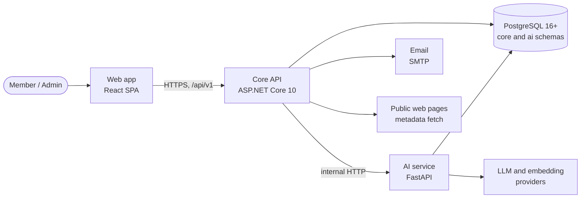
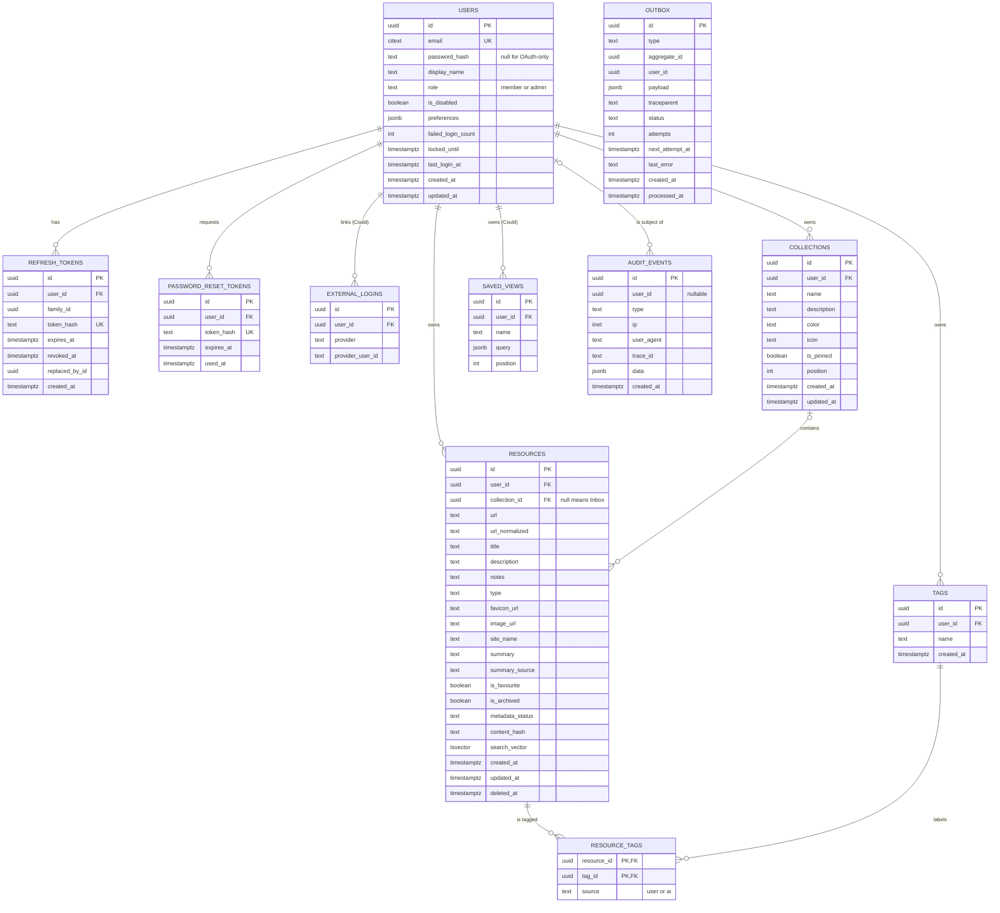
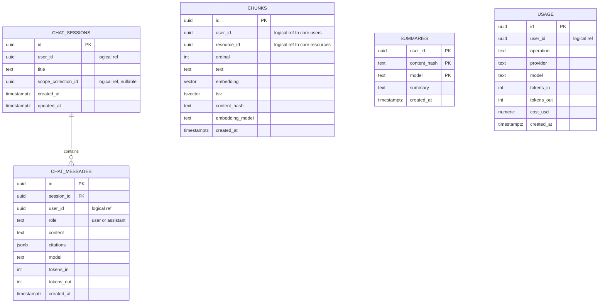
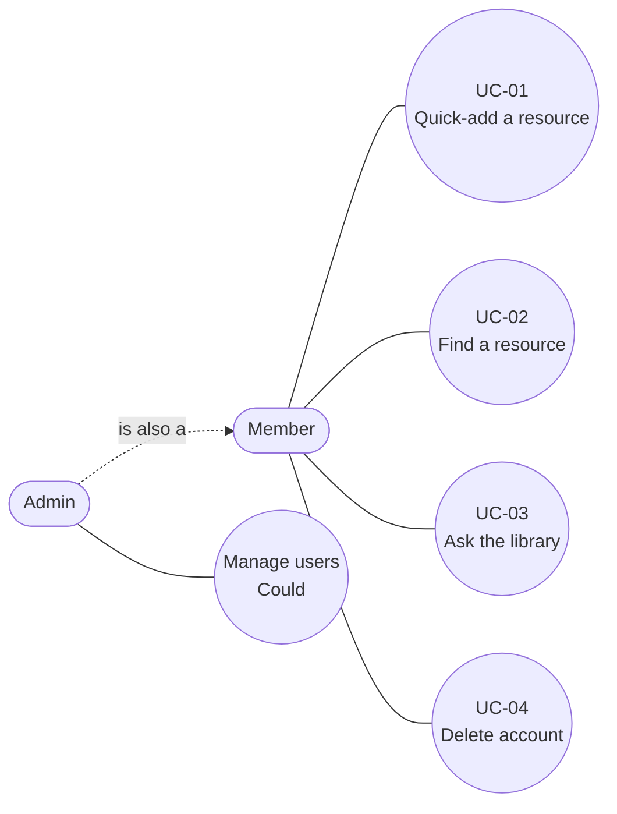

# Knowledge Hub — Software Requirements Specification

| | |
|---|---|
| **Document** | 01 — Software Requirements Specification (SRS) |
| **Version** | 0.1 (draft) |
| **Date** | 2026-11-02 |
| **Author** | Lahiru Dissanayake |
| **Status** | Draft for review |
| **Structure** | ISO/IEC/IEEE 29148:2018, software requirements specification outline |
| **Companion documents** | [02 — System architecture](02-system-architecture.md) · [03 — UI/UX design plan](03-ui-ux-design-plan.md) |

---

## Contents

1. [Introduction](#1-introduction)
2. [Overall description](#2-overall-description)
3. [Functional requirements](#3-functional-requirements)
4. [External interface requirements](#4-external-interface-requirements)
5. [Non-functional requirements](#5-non-functional-requirements)
6. [Data requirements](#6-data-requirements)
7. [Use cases](#7-use-cases)
8. [Appendices](#8-appendices)

---

## 1. Introduction

### 1.1 Purpose

This document states what Knowledge Hub version 1 must do and how well it must do it. It is the
reference for:

- the **system architecture** (Doc 02), which designs a solution that meets these requirements;
- the **UI/UX design plan** (Doc 03), which designs the screens that expose them;
- the **test suites**, which prove each requirement through the traceability matrix in
  [Appendix A](#a-traceability-matrix).

Readers are the developer (design and build), the mentor (review), and anyone assessing the
project as a portfolio piece.

### 1.2 Scope

**Knowledge Hub** helps a person **save, organise, find and learn from web resources, with AI
assistance**. A user pastes a link; the system fetches its title, description and preview image,
suggests tags, writes a short summary, and indexes it. Later the user can find it by keyword, by
meaning (semantic search), or by asking a question in plain language and getting an answer that
cites their own saved resources.

**In scope for v1:**

- Accounts with email and password, secure cookie sessions, password reset and account deletion.
- Collections, resources and tags, with full create, read, update and delete.
- Automatic metadata extraction from a URL.
- Keyword search with filters, sorting and pagination.
- A dashboard with counts and recent activity.
- AI features: summaries, tag suggestions, semantic search, related resources and the
  **"Ask your library"** chat with citations, all usable at **zero running cost** by default.
- JSON and CSV export.
- A minimal admin area (Could).

**Out of scope for v1:** teams, shared collections and any multi-user collaboration; browser
extensions; native mobile apps; full-page archiving (snapshots); highlights and annotations
inside saved pages; languages other than English for the UI.

### 1.3 Definitions

| Term | Meaning |
|---|---|
| **Resource** | One saved item: a URL plus its metadata, the user's notes, tags and an optional summary. |
| **Collection** | A named group of resources owned by one user. A resource belongs to at most one collection. |
| **Inbox** | The virtual collection that shows resources with no collection. It cannot be renamed or deleted. |
| **Tag** | A short, lowercase label owned by one user. A resource can have many tags. |
| **Metadata** | Data fetched from the resource's URL: title, description, favicon, preview image (`og:image`), site name and the main text. |
| **Embedding** | A vector of numbers that represents the meaning of a piece of text, so that texts with similar meaning have nearby vectors. |
| **Chunk** | A passage of a resource's text (a few hundred words) that is embedded and indexed on its own. |
| **Semantic search** | Search by meaning: the query is embedded and compared with chunk embeddings. |
| **Hybrid retrieval** | Combining semantic and keyword results into one ranked list (reciprocal rank fusion). |
| **RAG** | Retrieval-augmented generation: the system retrieves relevant chunks and gives them to a language model, which writes an answer from them. |
| **Citation** | A link from part of an AI answer to the saved resource it came from. |
| **AI profile** | The configured set of AI providers. `free` (default) uses only zero-cost local components; `claude` uses Anthropic Claude and Voyage embeddings. |
| **Member** | A signed-in regular user. |
| **Admin** | A user with the `admin` role. |

More terms are in the [glossary](#b-glossary).

### 1.4 References

**Standards and specifications**

| ID | Reference |
|---|---|
| REF-01 | ISO/IEC/IEEE 29148:2018 — Systems and software engineering — Requirements engineering |
| REF-02 | OWASP Application Security Verification Standard (ASVS) 5.0 |
| REF-03 | W3C Web Content Accessibility Guidelines (WCAG) 2.2 |
| REF-04 | RFC 9457 — Problem Details for HTTP APIs |
| REF-05 | OpenAPI Specification 3.1 |
| REF-06 | NIST SP 800-63B — Digital Identity Guidelines: Authentication |
| REF-07 | WHATWG HTML Living Standard — Server-sent events |
| REF-08 | Web Share Target API (W3C draft) |
| REF-09 | The C4 model for software architecture (used in Doc 02) |

**Related systems.** These products solve a similar problem. They were studied for ideas, not
copied. "Status" was checked on 2026-11-02 where marked; the others still need a check before they
are cited anywhere public.

| System | Type | Status | What to learn from it |
|---|---|---|---|
| Karakeep (formerly Hoarder) | Open source, self-hosted | Active (checked: v0.33.x in mid-2026; a hosted beta exists) | AI tagging and summaries with a local Ollama model or a paid provider; works fully with AI turned off; background jobs for fetching and tagging |
| Linkwarden | Open source, self-hosted | Active (checked: 2.x releases through 2026) | Collections and tags model, page archiving, AI tagging through Ollama or a hosted provider, tagging existing links |
| Wallabag | Open source, read-later | Not re-checked | Article text and metadata extraction |
| LinkAce / Shiori | Open source, bookmarks | Not re-checked | A minimal bookmark data model |
| Omnivore | Open source, hosted service shut down | Checked: hosted service closed November 2024; code still public | A well-built read-later reference |
| Raindrop.io | Commercial | Not re-checked | Library layout: collections sidebar, list/grid views, filters, quick add |
| mymind | Commercial | Not re-checked | Calm, content-first presentation of AI tags and summaries |
| Readwise Reader | Commercial | Not re-checked | Reading, highlights and chat over saved content |

### 1.5 Document conventions

- **"Shall"** marks a binding requirement. **"Should"** marks a recommendation. **"May"** marks an
  option.
- **Priority** uses MoSCoW: **M** = Must (v1 is not done without it), **S** = Should (planned for
  v1, can slip), **C** = Could (only if time allows), **W** = Won't (this release).
- **Requirement IDs:**
  - `FR-<MODULE>-NN` — functional requirement, for example `FR-RES-03`.
  - `NFR-<CATEGORY>-NN` — non-functional requirement, for example `NFR-SEC-04`.
  - `IR-NN` — external interface requirement.
  - `DR-NN` — data requirement.
  - `UC-NN` — use case.
  - `SCR-<NAME>` — screen in Doc 03.
  - `T-<KIND>-<MODULE>-NN` — test, where kind is `UT` (unit), `IT` (integration), `CT` (contract),
    `E2E` (end-to-end in the browser) or `AI` (AI service tests).
- IDs are never reused. A removed requirement keeps its ID with the status "Withdrawn".
- API paths are relative to `/api/v1`. They are a **draft**: the endpoint list in Doc 02 and
  `contracts/openapi.yaml` are authoritative once written.
- JSON field names and enum values are shown as they appear on the wire: `snake_case` names,
  lowercase enums.

---

## 2. Overall description

### 2.1 Product perspective

Knowledge Hub is a new, self-contained system with four runtime parts:

- **Web app:** the only user interface. It talks only to the Core API.
- **Core API:** owns accounts, the library (collections, resources, tags), search, the dashboard,
  export and admin. It fetches metadata and is the only caller of the AI service.
- **AI service:** owns embeddings, summaries, tag suggestions, semantic search and chat. It never
  reads Core API tables; it receives the text it needs from the Core API.
- **PostgreSQL:** one database with a `core` schema owned by the Core API and an `ai` schema owned
  by the AI service.

### 2.2 Product functions (summary)

1. Register, sign in, stay signed in securely, reset a forgotten password, delete the account.
2. Save a link in a few seconds; the system fills in its details.
3. Organise resources into collections and tag them.
4. Find resources by keyword, filters, or meaning.
5. Read an AI or extracted summary and accept suggested tags.
6. Ask questions about the library and get answers with citations.
7. See a dashboard of the library.
8. Export all data.
9. (Admin) see users and AI usage, and disable accounts.

### 2.3 User classes

| Class | Description | Frequency | Technical skill | Key needs |
|---|---|---|---|---|
| **Member** | The main user. Owns a private library. | Daily to weekly | Low to high | Fast capture, fast retrieval, trustworthy AI |
| **Admin** | The operator of the deployment. Also a member. | Occasional | High | Disable abusive accounts, watch AI usage and cost |
| **Visitor** | Not signed in. | Once | Any | Register or sign in; nothing else is visible |

### 2.4 Personas

**Persona 1 — Nimali, university student (22).** Studies computer science. Collects lecture
slides (PDF), YouTube explainers and blog posts for each module. Today they sit in browser
bookmarks and chat messages to herself, and she cannot find them before exams.
*Goal:* one collection per module, and the ability to ask "what did I save about B-trees?"
*Frustration:* forgetting why she saved something.

**Persona 2 — Kasun, self-taught developer (28).** Works in support and is learning backend
development in the evenings. Saves courses, GitHub repositories and documentation pages into a
learning path. *Goal:* see what he saved this week, tag by technology, and find "that article about
connection pooling" without remembering its title. *Frustration:* tools that need a lot of manual
filing.

### 2.5 Operating environment

- **Clients:** the last two major versions of Chrome, Edge, Firefox and Safari, on desktop and
  mobile, at widths from 360 px.
- **Servers:** Linux containers (Docker). Core API on .NET 10; AI service on Python 3.12+.
- **Database:** PostgreSQL 16 or later with the `pgvector` extension.
- **Local development:** one `docker compose up` from the repository root.
- **Demo hosting:** free tiers (static frontend host, container host, managed Postgres). These may
  pause when idle.

### 2.6 Design and implementation constraints

| ID | Constraint |
|---|---|
| CON-01 | The Core API shall implement `contracts/openapi.yaml` exactly, so the frontend and the API can be built and tested separately. The contract is written first and changed only on purpose. |
| CON-02 | Only the Core API calls the AI service. The browser never reaches it. |
| CON-03 | The Core API shall be built with ASP.NET Core 10 and EF Core. The AI service shall be built with Python FastAPI. No other backend is in scope. |
| CON-04 | Data shall be stored in PostgreSQL 16+ with `pgvector`. No separate vector database. |
| CON-05 | LLM and embedding providers shall sit behind interfaces. The default profile shall cost nothing to run; Claude is optional and enabled by configuration only. |
| CON-06 | Secrets (keys, connection strings, signing keys) shall come only from environment variables or the host's secret store, never from source control. |
| CON-07 | The system shall run without Redis or a message broker; background work uses a database outbox table. |

### 2.7 Assumptions and dependencies

| ID | Assumption or dependency | Impact if wrong |
|---|---|---|
| ASM-01 | Libraries are single-user. No sharing in v1. | Sharing would change the ownership model and authorisation rules. |
| ASM-02 | The UI is English only. | Text would need extracting into resource files. |
| ASM-03 | Users run modern evergreen browsers. | Older browsers may break the SPA. |
| ASM-04 | A typical library has under 10,000 resources. | Performance targets in NFR-PERF are set for this size. |
| ASM-05 | Most saved pages expose `<title>`, meta description or Open Graph tags. | Metadata and the free summary would be poorer. |
| ASM-06 | The free AI profile runs on a 4-core CPU with no GPU and about 4 GB of free memory for models. | Chat latency targets would be missed. |
| DEP-01 | Ollama and an open-weight chat model (free profile). | Chat would be unavailable in the free profile. |
| DEP-02 | A `sentence-transformers` embedding model (free profile). | Semantic search would be unavailable. |
| DEP-03 | Anthropic and Voyage APIs (Claude profile only). | Fall back to the free profile. |
| DEP-04 | An SMTP service: Mailpit in development, a free-tier transactional email provider for the demo. | Password reset (S) would be unavailable. |

---

## 3. Functional requirements

Each requirement has an ID, a priority, the requirement, and acceptance criteria that a test can
check. Unless stated otherwise, every requirement applies only to the signed-in user's own data
(see NFR-SEC-05).

### 3.1 AUTH — Accounts and sessions

| ID | Pri | Requirement | Acceptance criteria |
|---|---|---|---|
| FR-AUTH-01 | M | The system shall let a visitor register with an email address, a password and a display name. | Email is valid and stored case-insensitively; password is 12–128 characters and not in a common-password list; display name is 1–60 characters. On success the user is signed in (FR-AUTH-02) and receives `201`. An email already registered returns `409 email_taken`. |
| FR-AUTH-02 | M | The system shall let a user sign in with email and password. | Correct credentials set an access-token cookie and a refresh-token cookie (httpOnly, Secure, SameSite=Lax) and return the current user. Wrong credentials return `401 invalid_credentials` with the same message whether the email exists or not. A disabled account returns `403 account_disabled`. After 10 failures within 15 minutes the account is locked for 15 minutes (`423 account_locked`). |
| FR-AUTH-03 | M | The system shall let a user sign out. | Both cookies are cleared and the refresh token is revoked server-side. Using the old refresh token afterwards returns `401`. |
| FR-AUTH-04 | M | The system shall keep users signed in with short-lived access tokens and rotating refresh tokens. | Access token lives 15 minutes; refresh token lives 7 days. Each refresh issues a new refresh token and revokes the old one. Reusing a revoked refresh token revokes the whole token family and returns `401`. The web app refreshes silently, so a user active within 7 days is not asked to sign in again. |
| FR-AUTH-05 | M | The system shall return the current user's profile. | `GET /me` returns id, email, display name, role, preferences and created date. Without a valid session it returns `401`. |
| FR-AUTH-06 | S | The system shall let a user reset a forgotten password by email. | Requesting a reset always returns `202` with the same message. If the account exists, an email with a single-use link valid for 30 minutes is sent. Setting a new password through the link revokes all of the user's refresh tokens. A used or expired link returns `400 invalid_token`. |
| FR-AUTH-07 | S | The system shall let a user change their password. | The current password is required. On success all other sessions are revoked and the current one stays signed in. |
| FR-AUTH-08 | S | The system shall let a user update their display name and preferences. | Display name rules as in FR-AUTH-01. Preferences: theme (`system`, `light`, `dark`) and AI settings (FR-AI-12). |
| FR-AUTH-09 | M | The system shall let a user delete their account and all of their data. | The current password (or a fresh sign-in for OAuth-only accounts) is required. All of the user's `core` rows are deleted in one transaction, the session ends, and a `user.deleted` event is queued. The AI service removes all of the user's `ai` rows within 5 minutes. Signing in again with the old credentials returns `401`. |
| FR-AUTH-10 | C | The system may let a user sign in with GitHub or Google (OAuth 2.0 / OpenID Connect). | A new OAuth user gets an account with no password. An existing account with the same verified email is linked only after the user signs in with their password. |

### 3.2 COL — Collections

| ID | Pri | Requirement | Acceptance criteria |
|---|---|---|---|
| FR-COL-01 | M | The system shall let a user create, view, rename, edit and delete collections. | Name is 1–100 characters and unique per user (case-insensitive); a duplicate returns `409 collection_name_taken`. The list returns all of the user's collections. |
| FR-COL-02 | S | A collection shall have an optional description, colour and emoji icon. | Description ≤ 500 characters; colour is one of the design-system palette names; icon is a single emoji. |
| FR-COL-03 | S | The system shall let a user pin collections and change their order. | Pinned collections are listed first in the sidebar. Reordering saves the new order, which survives a reload. |
| FR-COL-04 | M | The system shall show the number of resources in each collection. | The count excludes deleted resources and matches the collection's resource list. The Inbox also shows a count. |
| FR-COL-05 | M | When deleting a collection, the user shall choose to delete its resources or move them to another collection or the Inbox. | The API requires the choice (`resources=delete` or `resources=move` with an optional `target_collection_id`; empty target means Inbox). Without it the request returns `400`. Moved resources keep their tags and notes. |

### 3.3 RES — Resources

| ID | Pri | Requirement | Acceptance criteria |
|---|---|---|---|
| FR-RES-01 | M | The system shall let a user save a resource from a URL. | Only `http` and `https` URLs up to 2,048 characters are accepted. Only the URL is required; title, description, notes, type, collection and tags are optional. The response is `201` with the resource and `metadata_status = pending`. |
| FR-RES-02 | M | The system shall let a user view a resource and list resources. | A resource shows: url, title, description, notes, type, collection, tags, favicon, preview image, site name, summary and its source, favourite and archived flags, metadata status, created and updated dates. Lists follow FR-SRCH-04. |
| FR-RES-03 | M | The system shall let a user edit every user-editable field of a resource. | Title ≤ 300 characters, description ≤ 2,000, notes ≤ 100,000. Editing the URL re-runs metadata extraction. A field edited by the user is not overwritten by later metadata extraction. |
| FR-RES-04 | M | The system shall let a user delete a resource, with undo. | The resource disappears from lists, search and chat immediately. `POST /resources/{id}/restore` within 7 days brings it back with its tags and notes. After 7 days it is removed permanently. |
| FR-RES-05 | M | A resource shall have a type: `article`, `video`, `pdf`, `course`, `repo`, `website` or `other`. | The type is guessed on save (FR-META-02) and the user can change it. Any other value returns `400`. |
| FR-RES-06 | M | A resource shall belong to at most one collection; a resource with no collection appears in the Inbox. | Saving without a collection puts it in the Inbox. Moving a resource changes only its collection. |
| FR-RES-07 | M | The system shall let a user add and remove tags on a resource. | Up to 20 tags per resource. Tags are created on first use (FR-TAG-01). |
| FR-RES-08 | M | Notes shall support Markdown. | Notes are stored as entered and rendered as sanitised Markdown (no raw HTML or scripts). |
| FR-RES-09 | S | The system shall let a user mark a resource as a favourite. | The flag toggles; favourites can be filtered (FR-SRCH-02). |
| FR-RES-10 | S | The system shall let a user archive a resource. | Archived resources are hidden from default lists but appear with the "archived" filter and in search when that filter is on. |
| FR-RES-11 | S | The system shall warn when the user saves a URL they already saved. | Before saving, the URL is normalised (lowercase scheme and host, no fragment, no default port, no trailing slash, no `utm_*` parameters) and checked. A match returns the existing resource; the user can open it or save anyway. |
| FR-RES-12 | S | The system shall let a user move, tag or delete many resources at once. | One request handles up to 100 resources. It applies to all of them or none, and reports the number changed. Bulk delete can be undone like FR-RES-04. |
| FR-RES-13 | C | The system may let a user save a link from the phone's share menu. | Installed as a PWA, the app appears as a share target; sharing a link opens quick-add with the URL filled in. |

### 3.4 META — Metadata extraction

| ID | Pri | Requirement | Acceptance criteria |
|---|---|---|---|
| FR-META-01 | M | The system shall fetch a URL's title, description, favicon, preview image, site name and main text. | Sources, in order: Open Graph tags, Twitter card tags, `<title>` and `<meta name="description">`, then the first paragraphs of the readable text. Values are trimmed to the field limits. |
| FR-META-02 | M | The system shall guess the resource type. | Rules, for example: known video hosts → `video`; `application/pdf` or `.pdf` → `pdf`; a repository path on known code hosts → `repo`; known course platforms → `course`; `og:type = article` → `article`; otherwise `website`. The rule list is configuration, not code. |
| FR-META-03 | M | Metadata extraction shall run in the background after save. | Saving does not wait for the fetch. The resource moves to `metadata_status = ready` or `failed`. The web app shows the new data without a manual reload (polling or refetch). A failed fetch keeps the URL and lets the user retry. |
| FR-META-04 | M | The system shall preview a URL's metadata before it is saved. | `POST /metadata/preview` returns title, description, image, favicon and guessed type in under 5 seconds or returns what it has. The preview is not stored. |
| FR-META-05 | M | Fetching shall be protected against server-side request forgery (SSRF). | Only `http`/`https` on ports 80 and 443. Hostnames are resolved and requests to private, loopback, link-local, multicast and cloud-metadata addresses (IPv4 and IPv6) are refused. Each redirect (max 5) is checked again. Timeout 5 seconds; response body read up to 5 MB. Refused URLs give `metadata_status = failed` with reason `blocked_url`. |

### 3.5 TAG — Tags

| ID | Pri | Requirement | Acceptance criteria |
|---|---|---|---|
| FR-TAG-01 | M | Tags shall belong to one user and be created when first used. | Names are trimmed, lowercased, 1–50 characters, letters, digits, spaces and `-`, `_`, `.`, `#`, `+`. Names are unique per user. |
| FR-TAG-02 | M | The system shall list the user's tags with usage counts. | Each tag shows the number of non-deleted resources using it. Unused tags show `0`. |
| FR-TAG-03 | S | The system shall let a user rename a tag. | All resources keep the tag under its new name. Renaming to an existing name returns `409` and suggests a merge. |
| FR-TAG-04 | S | The system shall let a user merge tags. | Merging A into B gives every resource with A the tag B (no duplicates) and deletes A. |
| FR-TAG-05 | S | The system shall let a user delete a tag. | The tag is removed from all resources; the resources stay. |

### 3.6 SRCH — Search and browsing

| ID | Pri | Requirement | Acceptance criteria |
|---|---|---|---|
| FR-SRCH-01 | M | The system shall search the user's resources by keyword. | Matches title, description, notes, URL and tag names, with stemming (English) and prefix matching on the last word. Title matches rank above notes matches. An empty query lists everything. |
| FR-SRCH-02 | M | The system shall filter resources. | Filters: type (many), tags (all of the given tags), collection (or Inbox), favourite, archived, created date range. Filters combine with AND and with the keyword query. |
| FR-SRCH-03 | M | The system shall sort resources. | `newest` (default), `oldest`, `title` (A–Z), `updated` (most recently updated first). With a keyword query, `relevance` is also offered and is the default. |
| FR-SRCH-04 | M | Lists shall be paginated. | Response shape `{items, page, page_size, total}`. Default page size 20, maximum 100. A page past the end returns an empty `items` list. |
| FR-SRCH-05 | C | The system may let a user save a set of filters as a named view. | Saved views appear in the sidebar and restore the same query, filters and sort. |

### 3.7 DASH — Dashboard

| ID | Pri | Requirement | Acceptance criteria |
|---|---|---|---|
| FR-DASH-01 | M | The dashboard shall show library totals. | Counts of resources, collections, tags and favourites, matching the list endpoints. |
| FR-DASH-02 | M | The dashboard shall show a breakdown by resource type. | One count per type; the counts add up to the resource total. |
| FR-DASH-03 | M | The dashboard shall show recently added resources. | The 5 most recently created, newest first. |
| FR-DASH-04 | S | The dashboard shall show weekly activity. | Resources added per week for the last 12 weeks, in the user's time zone. |
| FR-DASH-05 | S | The dashboard shall show an onboarding checklist to new users. | Steps: save a first resource, create a collection, try search, ask a question. Done steps are ticked automatically. The user can dismiss the checklist. |

### 3.8 AI — AI assistance

| ID | Pri | Requirement | Acceptance criteria |
|---|---|---|---|
| FR-AI-00 | M | Every Must AI feature shall work in a zero-cost default profile, with no paid API. | With `AI_PROFILE=free` and no API keys set, summaries, tag suggestions, semantic search and chat all work using local components (extractive summary, keyword tagger, local embedding model, local chat model through Ollama). |
| FR-AI-01 | M | Claude shall be an optional provider, enabled by configuration only. | Setting `AI_PROFILE=claude` plus API keys switches providers with no code change. Changing the embedding model triggers a full re-index of the user's chunks. |
| FR-AI-02 | M | The system shall produce a resource summary on demand. | "Summarise" (and "Regenerate") returns a summary of 2–4 sentences, ≤ 600 characters, from the resource's text. If there is not enough text, it returns `422 not_enough_content`. |
| FR-AI-03 | M | The system shall produce a summary automatically after save, when the user has this turned on. | After metadata extraction, a summary is generated in the background. It never overwrites a summary the user wrote or edited. |
| FR-AI-04 | M | The system shall suggest tags for a resource, preferring the user's existing tags. | Up to 5 suggestions, before or after save. Existing tags that fit are listed first. Suggestions are never applied without the user accepting them. |
| FR-AI-05 | M | The system shall search the user's resources by meaning. | Semantic mode returns resources ranked by hybrid retrieval over their chunks (semantic plus keyword), at most one result per resource, each with a short matching snippet. A search for a synonym of a word in a saved title finds that resource. |
| FR-AI-06 | M | The system shall answer questions about the user's library ("Ask your library"), streaming the answer and citing sources. | The answer streams token by token. Every statement drawn from the library has a citation to one of the user's resources. If nothing relevant is found, the answer says so and cites nothing. The user can limit the scope to one collection. Each citation opens the cited resource. |
| FR-AI-07 | S | The system shall show resources related to the one being viewed. | Up to 5 other resources of the same user, ranked by embedding similarity, excluding deleted ones. |
| FR-AI-08 | S | The system shall keep chat history. | The user can list past chats, reopen one and continue it, rename it and delete it. Chats are titled automatically from the first question. |
| FR-AI-09 | M | The system shall keep working when AI is unavailable. | If the AI service or a model is down: CRUD, keyword search, metadata and the dashboard still work; AI endpoints return `503 ai_unavailable` with `Retry-After`; semantic search falls back to keyword search with a notice; background AI jobs are retried later. |
| FR-AI-10 | M | The system shall enforce a per-user AI quota. | Configurable daily limits per operation (defaults in [Appendix C](#c-default-configuration-values)). Over the limit, the request returns `429 ai_quota_exceeded` with the reset time. Background indexing does not count toward the quota. |
| FR-AI-11 | M | AI output shall be labelled and editable. | Summaries show their source: `extracted` (free profile), `ai` (model-generated) or `user` (written or edited by the user). Chat answers are labelled as AI-generated. The user can edit or remove any summary and reject any tag suggestion. |
| FR-AI-12 | S | The user shall be able to turn automatic AI features off. | Preferences: auto-summary on save (on by default), tag suggestions on quick-add (on by default). When off, nothing is generated until the user asks. |

### 3.9 EXP — Export

| ID | Pri | Requirement | Acceptance criteria |
|---|---|---|---|
| FR-EXP-01 | S | The system shall export all of the user's library as JSON. | One file with collections, resources (all fields, including notes and summaries) and tags, plus a schema version. Deleted resources are excluded. |
| FR-EXP-02 | S | The system shall export the user's resources as CSV. | One row per resource; tags joined with `;`; UTF-8 with a header row; opens correctly in common spreadsheet tools. |

### 3.10 ADM — Administration

| ID | Pri | Requirement | Acceptance criteria |
|---|---|---|---|
| FR-ADM-01 | C | An admin may list users. | Shows email, display name, role, created date, last sign-in, resource count and disabled flag; paginated and searchable by email. No access to users' resources. |
| FR-ADM-02 | C | An admin may disable and re-enable a user. | A disabled user's sessions are revoked at once and they cannot sign in (FR-AUTH-02). An admin cannot disable themselves. |
| FR-ADM-03 | C | An admin may view AI usage and cost. | Per user and in total, per day for the last 30 days: number of AI calls, tokens and estimated cost per operation. |
| FR-ADM-04 | M | Admin functions shall be available only to admins. | Every admin endpoint returns `403` to members. The first admin is created from configuration (`ADMIN_EMAIL`); there is no self-promotion. |

---

## 4. External interface requirements

### 4.1 User interface

| ID | Requirement |
|---|---|
| IR-01 | The user interface shall follow Doc 03 (UI/UX design plan), including its sitemap, key screens, design system and accessibility checklist. |
| IR-02 | Every screen shall have designed empty, loading and error states, and every AI element shall have an "AI unavailable" state. |
| IR-03 | Error messages shown to users shall be derived from the API's Problem Details `type` and never show stack traces or raw server text. |

### 4.2 REST API (Core API, public to the web app)

| ID | Requirement |
|---|---|
| IR-10 | The API shall be served under `/api/v1` and described by `contracts/openapi.yaml` (OpenAPI 3.1). Breaking changes require `/api/v2`. |
| IR-11 | Bodies shall be JSON with `snake_case` field names; enum values shall be lowercase strings; timestamps shall be ISO 8601 in UTC; IDs shall be UUIDs (v7). |
| IR-12 | Errors shall use RFC 9457 Problem Details (`application/problem+json`) with `type`, `title`, `status`, `detail`, `instance`, a machine-readable `code`, `trace_id`, and an `errors` map for validation failures. |
| IR-13 | Authentication shall use httpOnly cookies set by the API. State-changing requests shall also send a CSRF token header that matches a CSRF cookie (double-submit). |
| IR-14 | List endpoints shall use offset pagination with `page` and `page_size` and return `{items, page, page_size, total}`. |
| IR-15 | Chat answers shall be streamed as server-sent events (`text/event-stream`) with event types for tokens, citations, completion and errors. |
| IR-16 | Responses that are rate limited or over quota shall return `429` with `Retry-After`. |
| IR-17 | The API shall expose `GET /health/live` and `GET /health/ready` (database and AI service checks) without authentication and without internal details. |

### 4.3 AI service API (internal)

| ID | Requirement |
|---|---|
| IR-20 | The AI service shall expose an internal HTTP API for: summarise, suggest tags, index a resource (`PUT /index/{resource_id}`), remove it (`DELETE /index/{resource_id}`), semantic search, related resources, chat (streamed), chat history, usage, and user purge (`DELETE /users/{user_id}`). |
| IR-21 | Every request shall carry a short-lived signed service token that names the user it acts for (or a shared service key in development). Requests without a valid token return `401`. |
| IR-22 | The AI service shall return only IDs, scores, snippets and generated text; the Core API loads full resources and re-checks ownership before returning them. |
| IR-23 | The AI service shall not be reachable from the public internet. |

### 4.4 AI providers

| ID | Requirement |
|---|---|
| IR-30 | Providers shall implement four interfaces: `Summarizer`, `Tagger`, `Embedder` and `LlmProvider`. |
| IR-31 | **Free profile:** extractive summariser, keyword tagger, a local `sentence-transformers` embedding model on CPU, and a local chat model served by Ollama. |
| IR-32 | **Claude profile:** Claude models for summaries, tags and chat, and Voyage AI for embeddings. Model IDs are configuration values. |
| IR-33 | Provider calls shall have timeouts (summary 20 s, chat first token 15 s) and be metered per user (FR-AI-10, FR-ADM-03). |

### 4.5 Other external systems

| ID | Requirement |
|---|---|
| IR-40 | **Email:** the system shall send password-reset email through SMTP: Mailpit in development, a free-tier transactional email provider for the demo (chosen at deployment). |
| IR-41 | **Web pages:** the metadata fetcher shall identify itself with a descriptive `User-Agent` and respect the limits in FR-META-05. |
| IR-42 | **OAuth (Could):** GitHub and Google through standard OAuth 2.0 / OpenID Connect flows. |

---

## 5. Non-functional requirements

Each NFR states a measurable target and how it is verified.

### 5.1 Performance

Measured on the reference setup: local Docker Compose on a 4-core, 16 GB laptop, a library of
10,000 resources, 10 concurrent users, warm caches.

| ID | Requirement | Target | Verification |
|---|---|---|---|
| NFR-PERF-01 | CRUD endpoint latency | p95 < 300 ms | Load test (k6) |
| NFR-PERF-02 | Keyword search latency | p95 < 500 ms | Load test on seeded data |
| NFR-PERF-03 | Semantic search latency | p95 < 800 ms (free profile) | Load test |
| NFR-PERF-04 | Summary and tag suggestions, free profile | < 1 s (no model call) | AI service test with timing |
| NFR-PERF-05 | Chat first token, free profile | < 10 s on the reference CPU | Timed test, 20 runs, p90 |
| NFR-PERF-06 | Summary, Claude profile | < 10 s | Timed test, p90 |
| NFR-PERF-07 | Chat first token, Claude profile | < 2 s | Timed test, p90 |
| NFR-PERF-08 | Save to "metadata ready" | p95 < 10 s for reachable pages | Integration test with a test page server |
| NFR-PERF-09 | Web app initial load | Initial JS ≤ 250 KB gzipped; LCP < 2.5 s on simulated fast 4G | Build report; Lighthouse |

### 5.2 Security

| ID | Requirement | Target | Verification |
|---|---|---|---|
| NFR-SEC-01 | Baseline | Meets OWASP ASVS 5.0 Level 1 | ASVS checklist review |
| NFR-SEC-02 | Password storage | Argon2id (memory ≥ 19 MiB, iterations ≥ 2) or bcrypt (cost ≥ 12); refresh and reset tokens stored only as SHA-256 hashes | Unit test; database inspection |
| NFR-SEC-03 | Cookies | Access and refresh cookies are `HttpOnly`, `Secure`, `SameSite=Lax`; refresh cookie path limited to the auth endpoints | Integration test on `Set-Cookie` |
| NFR-SEC-04 | CSRF | Every state-changing request without a valid CSRF token returns `403` | Integration test |
| NFR-SEC-05 | Data isolation | Every query is filtered by owner; any request for another user's resource, collection, tag or chat returns `404` (not `403`) | Automated cross-user test for every endpoint |
| NFR-SEC-06 | Rate limits | Sign-in: 5 per minute per IP and email, 20 per minute per IP; register and reset: 5 per hour per IP; AI: 30 requests per minute per user; others: 300 per minute per user | Integration test |
| NFR-SEC-07 | SSRF | No request reaches a private or metadata address (FR-META-05) | Test suite of blocked URLs, including redirects and DNS rebinding cases |
| NFR-SEC-08 | Prompt injection | Fetched content is passed to models only as clearly delimited data, never as instructions; chat has no tools that write or fetch; citations are checked against the retrieved set and owner | AI test set of injection pages |
| NFR-SEC-09 | Secrets | No secrets in the repository or images; all from environment variables | Secret scanning in CI |
| NFR-SEC-10 | Transport | HTTPS only in production; HSTS enabled | Deployment check |
| NFR-SEC-11 | Security headers | CSP without `unsafe-inline` scripts, `X-Content-Type-Options`, `Referrer-Policy`, `frame-ancestors 'none'` | Header scan |
| NFR-SEC-12 | Dependencies | No known critical vulnerabilities in dependencies at release | Dependency scanning in CI |
| NFR-SEC-13 | Audit | Sign-in, failed sign-in, password change and reset, account deletion and admin actions are recorded with user ID, time, IP and trace ID | Integration test |

### 5.3 Reliability

| ID | Requirement | Target | Verification |
|---|---|---|---|
| NFR-REL-01 | AI isolation | With the AI service stopped, all non-AI Must requirements pass | Integration test run with AI service down |
| NFR-REL-02 | Background job retries | Exponential backoff with jitter, starting at 10 s, up to 8 attempts; then the job is marked `dead` | Integration test |
| NFR-REL-03 | Idempotency | Processing an outbox event twice gives the same result as once | Integration test |
| NFR-REL-04 | Circuit breaker | After 5 consecutive AI service failures, calls fail fast for 30 s | Unit test |
| NFR-REL-05 | Backups | Daily database backup, kept 7 days; a restore is tested once before the demo | Restore drill |
| NFR-REL-06 | Idle cold start (demo hosting) | First request after idle answered within 15 s | Manual check |

### 5.4 Usability and accessibility

| ID | Requirement | Target | Verification |
|---|---|---|---|
| NFR-USA-01 | Accessibility | WCAG 2.2 Level AA; no serious or critical axe-core violations on any key screen | Automated axe checks in E2E tests; manual screen-reader check |
| NFR-USA-02 | Keyboard | Every feature usable with a keyboard only; visible focus everywhere | Manual test script |
| NFR-USA-03 | Responsive | Usable from 360 px to 1,920 px wide with no horizontal scrolling | E2E screenshots at 360, 768, 1,024 and 1,440 px |
| NFR-USA-04 | Quick capture | A returning user saves a link in ≤ 5 s and ≤ 3 interactions (open quick-add, paste, Enter) | Usability test |
| NFR-USA-05 | First save | A new user saves their first resource within 60 s of registering | Usability test (5 users) |
| NFR-USA-06 | Touch targets | ≥ 44 × 44 px on touch devices | Design review |

### 5.5 Privacy

| ID | Requirement | Target | Verification |
|---|---|---|---|
| NFR-PRIV-01 | Account deletion | Removes all of the user's rows in `core` at once and in `ai` within 5 minutes; removed from backups once they age out (≤ 7 days) | Integration test across both schemas |
| NFR-PRIV-02 | No training use | User data is never used to train models; the Claude profile uses only API terms that exclude training | Configuration review |
| NFR-PRIV-03 | AI labelling | All AI output is labelled (FR-AI-11) | E2E test |
| NFR-PRIV-04 | Logs | Logs contain no passwords, tokens, notes or page content; emails are masked | Log review; unit test of the log filter |
| NFR-PRIV-05 | Data minimisation | Only the data in the data dictionary (§6.2) is stored | Schema review |

### 5.6 Maintainability

| ID | Requirement | Target | Verification |
|---|---|---|---|
| NFR-MAIN-01 | Contract first | `contracts/openapi.yaml` is the source of truth; the web client is generated from it | CI check that the generated client is up to date |
| NFR-MAIN-02 | Contract tests | Schemathesis run against the Core API with zero failures | CI |
| NFR-MAIN-03 | Test coverage | ≥ 70 % line coverage on the Core API Domain and Application projects and on the AI service | CI coverage report |
| NFR-MAIN-04 | Static checks | Build with warnings as errors (.NET); ruff and mypy (Python); ESLint and TypeScript strict mode (web) | CI |
| NFR-MAIN-05 | Architecture rules | Domain has no dependency on Infrastructure or ASP.NET Core | Architecture test |
| NFR-MAIN-06 | Decisions recorded | Each significant decision has an ADR | Review |

### 5.7 Portability

| ID | Requirement | Target | Verification |
|---|---|---|---|
| NFR-PORT-01 | Containers | Core API and AI service ship as Docker images; the web app as a static build | CI builds |
| NFR-PORT-02 | Local start | One `docker compose up` from the repository root starts the full system with seeded config | Fresh-clone test |
| NFR-PORT-03 | Hosting independence | No host-specific code; host changes need only configuration | Review |

### 5.8 Observability

| ID | Requirement | Target | Verification |
|---|---|---|---|
| NFR-OBS-01 | Structured logs | JSON logs with timestamp, level, message, `trace_id` and `user_id` (where known) | Log sample review |
| NFR-OBS-02 | Tracing | OpenTelemetry traces span web request → Core API → outbox job → AI service, with `traceparent` carried through outbox events | Trace visible end to end in Jaeger |
| NFR-OBS-03 | Metrics | Request rate, errors and duration (RED) per endpoint; outbox backlog and dead jobs; AI tokens and estimated cost per operation | Metrics endpoint check |
| NFR-OBS-04 | Health | Liveness and readiness endpoints on both services (IR-17) | Integration test |

---

## 6. Data requirements

### 6.1 Logical data model

The two schemas are drawn separately because they are owned by different services. Lines between
them are **logical references only**: the `ai` schema stores `user_id` and `resource_id` values
but has no foreign keys into `core` and no permission to read it.

**`core` schema (owned by the Core API)**

**`ai` schema (owned by the AI service)**

### 6.2 Data dictionary

Only fields that need explanation are listed; `id`, `user_id`, `created_at` and `updated_at`
mean the same everywhere (UUIDv7 key, owner, creation and last-change time in UTC).

**core.users**

| Field | Type | Rules |
|---|---|---|
| email | citext | Required, unique, ≤ 254 characters |
| password_hash | text | Argon2id/bcrypt hash; null only for OAuth-only accounts |
| display_name | text | 1–60 characters |
| role | text | `member` (default) or `admin` |
| is_disabled | boolean | Default false; set by admins (FR-ADM-02) |
| preferences | jsonb | `{ "theme": "system\|light\|dark", "ai_auto_summary": true, "ai_tag_suggestions": true, "onboarding_dismissed": false }` |
| failed_login_count, locked_until | int, timestamptz | Lockout state (FR-AUTH-02) |

**core.refresh_tokens / core.password_reset_tokens**

| Field | Type | Rules |
|---|---|---|
| token_hash | text | SHA-256 of the random token; the raw token is never stored |
| family_id | uuid | All tokens from one sign-in share a family; reuse revokes the family (FR-AUTH-04) |
| expires_at | timestamptz | Refresh: created + 7 days. Reset: created + 30 minutes |
| revoked_at, replaced_by_id, used_at | | Rotation and single-use tracking |

**core.collections**

| Field | Type | Rules |
|---|---|---|
| name | text | 1–100 characters; unique per user, case-insensitive |
| description | text | ≤ 500 characters, optional |
| color | text | A palette name from the design system, optional |
| icon | text | One emoji, optional |
| is_pinned, position | boolean, int | Sidebar order (FR-COL-03) |

**core.resources**

| Field | Type | Rules |
|---|---|---|
| collection_id | uuid | Null means Inbox. Foreign key to `collections` |
| url | text | Required, `http`/`https`, ≤ 2,048 characters, as entered |
| url_normalized | text | Normalised form for duplicate checks (FR-RES-11); indexed, not unique |
| title | text | ≤ 300 characters; from metadata or the user |
| description | text | ≤ 2,000 characters |
| notes | text | Markdown, ≤ 100,000 characters |
| type | text | `article`, `video`, `pdf`, `course`, `repo`, `website`, `other` |
| favicon_url, image_url, site_name | text | From metadata; URLs ≤ 2,048 characters |
| summary | text | ≤ 600 characters for generated summaries, ≤ 2,000 if written by the user |
| summary_source | text | `none`, `extracted`, `ai`, `user` (FR-AI-11) |
| is_favourite, is_archived | boolean | Default false |
| metadata_status | text | `pending`, `ready`, `failed` |
| content_hash | text | SHA-256 of the extracted text; used to skip re-indexing unchanged content |
| search_vector | tsvector | Weighted: title A, tags B, description C, notes and URL D; GIN index |
| deleted_at | timestamptz | Set on delete; the row is purged 7 days later (FR-RES-04) |

**core.tags / core.resource_tags**

| Field | Type | Rules |
|---|---|---|
| tags.name | text | Normalised as in FR-TAG-01; unique per user |
| resource_tags.source | text | `user` or `ai` (accepted suggestion), for measuring suggestion acceptance |

**core.outbox**

| Field | Type | Rules |
|---|---|---|
| type | text | `resource.created`, `resource.updated`, `resource.deleted`, `resource.restored`, `user.deleted` |
| payload | jsonb | IDs and the minimum data the job needs |
| traceparent | text | W3C trace context, so the job joins the original trace (NFR-OBS-02) |
| status | text | `pending`, `processing`, `done`, `dead` |
| attempts, next_attempt_at, last_error | | Retry state (NFR-REL-02) |

**core.audit_events**

| Field | Type | Rules |
|---|---|---|
| type | text | For example `auth.login`, `auth.login_failed`, `auth.password_changed`, `account.deleted`, `admin.user_disabled` |
| ip, user_agent | inet, text | Security context |
| data | jsonb | Extra, non-sensitive details; never passwords, tokens or content |

**ai.chunks**

| Field | Type | Rules |
|---|---|---|
| ordinal | int | Position of the chunk in the resource |
| text | text | About 200–400 words with overlap |
| embedding | vector(n) | Dimension set by the embedding model (for example 384 for a small local model); HNSW index |
| tsv | tsvector | Keyword index for hybrid retrieval; GIN index |
| embedding_model | text | Lets the service detect chunks that need re-embedding after a profile change |

**ai.summaries, ai.chat_sessions, ai.chat_messages, ai.usage**

| Field | Type | Rules |
|---|---|---|
| summaries (user_id, content_hash, model) | composite key | Cache: the same content and model are never summarised twice for a user |
| chat_sessions.scope_collection_id | uuid | Null means the whole library (FR-AI-06) |
| chat_messages.citations | jsonb | List of `{resource_id, chunk_id, quote}`, checked against the retrieved set |
| usage.operation | text | `summarize`, `suggest_tags`, `embed`, `search`, `chat` |
| usage.cost_usd | numeric(10,6) | Estimated from provider prices; `0` in the free profile |

### 6.3 Data integrity rules

| ID | Rule |
|---|---|
| DR-01 | Every user-owned row has a non-null `user_id`; every query filters by it. |
| DR-02 | A resource's collection and tags must belong to the same user as the resource. |
| DR-03 | Deleting a user cascades to all of their `core` rows in one transaction. |
| DR-04 | Deleting a collection follows the user's choice (FR-COL-05) in one transaction. |
| DR-05 | A change to a resource and its outbox event are written in the same transaction. |
| DR-06 | The `ai` schema never stores email addresses, passwords or display names. |

### 6.4 Retention and deletion

| Data | Kept for | Then |
|---|---|---|
| Resources, collections, tags, saved views | Until the user deletes them or the account | Deleted |
| Deleted resources | 7 days (undo window) | Purged, including `ai` chunks (removed at delete time) |
| Refresh tokens | Until 7 days after expiry or revocation | Deleted |
| Password reset tokens | 24 hours after creation | Deleted |
| Outbox rows | `done`: 7 days; `dead`: 30 days | Deleted |
| Audit events | 90 days | Deleted. On account deletion, the user's audit events are deleted except the `account.deleted` event, which keeps only the user ID (no email) for 90 days |
| Chat sessions and messages | Until the user deletes them or the account | Deleted |
| AI usage records | 12 months, or until account deletion | Deleted |
| Application logs | 14 days | Deleted |
| Database backups | 7 days | Deleted |

---

## 7. Use cases

### UC-01 Quick-add a resource

| | |
|---|---|
| **Actor** | Member |
| **Goal** | Save a link in a few seconds, with details filled in automatically. |
| **Requirements** | FR-RES-01, FR-RES-11, FR-META-01–05, FR-AI-03, FR-AI-04 |
| **Preconditions** | The member is signed in. |
| **Trigger** | The member presses `N`, clicks "+", uses the command palette, or shares a link to the PWA. |
| **Postconditions** | A resource exists with `metadata_status` `ready` (or `failed`), is indexed for semantic search, and has a summary if auto-summary is on. |

**Main flow**

1. The member opens quick-add and pastes a URL.
2. The system validates the URL and shows a preview card (title, image, guessed type) as soon as
   the preview returns.
3. The system shows up to 5 tag suggestions, existing tags first.
4. The member optionally accepts tags, picks a collection, or edits the title.
5. The member presses Enter.
6. The system saves the resource, returns `201`, closes quick-add and shows the new item at the top
   of the list with an undo toast.
7. In the background the system fetches full metadata, then indexes the text and (if enabled)
   generates a summary.
8. The new item updates in place when the background work finishes.

**Alternative and error flows**

- **2a. Invalid URL:** the system shows an inline error; nothing is saved.
- **2b. Preview is slow or fails:** the card shows the URL only; the member can still save.
- **2c. Duplicate URL (FR-RES-11):** the system shows "You saved this on <date>" with "Open it" and
  "Save anyway".
- **3a. AI unavailable:** no suggestions are shown; a small note says AI is unavailable. Saving
  still works.
- **7a. Blocked or unreachable URL:** `metadata_status = failed`; the item shows "Couldn't fetch
  details" with a retry action.
- **7b. AI service down:** the indexing job is retried with backoff (NFR-REL-02).

### UC-02 Find a resource

| | |
|---|---|
| **Actor** | Member |
| **Goal** | Find a saved resource quickly, by words or by meaning. |
| **Requirements** | FR-SRCH-01–05, FR-AI-05, FR-AI-07 |
| **Preconditions** | The member is signed in and has saved resources. |
| **Trigger** | The member presses `/` or `⌘K`, or opens the Library. |
| **Postconditions** | None (read only). |

**Main flow**

1. The member types a query.
2. The system shows keyword results as they type (debounced), ranked by relevance.
3. The member narrows the list with filters (type, tags, collection, favourite, date). The filters
   are reflected in the page URL.
4. The member opens a result in the resource drawer.

**Alternative flows**

- **2a. No keyword matches:** the system offers "Search by meaning instead".
- **2b. Semantic mode:** the member switches to Semantic; the system shows resources ranked by
  meaning with the matching snippet.
- **2c. AI unavailable in semantic mode:** the system falls back to keyword results and says so.
- **4a. Related resources:** the drawer shows up to 5 related resources (FR-AI-07).

### UC-03 Ask the library

| | |
|---|---|
| **Actor** | Member |
| **Goal** | Get an answer to a question, grounded in their own saved resources. |
| **Requirements** | FR-AI-06, FR-AI-08, FR-AI-09, FR-AI-10, FR-AI-11 |
| **Preconditions** | The member is signed in; at least one resource is indexed. |
| **Trigger** | The member opens Ask and types a question. |
| **Postconditions** | The question and answer are saved in a chat session (if FR-AI-08 is built); usage is recorded. |

**Main flow**

1. The member chooses the scope (whole library or one collection) and types a question.
2. The Core API checks the quota and forwards the question to the AI service with the member's ID.
3. The AI service retrieves the most relevant chunks of the member's resources (hybrid retrieval).
4. The AI service asks the model to answer only from those chunks, and streams the answer.
5. The web app shows the answer as it streams, with citation chips.
6. The member clicks a citation; the cited resource opens in the drawer.

**Alternative and error flows**

- **3a. Nothing relevant found:** the answer says the library has nothing on this, and suggests
  saving resources or rephrasing. No citations.
- **2a. Quota exceeded:** `429 ai_quota_exceeded`; the UI shows when the quota resets.
- **4a. Model unavailable or times out:** the stream ends with an error event; the UI offers retry
  and keeps the question text.
- **4b. A retrieved page contains instructions ("ignore previous instructions…"):** the model
  treats it as content only (NFR-SEC-08); any citation not in the retrieved set is dropped.

### UC-04 Delete account

| | |
|---|---|
| **Actor** | Member |
| **Goal** | Remove the account and all personal data permanently. |
| **Requirements** | FR-AUTH-09, NFR-PRIV-01 |
| **Preconditions** | The member is signed in. |
| **Trigger** | Settings → Danger zone → "Delete account". |
| **Postconditions** | No `core` rows remain for the user; `ai` rows are purged within 5 minutes; the session is ended. |

**Main flow**

1. The system explains what will be deleted and offers export first (FR-EXP-01).
2. The member types their password and confirms.
3. The Core API deletes the user's `core` data, writes the `account.deleted` audit event and a
   `user.deleted` outbox event in one transaction, and clears the cookies.
4. The web app shows a goodbye page.
5. The background worker calls the AI service to purge the user's `ai` rows.

**Alternative and error flows**

- **2a. Wrong password:** `401`; nothing is deleted.
- **5a. AI service down:** the purge job retries (NFR-REL-02). A `dead` purge job raises an alert
  for manual action.

---

## 8. Appendices

### A. Traceability matrix

Endpoints are draft paths under `/api/v1` (Doc 02 is authoritative). Screens use the IDs that
Doc 03 will define:

| Screen ID | Screen |
|---|---|
| SCR-AUTH | Sign in, register, reset password |
| SCR-HOME | Home (dashboard) |
| SCR-LIB | Library (all resources, search, filters) |
| SCR-ADD | Quick-add dialog |
| SCR-DRAWER | Resource detail drawer |
| SCR-COLS | Collections list and collection page |
| SCR-TAGS | Tags manager |
| SCR-ASK | Ask (AI chat) |
| SCR-SET | Settings (profile, appearance, AI, data, danger zone) |
| SCR-ADM | Admin |
| SCR-CMDK | Command palette |
| SCR-SHARE | PWA share target |

| Requirement | Pri | Endpoint(s) | Screen(s) | Test(s) |
|---|---|---|---|---|
| FR-AUTH-01 | M | `POST /auth/register` | SCR-AUTH | T-IT-AUTH-01, T-E2E-AUTH-01 |
| FR-AUTH-02 | M | `POST /auth/login` | SCR-AUTH | T-IT-AUTH-02, T-IT-AUTH-03 (lockout) |
| FR-AUTH-03 | M | `POST /auth/logout` | SCR-SET, sidebar | T-IT-AUTH-04 |
| FR-AUTH-04 | M | `POST /auth/refresh` | (silent) | T-IT-AUTH-05 (rotation), T-IT-AUTH-06 (reuse) |
| FR-AUTH-05 | M | `GET /me` | All signed-in screens | T-IT-AUTH-07 |
| FR-AUTH-06 | S | `POST /auth/password-reset`, `POST /auth/password-reset/confirm` | SCR-AUTH | T-IT-AUTH-08 |
| FR-AUTH-07 | S | `PUT /me/password` | SCR-SET | T-IT-AUTH-09 |
| FR-AUTH-08 | S | `PATCH /me` | SCR-SET | T-IT-AUTH-10 |
| FR-AUTH-09 | M | `DELETE /me` | SCR-SET | T-IT-AUTH-11, T-IT-PRIV-01 |
| FR-AUTH-10 | C | `GET /auth/oauth/{provider}`, `GET /auth/oauth/{provider}/callback` | SCR-AUTH | T-IT-AUTH-12 |
| FR-COL-01 | M | `GET/POST /collections`, `GET/PATCH/DELETE /collections/{id}` | SCR-COLS | T-IT-COL-01 |
| FR-COL-02 | S | `POST/PATCH /collections` | SCR-COLS | T-IT-COL-02 |
| FR-COL-03 | S | `PATCH /collections/{id}`, `PUT /collections/order` | Sidebar, SCR-COLS | T-IT-COL-03 |
| FR-COL-04 | M | `GET /collections` (`resource_count`) | Sidebar, SCR-COLS | T-IT-COL-04 |
| FR-COL-05 | M | `DELETE /collections/{id}?resources=…` | SCR-COLS | T-IT-COL-05 |
| FR-RES-01 | M | `POST /resources` | SCR-ADD | T-IT-RES-01, T-E2E-RES-01 |
| FR-RES-02 | M | `GET /resources`, `GET /resources/{id}` | SCR-LIB, SCR-DRAWER | T-IT-RES-02 |
| FR-RES-03 | M | `PATCH /resources/{id}` | SCR-DRAWER | T-IT-RES-03 |
| FR-RES-04 | M | `DELETE /resources/{id}`, `POST /resources/{id}/restore` | SCR-LIB, SCR-DRAWER | T-IT-RES-04 |
| FR-RES-05 | M | `POST/PATCH /resources` | SCR-ADD, SCR-DRAWER | T-UT-RES-01, T-CT-01 |
| FR-RES-06 | M | `POST/PATCH /resources` | SCR-ADD, SCR-DRAWER, SCR-COLS | T-IT-RES-05 |
| FR-RES-07 | M | `POST/PATCH /resources` (`tags`) | SCR-ADD, SCR-DRAWER | T-IT-RES-06 |
| FR-RES-08 | M | `PATCH /resources/{id}` (`notes`) | SCR-DRAWER | T-UT-WEB-01 (sanitising) |
| FR-RES-09 | S | `PATCH /resources/{id}` | SCR-LIB, SCR-DRAWER | T-IT-RES-07 |
| FR-RES-10 | S | `PATCH /resources/{id}` | SCR-LIB, SCR-DRAWER | T-IT-RES-08 |
| FR-RES-11 | S | `GET /resources/check-url?url=` | SCR-ADD | T-UT-RES-02, T-IT-RES-09 |
| FR-RES-12 | S | `POST /resources/bulk` | SCR-LIB | T-IT-RES-10 |
| FR-RES-13 | C | (web manifest share target) | SCR-SHARE | T-E2E-RES-02 |
| FR-META-01 | M | (worker) | SCR-DRAWER | T-UT-META-01 |
| FR-META-02 | M | (worker), `POST /metadata/preview` | SCR-ADD | T-UT-META-02 |
| FR-META-03 | M | (worker), `GET /resources/{id}` | SCR-LIB, SCR-DRAWER | T-IT-META-01 |
| FR-META-04 | M | `POST /metadata/preview` | SCR-ADD | T-IT-META-02 |
| FR-META-05 | M | (worker), `POST /metadata/preview` | — | T-UT-META-03, T-IT-META-03 |
| FR-TAG-01 | M | `POST/PATCH /resources` | SCR-ADD, SCR-DRAWER | T-UT-TAG-01 |
| FR-TAG-02 | M | `GET /tags` | Sidebar, SCR-TAGS | T-IT-TAG-01 |
| FR-TAG-03 | S | `PATCH /tags/{id}` | SCR-TAGS | T-IT-TAG-02 |
| FR-TAG-04 | S | `POST /tags/{id}/merge` | SCR-TAGS | T-IT-TAG-03 |
| FR-TAG-05 | S | `DELETE /tags/{id}` | SCR-TAGS | T-IT-TAG-04 |
| FR-SRCH-01 | M | `GET /resources?q=` | SCR-LIB, SCR-CMDK | T-IT-SRCH-01 |
| FR-SRCH-02 | M | `GET /resources?type=&tag=&collection_id=&favourite=&archived=&from=&to=` | SCR-LIB | T-IT-SRCH-02 |
| FR-SRCH-03 | M | `GET /resources?sort=` | SCR-LIB | T-IT-SRCH-03 |
| FR-SRCH-04 | M | `GET /resources?page=&page_size=` (all lists) | SCR-LIB | T-CT-02 |
| FR-SRCH-05 | C | `GET/POST/PATCH/DELETE /views` | Sidebar, SCR-LIB | T-IT-SRCH-04 |
| FR-DASH-01 | M | `GET /dashboard` | SCR-HOME | T-IT-DASH-01 |
| FR-DASH-02 | M | `GET /dashboard` | SCR-HOME | T-IT-DASH-01 |
| FR-DASH-03 | M | `GET /dashboard` | SCR-HOME | T-IT-DASH-01 |
| FR-DASH-04 | S | `GET /dashboard` | SCR-HOME | T-IT-DASH-02 |
| FR-DASH-05 | S | `GET /dashboard`, `PATCH /me` | SCR-HOME | T-E2E-DASH-01 |
| FR-AI-00 | M | (configuration) | — | T-AI-00 (free-profile suite with no keys) |
| FR-AI-01 | M | (configuration) | — | T-AI-01 |
| FR-AI-02 | M | `POST /resources/{id}/summary` | SCR-DRAWER | T-IT-AI-01, T-AI-02 |
| FR-AI-03 | M | (worker) | SCR-DRAWER | T-IT-AI-02 |
| FR-AI-04 | M | `POST /ai/tag-suggestions` | SCR-ADD, SCR-DRAWER | T-AI-03 |
| FR-AI-05 | M | `GET /search/semantic?q=` | SCR-LIB | T-IT-AI-03, T-AI-04 |
| FR-AI-06 | M | `POST /chat/sessions`, `POST /chat/sessions/{id}/messages` (SSE) | SCR-ASK | T-IT-AI-04, T-AI-05, T-E2E-AI-01 |
| FR-AI-07 | S | `GET /resources/{id}/related` | SCR-DRAWER | T-IT-AI-05 |
| FR-AI-08 | S | `GET /chat/sessions`, `GET/PATCH/DELETE /chat/sessions/{id}` | SCR-ASK | T-IT-AI-06 |
| FR-AI-09 | M | all AI endpoints (`503`), `GET /ai/status` | SCR-LIB, SCR-ADD, SCR-DRAWER, SCR-ASK | T-IT-REL-01 (AI down suite) |
| FR-AI-10 | M | all AI endpoints (`429`), `GET /me/ai-usage` | SCR-ASK, SCR-SET | T-IT-AI-07 |
| FR-AI-11 | M | `PATCH /resources/{id}` (`summary`), `DELETE /resources/{id}/summary` | SCR-DRAWER, SCR-ASK | T-E2E-AI-02 |
| FR-AI-12 | S | `PATCH /me` (`preferences`) | SCR-SET | T-IT-AI-08 |
| FR-EXP-01 | S | `GET /export?format=json` | SCR-SET | T-IT-EXP-01 |
| FR-EXP-02 | S | `GET /export?format=csv` | SCR-SET | T-IT-EXP-02 |
| FR-ADM-01 | C | `GET /admin/users` | SCR-ADM | T-IT-ADM-01 |
| FR-ADM-02 | C | `PATCH /admin/users/{id}` | SCR-ADM | T-IT-ADM-02 |
| FR-ADM-03 | C | `GET /admin/ai-usage` | SCR-ADM | T-IT-ADM-03 |
| FR-ADM-04 | M | all `/admin/*` | SCR-ADM | T-IT-ADM-04 |

**Non-functional requirements to tests.** Each NFR table above names its verification method.
Cross-cutting suites:

| Suite | Covers |
|---|---|
| T-IT-SEC-01 cross-user isolation | NFR-SEC-05, DR-01, DR-02 — runs every endpoint with a second user's IDs and expects `404` |
| T-IT-REL-01 AI down | FR-AI-09, NFR-REL-01 — runs the Must suite with the AI service stopped |
| T-CT-* Schemathesis | IR-10–IR-16, NFR-MAIN-02 |
| T-E2E-A11Y-* axe checks | NFR-USA-01 on every SCR-* screen |
| T-PERF-* k6 | NFR-PERF-01–03 |

### B. Glossary

| Term | Meaning |
|---|---|
| ADR | Architecture decision record: a short document explaining one design decision. |
| ASVS | OWASP Application Security Verification Standard. |
| BFF | Backend-for-frontend: the Core API serves the web app and hides the AI service. |
| CSRF | Cross-site request forgery: a malicious site making the browser send a request with the user's cookies. |
| EF Core | Entity Framework Core, the .NET object-relational mapper. |
| HNSW | Hierarchical navigable small world: an index for fast nearest-neighbour vector search. |
| LCP | Largest Contentful Paint, a page-load speed metric. |
| MoSCoW | Must, Should, Could, Won't — a priority scheme. |
| Ollama | A tool that runs open-weight language models locally. |
| Outbox | A database table where changes record events in the same transaction, for a worker to process later. |
| p95 | 95th percentile: 95 % of measurements are at or below this value. |
| pgvector | A PostgreSQL extension for storing and searching vectors. |
| Problem Details | The RFC 9457 JSON format for API errors. |
| PWA | Progressive web app: a web app that can be installed and act like a native app. |
| RED | Rate, errors, duration — a set of service metrics. |
| RRF | Reciprocal rank fusion: a way of merging ranked lists. |
| SSE | Server-sent events: a one-way stream from server to browser over HTTP. |
| SSRF | Server-side request forgery: tricking a server into requesting an internal address. |
| STRIDE | Spoofing, tampering, repudiation, information disclosure, denial of service, elevation of privilege — a threat-modelling scheme. |
| Testcontainers | A library that starts real dependencies (such as PostgreSQL) in Docker for tests. |
| UUIDv7 | A time-ordered UUID, good for database keys. |

### C. Default configuration values

These defaults are referenced by the requirements and can be changed through configuration.

| Setting | Default | Used by |
|---|---|---|
| Access token lifetime | 15 minutes | FR-AUTH-04 |
| Refresh token lifetime | 7 days | FR-AUTH-04 |
| Lockout | 10 failures in 15 minutes → 15-minute lock | FR-AUTH-02 |
| Password reset link lifetime | 30 minutes | FR-AUTH-06 |
| Undo / restore window for deleted resources | 7 days | FR-RES-04 |
| Metadata fetch | 5 s timeout, 5 MB, 5 redirects | FR-META-05 |
| Page size | 20 (max 100) | FR-SRCH-04 |
| AI quota, free profile | 100 chat messages, 300 summaries, 300 tag suggestions, 500 semantic searches per user per day | FR-AI-10 |
| AI quota, Claude profile | 30 chat messages, 100 summaries, 200 tag suggestions per user per day; a daily cost cap of USD 0.50 per user and a monthly cap of USD 10 for the deployment | FR-AI-10 |
| Outbox retries | 8 attempts, exponential backoff from 10 s with jitter | NFR-REL-02 |
| Circuit breaker | Open after 5 failures, for 30 s | NFR-REL-04 |

### D. Open issues

| ID | Issue | Proposed handling |
|---|---|---|
| OI-01 | `409 email_taken` on registration reveals that an email is registered. | Accept for v1 (rate-limited, common practice); revisit if email verification is added. |
| OI-02 | No email verification on registration. | Won't for v1; consider with FR-AUTH-10. |
| OI-03 | Which local chat and embedding models to use in the free profile. | Choose in Doc 02 by testing two or three small models against NFR-PERF-05 and answer quality. |
| OI-04 | Which free-tier email provider to use for the demo. | Choose at deployment. |
| OI-05 | Pages behind logins or heavy JavaScript give poor metadata. | Accept for v1; the user can edit the fields. |
| OI-06 | Status of the related systems marked "Not re-checked". | Check before citing them in public material. |
| OI-07 | Whether the free-tier database host meets the connection and `pgvector` needs. | Confirm in Doc 02 before choosing a provider. |
