# Knowledge Hub — System Architecture

| | |
|---|---|
| **Document** | 02 — System architecture |
| **Version** | 0.1 (draft) |
| **Date** | 2026-11-02 |
| **Author** | Lahiru Dissanayake |
| **Status** | Draft for review |
| **Method** | C4 model (context, containers, components) plus architecture decision records (ADRs) |
| **Companion documents** | [01 — SRS](01-software-requirements-specification.md) · [03 — UI/UX design plan](03-ui-ux-design-plan.md) |

Requirement IDs (`FR-…`, `NFR-…`, `IR-…`, `DR-…`) refer to Doc 01.

---

## Contents

1. [Goals and quality drivers](#1-goals-and-quality-drivers)
2. [Context and containers (C4 L1, L2)](#2-context-and-containers-c4-l1-l2)
3. [Core API components (C4 L3)](#3-core-api-components-c4-l3)
4. [AI service components](#4-ai-service-components)
5. [Integration design](#5-integration-design)
6. [Sequence diagrams](#6-sequence-diagrams)
7. [Data architecture](#7-data-architecture)
8. [API contract](#8-api-contract)
9. [Security architecture](#9-security-architecture)
10. [Deployment](#10-deployment)
11. [Observability](#11-observability)
12. [Repository layout](#12-repository-layout)
13. [Architecture decision records](#13-architecture-decision-records)
14. [Risks and open issues](#14-risks-and-open-issues)

---

## Architecture at a glance

- **Style:** a **modular monolith Core API** (ASP.NET Core 10) plus a separate **AI service**
  (Python FastAPI, because Python has the best AI/ML ecosystem).
- **Communication:** the web app calls only the Core API. The Core API calls the AI service over
  internal HTTP, and hands it background work through a **transactional outbox** table that an
  in-process worker drains.
- **Data:** one PostgreSQL database with two schemas, `core` and `ai`, each owned by one service
  and protected by separate database roles.
- **AI cost:** the default `free` profile uses only local components. Claude is an optional
  provider, switched on by configuration.
- **Moving parts:** three deployable units (static web build, Core API container, AI service
  container), plus Ollama and PostgreSQL. No Redis, no message broker.

**Decisions on the SRS open issues**

| Open issue | Decision | Where |
|---|---|---|
| OI-03 Free-profile models | Chat: `llama3.2:3b` through Ollama by default, with `qwen3:4b` as the candidate to compare. Embeddings: `BAAI/bge-small-en-v1.5` (384 dimensions) run in-process with ONNX Runtime through `fastembed`. Final choice after the evaluation in §4.5. | §4.4, ADR-011 |
| OI-07 Database host | Neon free plan: one project, pooled endpoint for the apps, direct endpoint for migrations. `pgvector` is available as an extension. Storage cap (0.5 GB, possibly raised to 1 GB) to be re-checked at deployment. | §7.5, §10.2 |

---

## 1. Goals and quality drivers

| Driver | What it means here | Main tactics | SRS |
|---|---|---|---|
| **Clear API contract** | Frontend and API can be built and tested apart | OpenAPI-first contract, generated client, contract tests in CI | CON-01, NFR-MAIN-01/02 |
| **AI isolation** | AI failures and AI code never break the library | Separate service, outbox for background AI work, circuit breaker, graceful degradation | FR-AI-09, NFR-REL-01 |
| **Privacy and data isolation** | Users see only their own data, AI included | Owner filter on every query, separate DB roles per schema, ownership re-checked on AI results, purge on account deletion | NFR-SEC-05, NFR-PRIV-01 |
| **Low cost** | Runs at zero cost by default | Free AI profile, free hosting tiers, no Redis or broker | FR-AI-00, CON-05, CON-07 |
| **Security** | ASVS 5.0 L1 | Cookie auth with rotation, CSRF, SSRF guard, rate limits, prompt-injection handling | NFR-SEC-01…13 |
| **Simplicity** | One developer can run and understand it | Modular monolith, one database, one `docker compose up` | NFR-PORT-02 |

**Non-goals:** horizontal scale beyond one instance of each service, multi-region hosting, zero
downtime deployments.

---

## 2. Context and containers (C4 L1, L2)

### 2.1 System context (L1)

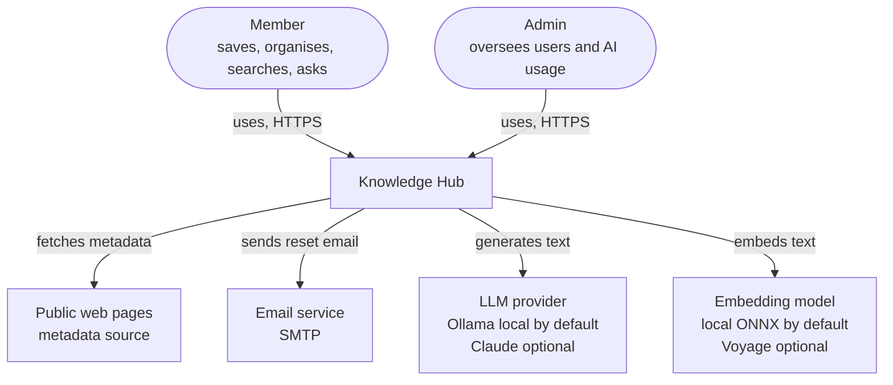

### 2.2 Containers (L2)

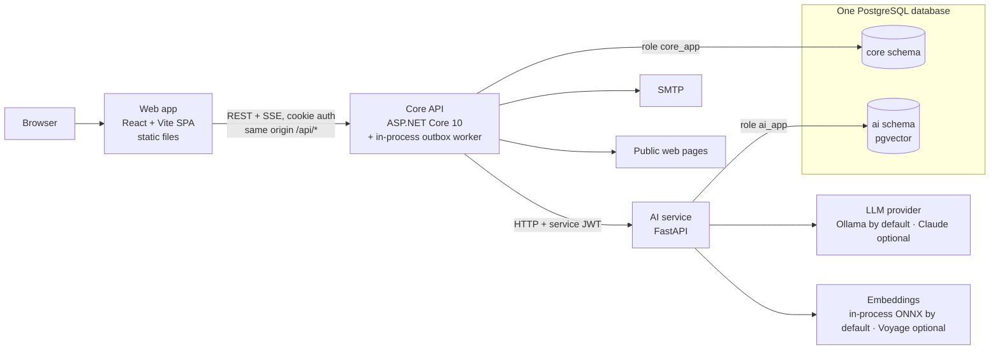

| Container | Technology | Responsibilities | Owns |
|---|---|---|---|
| **Web app** | React 19, Vite, TypeScript, TanStack Router and Query | All UI. Talks only to `/api/*` on its own origin. | Nothing server-side |
| **Core API** | ASP.NET Core 10, EF Core 10, Npgsql | Auth, library, search, dashboard, export, admin, metadata fetching, outbox worker, proxy to AI | `core` schema |
| **AI service** | Python 3.12, FastAPI, SQLAlchemy 2, pgvector | Chunking, embeddings, hybrid retrieval, summaries, tag suggestions, chat, usage metering and quotas | `ai` schema |
| **PostgreSQL** | PostgreSQL 16+ with `pgvector` 0.8+ | Storage for both services | — |
| **Ollama** | Ollama server | Runs the local chat model (free profile) | Model files |

---

## 3. Core API components (C4 L3)

### 3.1 Layers

Clean-Architecture-lite: dependencies point inward, and Domain depends on nothing.

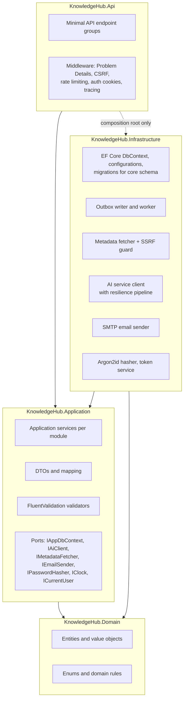

| Project | Contains | May reference |
|---|---|---|
| `KnowledgeHub.Domain` | Entities (`User`, `Collection`, `Resource`, `Tag`, …), value objects (`NormalizedUrl`, `TagName`), enums, domain rules (tag normalisation, URL normalisation, type guessing rules interface) | Nothing |
| `KnowledgeHub.Application` | One folder per module with services, DTOs, validators; port interfaces; Problem error types | Domain |
| `KnowledgeHub.Infrastructure` | EF Core, outbox, metadata fetcher, AI client, email, password hashing, JWT issuing | Application, Domain |
| `KnowledgeHub.Api` | `Program.cs` (composition root), endpoint groups, middleware, auth cookie handling, OpenAPI document | Application, Infrastructure (for registration only) |

NFR-MAIN-05 is enforced by an architecture test (NetArchTest) in the unit test project.

### 3.2 Modules

Each module is a folder in Application (services, DTOs, validators) and in Api (an endpoint group).
Modules talk to each other only through Application service interfaces, never through each other's
tables.

| Module | Endpoints (§8.2) | Responsibilities | SRS |
|---|---|---|---|
| **Identity** | `/auth/*`, `/me*` | Register, sign in, refresh rotation, sign out, password reset and change, profile, preferences, account deletion | FR-AUTH-* |
| **Library** | `/collections*`, `/resources*`, `/tags*`, `/metadata/preview` | Collections, resources, tags, bulk actions, soft delete and restore, duplicate check | FR-COL-*, FR-RES-*, FR-TAG-*, FR-META-* |
| **Search** | `GET /resources` (query part), `/views*` | Keyword search, filters, sort, pagination, saved views | FR-SRCH-* |
| **Insights** | `/dashboard` | Counts, type breakdown, recent items, weekly activity, onboarding state | FR-DASH-* |
| **AI Gateway** | `/ai/*`, `/search/semantic`, `/resources/{id}/summary`, `/resources/{id}/related`, `/chat/*`, `/me/ai-usage` | Calls the AI service, hydrates and owner-checks results, relays SSE, maps AI errors | FR-AI-* |
| **Export** | `/export` | Streams JSON and CSV | FR-EXP-* |
| **Admin** | `/admin/*` | User list, disable, AI usage | FR-ADM-* |

### 3.3 Key implementation choices

| Concern | Choice | Notes |
|---|---|---|
| HTTP layer | Minimal APIs with `MapGroup` per module | Typed results (`Results<Ok<T>, NotFound, …>`) keep the OpenAPI document accurate |
| Validation | FluentValidation in Application | Errors become `400 validation_failed` with an `errors` map |
| Errors | `IProblemDetailsService` + an exception handler | One mapping table from error codes to status and `type` (§8.4) |
| Persistence | EF Core 10 + Npgsql, `HasDefaultSchema("core")`, snake_case naming convention | Global query filters for soft delete; owner filters written explicitly in every query (see §9.4) |
| IDs | UUIDv7 via `Guid.CreateVersion7()` | Time-ordered keys keep B-tree inserts local |
| Password hashing | Argon2id (Konscious.Security.Cryptography) behind `IPasswordHasher` | Parameters in §9.2 |
| Auth | JWT bearer authentication reading the token from the `kh_at` cookie | Custom `OnMessageReceived` handler; no `Authorization` header from the browser |
| Rate limiting | Built-in `Microsoft.AspNetCore.RateLimiting` | Partitioned by IP and email for sign-in, by user for the rest (NFR-SEC-06) |
| HTTP resilience | `Microsoft.Extensions.Http.Resilience` standard pipeline | Timeout, retry with jitter, circuit breaker (§5.5) |
| HTML parsing | AngleSharp for meta tags, SmartReader (Readability port) for main text | Runs only inside the metadata fetcher |
| Background work | `BackgroundService` outbox worker and a maintenance service using `PeriodicTimer` | §5.3 |
| Observability | OpenTelemetry .NET (traces, metrics, logs), OTLP exporter | §11 |
| Tests | xUnit v3, `WebApplicationFactory`, Testcontainers for PostgreSQL, NetArchTest | Coverage gate on Domain and Application (NFR-MAIN-03) |

---

## 4. AI service components

### 4.1 Component view

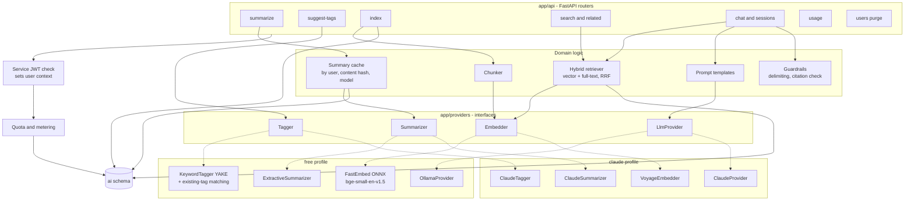

Libraries: FastAPI, Pydantic v2 and `pydantic-settings`, SQLAlchemy 2 (async) with `asyncpg`,
`pgvector` (Python), Alembic, `httpx`, `fastembed`, `yake`, the `anthropic` and `voyageai` SDKs
(Claude profile only), OpenTelemetry. Quality checks: pytest, ruff, mypy.

### 4.2 Provider interfaces

Defined as Python `Protocol` classes in `app/providers/base.py`. The profile is chosen once at
start-up from `AI_PROFILE` and injected with FastAPI dependencies.

| Interface | Method (simplified) | Free implementation | Claude implementation |
|---|---|---|---|
| `Summarizer` | `summarize(title, description, text) -> Summary` | `ExtractiveSummarizer`: the page's description if it is at least 80 characters, otherwise the first paragraphs of the text, trimmed at a sentence boundary to ≤ 600 characters. `source = extracted` | Claude Haiku-class model, 2–4 sentences. `source = ai` |
| `Tagger` | `suggest(title, description, text, existing_tags) -> list[str]` | YAKE keyphrases from title, description and the first 2,000 characters; existing tags ranked first when they match a keyphrase or their embedding is close (cosine ≥ 0.75) to the document embedding | Claude Haiku-class model given the user's existing tags, asked to prefer them |
| `Embedder` | `embed_documents(texts)`, `embed_query(text)`; `model_id`, `dimensions` | `fastembed` with `BAAI/bge-small-en-v1.5`, 384 dimensions, CPU | Voyage `voyage-4-lite`, 1,024 dimensions |
| `LlmProvider` | `stream_chat(system, messages) -> AsyncIterator[str]`; `model_id` | Ollama `/api/chat` with streaming, `num_ctx` set to 8,192 explicitly | Claude Sonnet-class model with streaming |

Model IDs are configuration (`LLM_MODEL`, `SUMMARY_MODEL`, `EMBEDDING_MODEL`), so newer models can be
used without code changes (IR-32).

### 4.3 Retrieval pipeline

**Indexing** (`PUT /index/{resource_id}`, called by the Core API worker):

1. Skip if `content_hash` and `embedding_model` match the stored chunks (NFR-REL-03).
2. Build the document: title, description, the user's notes, then the extracted text (capped at
   200,000 characters).
3. Chunk it: about 300 words per chunk with 50 words of overlap, split on paragraph and sentence
   boundaries. Every chunk is prefixed with the title so it carries its context.
4. Embed the chunks in batches of 32.
5. Replace the resource's chunks in one transaction.

**Hybrid retrieval** (search, related, chat):

1. Embed the query.
2. **Vector leg:** top 50 chunks by cosine distance, filtered by `user_id` (and `collection_id` when
   the chat is scoped), using the model's HNSW index with `hnsw.iterative_scan = relaxed_order` so
   the filter does not starve the result list.
3. **Keyword leg:** top 50 chunks by `ts_rank_cd` over `tsv`, same filters.
4. **Merge** with reciprocal rank fusion, `score = Σ 1 / (60 + rank)`.
5. **Group** by resource: keep the best chunk per resource as the snippet.

Search returns at most `page_size` resources (≤ 50). Chat keeps the top 8 chunks, up to about 3,000
tokens of context. **Related resources** use the mean of the resource's chunk embeddings
(pgvector `avg`) as the query vector and exclude the resource itself.

### 4.4 Chat, prompts and guardrails

- **Prompt structure:** a fixed system prompt states the assistant's role, tells it to answer only
  from the provided sources, to cite them as `[1]`, `[2]`, … and to say so when the sources do not
  contain the answer. Each retrieved chunk is wrapped in a numbered `<source id="n">…</source>`
  block, and the prompt says that text inside sources is data, never instructions
  (NFR-SEC-08).
- **History:** the last 6 messages of the session are included.
- **Citation check:** after streaming, the service maps each `[n]` to its chunk and resource. A
  marker that does not match a retrieved source is dropped. Only resources in the retrieved set,
  all owned by the user, can be cited.
- **No tools:** the chat model has no tools and cannot fetch URLs or write data.
- **Free profile numbers:** `llama3.2:3b` at Q4 needs about 2–3 GB of memory and runs on CPU. If
  quality is too low, `qwen3:4b` (with its thinking mode turned off) is the next option.

### 4.5 Model evaluation (closes OI-03)

Before freezing the free-profile defaults, a small evaluation in `services/ai-service/tests/eval/`:

- 30 saved resources from the personas' domains and 20 questions with known answers.
- Measured per model: answer correctness (manual 0–2 score), citation accuracy, refusal when the
  answer is not in the library, injection resistance (5 crafted pages), first-token time on the
  reference CPU (NFR-PERF-05).
- Candidates: `llama3.2:3b`, `qwen3:4b`. Embeddings: `bge-small-en-v1.5` against
  `nomic-embed-text-v1.5` for recall@5.
- The result is recorded in ADR-011.

### 4.6 Quotas and metering

The AI service owns usage data, so it enforces quotas (FR-AI-10):

- Every user-initiated operation reads today's count for the user and operation from `ai.usage`
  (UTC day) and returns `429 ai_quota_exceeded` with `reset_at` when the limit is reached.
- Background indexing (`PUT /index`) is metered but not limited.
- Every call writes a `usage` row with provider, model, tokens and estimated cost (`0` in the free
  profile). Cost uses a price table in configuration.
- Claude profile: a per-user daily cost cap and a deployment-wide monthly cap. When the monthly
  cap is hit, the service switches that operation to the free provider and logs a warning.

---

## 5. Integration design

### 5.1 Principles

- The web app talks only to the Core API, which acts as a backend-for-frontend. The AI service
  stays internal (CON-02, IR-23).
- The AI service never reads `core` tables. The Core API sends it the text and IDs it needs.
- Results from the AI service are IDs, scores, snippets and text. The Core API loads resources
  itself, with its own owner filter, before returning them (IR-22).

### 5.2 Synchronous calls (Core API → AI service)

| Use | Core API endpoint | AI service endpoint | Timeout | Sent | Returned |
|---|---|---|---|---|---|
| Summary on demand | `POST /resources/{id}/summary` | `POST /summarize` | 20 s | title, description, text, content hash | summary, source, model |
| Tag suggestions | `POST /ai/tag-suggestions` | `POST /suggest-tags` | 10 s | title, description, text excerpt, existing tag names | up to 5 tag names, flagged existing or new |
| Semantic search | `GET /search/semantic` | `POST /search` | 5 s | query, limit | resource IDs, scores, snippets |
| Related | `GET /resources/{id}/related` | `GET /resources/{id}/related` | 5 s | resource ID, limit | resource IDs, scores |
| Chat | `POST /chat/sessions/{id}/messages` | `POST /chat/sessions/{id}/messages` (SSE) | 15 s to first event, 120 s total | message, scope | event stream (§8.5) |
| Chat sessions | `/chat/sessions*` | `/chat/sessions*` | 5 s | — | session list or detail |
| AI usage | `GET /me/ai-usage`, `GET /admin/ai-usage` | `GET /usage` | 5 s | user (or all, for admin) | counts, limits, cost |
| AI status | `GET /ai/status` | `GET /health/ready` | 2 s | — | `available`, `degraded` or `unavailable`, profile |

The Core API caches `GET /ai/status` for 10 seconds so the UI can poll it cheaply.

### 5.3 Asynchronous work: the transactional outbox

When a request changes data that needs background work, the Core API writes an `outbox` row **in
the same transaction** as the change (DR-05). The in-process worker then processes it.

**Worker loop**

- Every 2 seconds (and right after a commit that wrote outbox rows, through an in-memory signal),
  claim up to 10 due rows with `SELECT … FOR UPDATE SKIP LOCKED`, set them to `processing`, and
  commit.
- Run each job with the trace context restored from its `traceparent` column (NFR-OBS-02).
- On success: `status = done`. On failure: `attempts + 1`, `next_attempt_at = now + backoff` with
  jitter (10 s × 2ⁿ, NFR-REL-02); after 8 attempts `status = dead`.
- Rows stuck in `processing` for more than 5 minutes (a crash) return to `pending`.

**Events and jobs**

| Event | Written when | Job | Calls |
|---|---|---|---|
| `resource.created` | A resource is saved | Fetch metadata (§5.4), update the resource, set `metadata_status`. If the extracted text changed, write `resource.content_changed` | Public web page |
| `resource.content_changed` | Metadata extraction found new text | Index the resource; then, if auto-summary is on and `summary_source` is `none` or `extracted`, request a summary and store it | `PUT /index/{id}`, `POST /summarize` |
| `resource.updated` | Title, description, notes, tags, collection or URL changed | URL changed: same as `resource.created`. Otherwise re-index (the AI service skips unchanged content, but updates `collection_id`) | `PUT /index/{id}` |
| `resource.deleted` | Soft delete (single or bulk) | Remove the resource's chunks | `DELETE /index/{id}` |
| `resource.restored` | Restore within 7 days | Re-index | `PUT /index/{id}` |
| `user.deleted` | Account deleted | Purge all of the user's `ai` rows | `DELETE /users/{id}` |

All jobs are idempotent: `PUT /index` replaces, `DELETE` of something already gone returns `204`,
and summaries are not stored if the user has edited the summary in the meantime.

**Maintenance service** (hourly, `PeriodicTimer`): purges resources soft-deleted more than 7 days
ago, and applies the retention rules in SRS §6.4 to tokens, outbox rows and audit events. The AI
service runs its own hourly clean-up of `usage` rows older than 12 months.

### 5.4 Metadata fetcher and SSRF guard

Implemented in Infrastructure, used by the `resource.created` job and by `POST /metadata/preview`.

1. Parse the URL; allow only `http` and `https` on ports 80 and 443.
2. Resolve the host name. Refuse if **any** resolved address is loopback, private (RFC 1918, RFC
   4193), link-local (including `169.254.169.254`), carrier-grade NAT, multicast, unspecified, or
   an IPv4-mapped form of these.
3. Connect to the **checked IP address** (a custom `SocketsHttpHandler.ConnectCallback`), so DNS
   cannot change between the check and the request (DNS rebinding).
4. Follow at most 5 redirects manually, repeating steps 1–3 for each.
5. 5-second total timeout; read at most 5 MB; only `text/html`, `application/xhtml+xml` and
   `application/pdf` (PDF: type and title from headers only in v1).
6. Parse with AngleSharp (Open Graph, Twitter cards, `<title>`, meta description, favicon links)
   and SmartReader (main text). Apply the type-guess rules from configuration (FR-META-02).

### 5.5 Resilience

| Mechanism | Setting | Requirement |
|---|---|---|
| Timeouts | Per call, §5.2 | NFR-REL-01 |
| Retries | 2 retries with exponential backoff and jitter, only for idempotent calls (`GET`, `PUT /index`, `DELETE`) and only on 5xx, timeouts and connection errors | NFR-REL-02 |
| Circuit breaker | Opens after 5 consecutive failures for 30 s; while open, AI endpoints return `503 ai_unavailable` with `Retry-After: 30` at once | NFR-REL-04 |
| Degradation | Semantic search falls back to keyword search and adds `"mode": "keyword_fallback"`; tag suggestions return an empty list with `ai_available: false`; background jobs wait in the outbox | FR-AI-09 |
| Dead jobs | Visible in the outbox table and in a metric; re-queued by setting `status = pending` | NFR-REL-02 |

### 5.6 Service-to-service authentication

- The Core API signs a JWT for each call to the AI service: `iss = core-api`, `aud = ai-service`,
  `sub = <user_id>`, `jti`, 60-second lifetime, HMAC-SHA256 with a secret shared through
  environment variables (`SERVICE_JWT_SECRET`, at least 32 random bytes).
- Purge and admin calls use `sub = system` with a `scope` claim (`users:purge`, `usage:read_all`).
- The AI service rejects missing, expired or wrongly scoped tokens with `401`. Every database query
  in the AI service uses the `sub` as the `user_id` filter; no endpoint accepts a user ID from the
  request body.
- The same mechanism runs in every environment, so there is only one code path to test.
- Defence in depth: the AI service also listens only on the private network (§10).

---

## 6. Sequence diagrams

### 6.1 Sign in and silent refresh

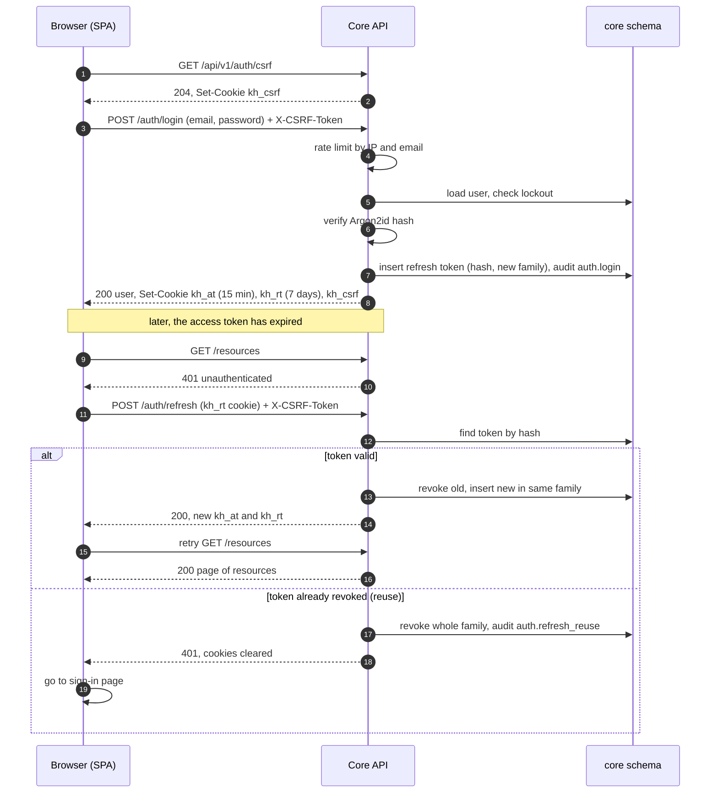

The SPA queues requests while one refresh is in flight, so several `401`s cause only one refresh.

### 6.2 Quick-add

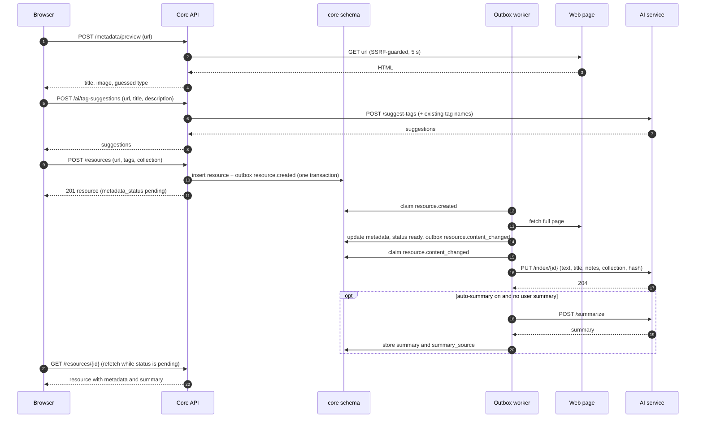

The web app refetches a pending resource every 2 seconds for up to 30 seconds (TanStack Query
`refetchInterval`), then stops; there is no push channel in v1.

### 6.3 Semantic search

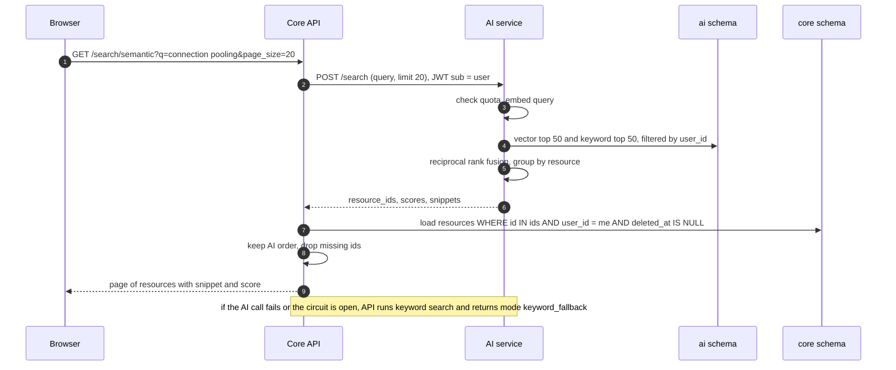

### 6.4 Ask the library (RAG with streaming)

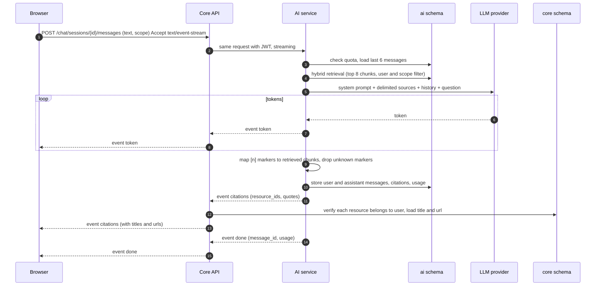

If the browser disconnects, the Core API cancels the upstream request, and the AI service stops
generation and stores the partial answer marked `interrupted`.

---

## 7. Data architecture

### 7.1 Ownership

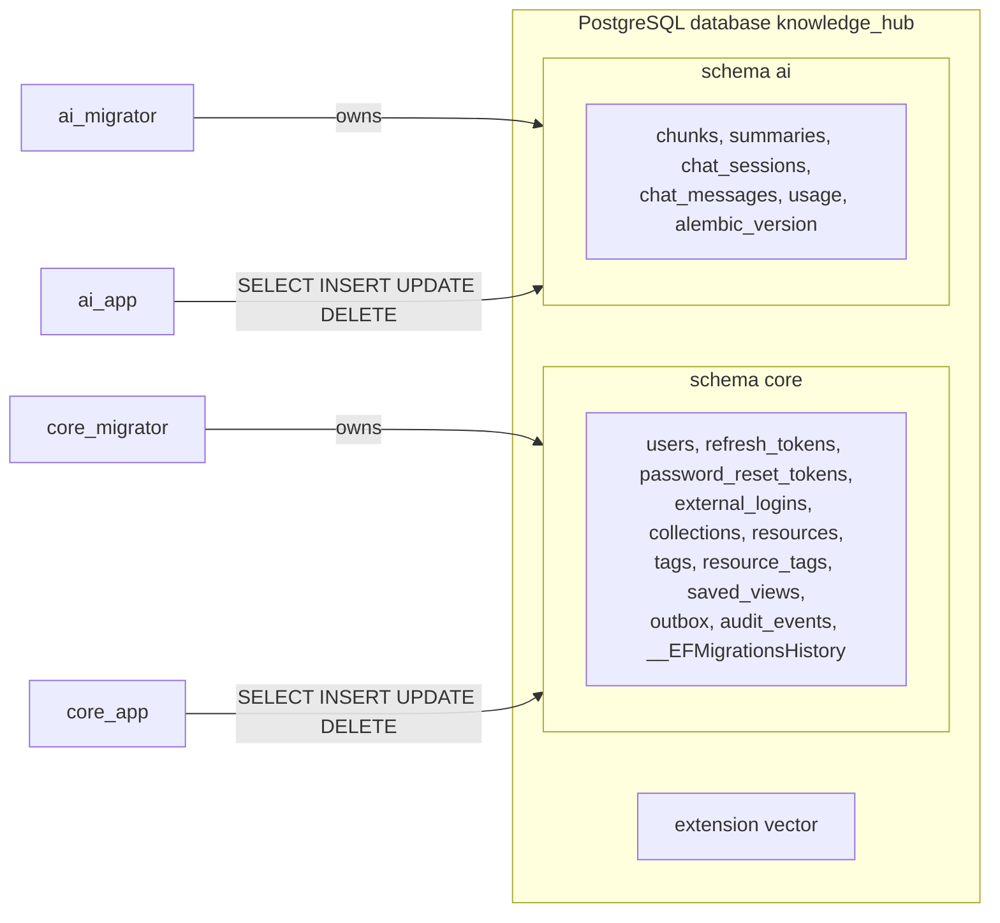

| Role | Used by | Rights |
|---|---|---|
| `core_migrator` | EF Core migration bundle (deploy step) | Owns schema `core`; DDL there only |
| `core_app` | Core API at runtime | DML on `core` tables; `USAGE` on schema `core`; nothing on `ai` |
| `ai_migrator` | Alembic (deploy step) | Owns schema `ai`; DDL there only |
| `ai_app` | AI service at runtime | DML on `ai` tables; `USAGE` on schema `ai`; nothing on `core` |

`infra/db/init.sql` creates the schemas, the four roles, the `vector` extension and default
privileges (`ALTER DEFAULT PRIVILEGES FOR ROLE core_migrator IN SCHEMA core GRANT … TO core_app`,
and the same for `ai`). Each role's `search_path` is set to its own schema. On Neon the same
script runs once as the project owner.

### 7.2 `core` schema

Columns follow the SRS data dictionary (§6.2). Physical details:

| Table | Key constraints and indexes |
|---|---|
| `users` | PK `id`; unique `email` (`citext`); check `role IN ('member','admin')` |
| `refresh_tokens` | PK `id`; unique `token_hash`; index `(user_id)`; index `(family_id)`; FK `user_id` on delete cascade |
| `password_reset_tokens` | PK `id`; unique `token_hash`; FK cascade |
| `external_logins` | PK `id`; unique `(provider, provider_user_id)`; FK cascade |
| `collections` | PK `id`; unique `(user_id, lower(name))`; index `(user_id, is_pinned DESC, position)`; FK cascade |
| `resources` | PK `id`; FK `user_id` cascade; FK `collection_id` (application handles FR-COL-05, the FK is `ON DELETE RESTRICT`); partial indexes `WHERE deleted_at IS NULL`: `(user_id, created_at DESC, id)`, `(user_id, updated_at DESC)`, `(user_id, collection_id)`, `(user_id, url_normalized)`; GIN on `search_vector`; index `(deleted_at) WHERE deleted_at IS NOT NULL` for purging; checks on `type`, `summary_source`, `metadata_status` |
| `tags` | PK `id`; unique `(user_id, name)`; FK cascade |
| `resource_tags` | PK `(resource_id, tag_id)`; index `(tag_id)`; both FKs cascade |
| `saved_views` | PK `id`; FK cascade |
| `outbox` | PK `id`; partial index `(next_attempt_at) WHERE status = 'pending'`; index `(status, processed_at)` for clean-up |
| `audit_events` | PK `id`; index `(user_id, created_at)`; index `(created_at)`; no FK (the `account.deleted` row outlives the user) |

**Keyword search column:**

```sql
search_vector tsvector GENERATED ALWAYS AS (
    setweight(to_tsvector('english', coalesce(title, '')), 'A') ||
    setweight(to_tsvector('english', coalesce(tags_text, '')), 'B') ||
    setweight(to_tsvector('english', coalesce(description, '')), 'C') ||
    setweight(to_tsvector('english', coalesce(notes, '') || ' ' || url), 'D')
) STORED
```

`tags_text` is updated by the application whenever a resource's tags change and by a set-based
`UPDATE` when a tag is renamed, merged or deleted. Queries build a `tsquery` from the user's words
with `:*` on the last word (prefix match while typing) and rank with `ts_rank_cd`.

### 7.3 `ai` schema

| Table | Key constraints and indexes |
|---|---|
| `chunks` | PK `id`; index `(user_id, resource_id)`; index `(user_id, collection_id)`; GIN on `tsv`; one **partial HNSW expression index per embedding model** (below); `embedding` column type is `vector` without a fixed dimension |
| `summaries` | PK `(user_id, content_hash, model)` |
| `chat_sessions` | PK `id`; index `(user_id, updated_at DESC)` |
| `chat_messages` | PK `id`; FK `session_id` cascade; index `(session_id, created_at)` |
| `usage` | PK `id`; index `(user_id, operation, created_at)`; index `(created_at)` |

**Vector indexes per model** (ADR-011). Each embedding model has its own dimension, so one column
holds all of them and each model gets its own index:

```sql
CREATE INDEX chunks_embedding_bge_small_hnsw
    ON ai.chunks USING hnsw ((embedding::vector(384)) vector_cosine_ops)
    WHERE embedding_model = 'BAAI/bge-small-en-v1.5';

CREATE INDEX chunks_embedding_voyage_4_lite_hnsw
    ON ai.chunks USING hnsw ((embedding::vector(1024)) vector_cosine_ops)
    WHERE embedding_model = 'voyage-4-lite';
```

Queries use the same cast and `WHERE embedding_model = :model`, so PostgreSQL picks the right
index. Switching profile starts a re-index: the AI service re-embeds each resource's chunks with
the new model in the background, and search keeps using the old model's rows until a user's
re-index finishes (FR-AI-01).

### 7.4 Migrations

| | Core API | AI service |
|---|---|---|
| Tool | EF Core migrations, `HasDefaultSchema("core")` | Alembic, `version_table_schema = "ai"` |
| History table | `core.__EFMigrationsHistory` | `ai.alembic_version` |
| Runs as | `core_migrator` | `ai_migrator` |
| Packaged as | An EF Core migration bundle (`efbundle`) built in CI | `alembic upgrade head` in the AI service image |
| When | A separate deploy step before the new containers start; locally, one-shot Compose services `migrate-core` and `migrate-ai` that the apps wait for | Same |
| Connection | Direct (non-pooled) endpoint | Direct endpoint |

Neither app runs migrations at start-up. Migrations are written to be backward compatible with the
previous app version (add, then switch, then remove in a later release).

### 7.5 Connection budget (Neon free plan)

- Apps connect through Neon's **pooled endpoint** (PgBouncer in transaction mode, up to 10,000 client
  connections). Migrations use the **direct endpoint**.
- Pool sizes: Core API `Maximum Pool Size=10`, AI service `pool_size=5, max_overflow=5`.
- Npgsql uses protocol-level prepared statements, which the pooler supports; SQL-level `PREPARE`
  and `LISTEN/NOTIFY` are not used (the outbox polls instead).
- The compute scales to zero when idle, so the first query after a pause takes longer
  (NFR-REL-06). Free compute hours (100 CU-hours a month) are enough for a demo that sleeps.
- Storage is the tightest limit (0.5 GB per project on the pricing page; reports say it rose to
  1 GB). At 384 dimensions a chunk is about 2 KB with its text and indexes, so 0.5 GB holds a few
  hundred thousand chunks: enough for the demo. Re-check before deployment.

---

## 8. API contract

### 8.1 Source of truth and workflow

- `contracts/openapi.yaml` (OpenAPI 3.1) is written and reviewed **before** an endpoint is built.
- The web client is generated from it with `openapi-typescript` and called with `openapi-fetch`.
  CI fails if the generated client is out of date.
- The Core API also produces its own OpenAPI document (`Microsoft.AspNetCore.OpenApi`). CI compares
  it with the contract using `oasdiff` and fails on any difference that is not marked as allowed.
- Schemathesis runs against the Core API in CI, driven by `contracts/schemathesis.toml`, with a
  seeded test user (NFR-MAIN-02).
- **Versioning:** the path holds the major version (`/api/v1`). Adding optional fields or new
  endpoints is not breaking. Removing or renaming anything needs `/api/v2`.

### 8.2 Endpoint list

All paths are under `/api/v1`. "Auth" means a valid `kh_at` cookie; "CSRF" means the
`X-CSRF-Token` header must match the `kh_csrf` cookie.

**Identity**

| Method | Path | Auth | CSRF | Purpose | SRS |
|---|---|---|---|---|---|
| GET | `/auth/csrf` | — | — | Set the CSRF cookie | IR-13 |
| POST | `/auth/register` | — | ✓ | Register and sign in | FR-AUTH-01 |
| POST | `/auth/login` | — | ✓ | Sign in | FR-AUTH-02 |
| POST | `/auth/logout` | ✓ | ✓ | Sign out | FR-AUTH-03 |
| POST | `/auth/refresh` | refresh cookie | ✓ | Rotate tokens | FR-AUTH-04 |
| POST | `/auth/password-reset` | — | ✓ | Request a reset email | FR-AUTH-06 |
| POST | `/auth/password-reset/confirm` | — | ✓ | Set a new password with the token | FR-AUTH-06 |
| GET | `/auth/oauth/{provider}` | — | — | Start OAuth (Could) | FR-AUTH-10 |
| GET | `/auth/oauth/{provider}/callback` | — | state check | Finish OAuth (Could) | FR-AUTH-10 |
| GET | `/me` | ✓ | — | Current user and preferences | FR-AUTH-05 |
| PATCH | `/me` | ✓ | ✓ | Display name, preferences | FR-AUTH-08, FR-AI-12 |
| PUT | `/me/password` | ✓ | ✓ | Change password | FR-AUTH-07 |
| DELETE | `/me` | ✓ | ✓ | Delete account (password in body) | FR-AUTH-09 |
| GET | `/me/ai-usage` | ✓ | — | Today's AI usage and limits | FR-AI-10 |

**Library**

| Method | Path | Auth | CSRF | Purpose | SRS |
|---|---|---|---|---|---|
| GET | `/collections` | ✓ | — | All collections with `resource_count`, plus the Inbox count | FR-COL-01, FR-COL-04 |
| POST | `/collections` | ✓ | ✓ | Create | FR-COL-01, FR-COL-02 |
| GET | `/collections/{id}` | ✓ | — | One collection | FR-COL-01 |
| PATCH | `/collections/{id}` | ✓ | ✓ | Edit, pin | FR-COL-01–03 |
| PUT | `/collections/order` | ✓ | ✓ | Save sidebar order (list of IDs) | FR-COL-03 |
| DELETE | `/collections/{id}?resources=delete\|move&target_collection_id=` | ✓ | ✓ | Delete with the user's choice | FR-COL-05 |
| GET | `/resources` | ✓ | — | List, keyword search, filter, sort, paginate (§8.3) | FR-RES-02, FR-SRCH-01–04 |
| POST | `/resources` | ✓ | ✓ | Save | FR-RES-01 |
| GET | `/resources/check-url?url=` | ✓ | — | Duplicate check | FR-RES-11 |
| POST | `/resources/bulk` | ✓ | ✓ | `move`, `add_tags`, `remove_tags`, `delete`, `restore` on up to 100 IDs | FR-RES-12 |
| GET | `/resources/{id}` | ✓ | — | One resource | FR-RES-02 |
| PATCH | `/resources/{id}` | ✓ | ✓ | Edit fields, tags, favourite, archive, summary | FR-RES-03, 05–10, FR-AI-11 |
| DELETE | `/resources/{id}` | ✓ | ✓ | Soft delete | FR-RES-04 |
| POST | `/resources/{id}/restore` | ✓ | ✓ | Undo delete | FR-RES-04 |
| POST | `/resources/{id}/metadata/refresh` | ✓ | ✓ | Retry metadata extraction | FR-META-03 |
| POST | `/metadata/preview` | ✓ | ✓ | Preview a URL without saving | FR-META-04 |
| GET | `/tags` | ✓ | — | Tags with usage counts | FR-TAG-02 |
| PATCH | `/tags/{id}` | ✓ | ✓ | Rename | FR-TAG-03 |
| POST | `/tags/{id}/merge` | ✓ | ✓ | Merge into `target_tag_id` | FR-TAG-04 |
| DELETE | `/tags/{id}` | ✓ | ✓ | Delete | FR-TAG-05 |
| GET/POST | `/views` | ✓ | POST | Saved views (Could) | FR-SRCH-05 |
| PATCH/DELETE | `/views/{id}` | ✓ | ✓ | Saved views (Could) | FR-SRCH-05 |

**Insights, export, AI and admin**

| Method | Path | Auth | CSRF | Purpose | SRS |
|---|---|---|---|---|---|
| GET | `/dashboard` | ✓ | — | Totals, type breakdown, recent items, weekly activity, onboarding steps | FR-DASH-* |
| GET | `/export?format=json\|csv` | ✓ | — | Download all data | FR-EXP-* |
| GET | `/ai/status` | ✓ | — | AI availability and profile | FR-AI-09 |
| POST | `/ai/tag-suggestions` | ✓ | ✓ | Suggestions for a URL or a saved resource | FR-AI-04 |
| POST | `/resources/{id}/summary` | ✓ | ✓ | Generate or regenerate | FR-AI-02 |
| DELETE | `/resources/{id}/summary` | ✓ | ✓ | Remove summary | FR-AI-11 |
| GET | `/resources/{id}/related` | ✓ | — | Related resources | FR-AI-07 |
| GET | `/search/semantic?q=&page_size=` | ✓ | — | Semantic search | FR-AI-05 |
| GET | `/chat/sessions` | ✓ | — | List chats | FR-AI-08 |
| POST | `/chat/sessions` | ✓ | ✓ | Start a chat (optional `scope_collection_id`) | FR-AI-06 |
| GET | `/chat/sessions/{id}` | ✓ | — | Chat with messages | FR-AI-08 |
| PATCH | `/chat/sessions/{id}` | ✓ | ✓ | Rename | FR-AI-08 |
| DELETE | `/chat/sessions/{id}` | ✓ | ✓ | Delete | FR-AI-08 |
| POST | `/chat/sessions/{id}/messages` | ✓ | ✓ | Ask; responds with SSE | FR-AI-06 |
| GET | `/admin/users` | admin | — | User list | FR-ADM-01 |
| PATCH | `/admin/users/{id}` | admin | ✓ | Disable or enable | FR-ADM-02 |
| GET | `/admin/ai-usage` | admin | — | AI usage and cost | FR-ADM-03 |
| GET | `/health/live`, `/health/ready` | — | — | Health (outside `/api/v1`) | IR-17 |

### 8.3 Conventions

| Topic | Rule |
|---|---|
| Naming | Plural nouns for collections of things, `snake_case` JSON fields, lowercase enum values |
| IDs and times | UUIDv7 strings; ISO 8601 UTC timestamps (`2026-11-02T08:30:00Z`) |
| Pagination | `?page=1&page_size=20` (max 100) → `{ "items": [], "page": 1, "page_size": 20, "total": 0 }`. Semantic search uses the same shape with `page` always 1 |
| Filters on `GET /resources` | `q`, `type` (repeatable), `tag` (repeatable, all must match), `collection_id` (or `inbox`), `favourite`, `archived`, `created_from`, `created_to`, `sort` (`relevance`, `newest`, `oldest`, `title`, `updated`) |
| Partial updates | `PATCH` with JSON merge semantics: absent fields are unchanged, `null` clears a nullable field |
| Concurrency | Resources and collections return `updated_at`. `PATCH` may send `expected_updated_at`; if it does not match, the API returns `409 edit_conflict` (protects autosaved notes edited in two tabs) |
| Errors | Problem Details (§8.4) |
| Rate limits | `429` with `Retry-After`; `RateLimit-Policy` and `RateLimit` headers |

### 8.4 Error catalogue

Every error is `application/problem+json`:

```json
{
  "type": "/problems/validation_failed",
  "title": "The request is not valid.",
  "status": 400,
  "detail": "One or more fields are not valid.",
  "instance": "/api/v1/resources",
  "code": "validation_failed",
  "trace_id": "4bf92f3577b34da6a3ce929d0e0e4736",
  "errors": { "url": ["Must be an http or https URL."] }
}
```

| Code | Status | When |
|---|---|---|
| `validation_failed` | 400 | Field validation errors (`errors` map present) |
| `invalid_token` | 400 | Reset token used, expired or unknown |
| `unauthenticated` | 401 | No valid access token |
| `invalid_credentials` | 401 | Wrong email or password, wrong current password |
| `csrf_failed` | 403 | Missing or mismatched CSRF token |
| `forbidden` | 403 | Member calling an admin endpoint |
| `account_disabled` | 403 | Disabled account signing in |
| `not_found` | 404 | Unknown ID **or another user's ID** (NFR-SEC-05) |
| `email_taken` | 409 | Registration with an existing email |
| `collection_name_taken` | 409 | Duplicate collection name |
| `tag_name_taken` | 409 | Rename to an existing tag (response suggests merge) |
| `edit_conflict` | 409 | `expected_updated_at` does not match |
| `not_enough_content` | 422 | Summary requested with too little text |
| `account_locked` | 423 | Too many failed sign-ins (`retry_after` included) |
| `rate_limited` | 429 | Rate limit hit |
| `ai_quota_exceeded` | 429 | Daily AI quota reached (`reset_at` included) |
| `internal_error` | 500 | Unexpected error (no details in production) |
| `ai_unavailable` | 503 | AI service down, timed out or circuit open |
| `service_unavailable` | 503 | Database unavailable |

The web app maps `code` to user-facing text (IR-03, Doc 03 §10).

### 8.5 Chat stream format

`POST /chat/sessions/{id}/messages` responds with `Content-Type: text/event-stream`:

```text
event: token
data: {"text":"Connection pooling keeps "}

event: token
data: {"text":"database connections open [1]."}

event: citations
data: {"items":[{"n":1,"resource_id":"0193…","title":"Npgsql performance","url":"https://…","quote":"…"}]}

event: done
data: {"message_id":"0193…","usage":{"tokens_in":1830,"tokens_out":212}}
```

An `error` event (`{"code":"ai_unavailable"}`, for example) can replace `done`. The Core API sets
`Cache-Control: no-cache` and `X-Accel-Buffering: no`, and sends a comment line every 15 seconds to
keep proxies from closing the connection.

---

## 9. Security architecture

### 9.1 Token and cookie model

| Cookie | Content | Lifetime | Attributes |
|---|---|---|---|
| `kh_at` | Access JWT (`sub`, `role`, `stamp`, `iat`, `exp`, `jti`), signed with HS256 | 15 minutes | `HttpOnly; Secure; SameSite=Lax; Path=/api` |
| `kh_rt` | Random 256-bit refresh token (stored as SHA-256 hash) | 7 days | `HttpOnly; Secure; SameSite=Lax; Path=/api/v1/auth` |
| `kh_csrf` | Random 128-bit CSRF token | Session | `Secure; SameSite=Lax; Path=/` (readable by the SPA) |

- **Rotation:** each refresh revokes the presented token and issues a new one in the same family.
  Presenting a revoked token revokes the whole family (FR-AUTH-04).
- **Revocation of access tokens:** access tokens are short-lived and not stored. Disabling a user
  or deleting an account also replaces the user's `security_stamp`. Each request compares the token's `stamp` claim with
  the stored value (cached for 60 seconds), so access ends within a minute.
- **Signing keys** come from environment variables and support a previous key during rotation.

### 9.2 Passwords

- Argon2id with memory 19 MiB, 2 iterations, parallelism 1 (the OWASP minimum), tuned so a hash
  takes about 100–200 ms on the server. Parameters are stored with the hash, so they can be raised
  later; hashes are upgraded on the next sign-in.
- 12–128 characters, checked against a bundled list of the 100,000 most common passwords.
- Failed sign-ins: lockout per FR-AUTH-02, plus rate limits per IP and email (NFR-SEC-06).

### 9.3 CSRF

- `SameSite=Lax` blocks most cross-site requests. On top of that, every `POST`, `PUT`, `PATCH` and
  `DELETE` must send `X-CSRF-Token` equal to the `kh_csrf` cookie (double-submit, NFR-SEC-04).
- The SPA reads `kh_csrf` and adds the header in the `openapi-fetch` middleware.
- Sign-in and registration are protected too (login CSRF), which is why `GET /auth/csrf` exists.

### 9.4 Authorisation and data isolation

- `ICurrentUser` gives the user ID from the token. Every Application query on user-owned data
  includes `user_id = currentUser.Id`. Repository-free: queries are written against
  `IAppDbContext` with a shared `OwnedBy(userId)` extension so it is hard to forget.
- A missing or foreign ID returns `404 not_found`, never `403` (NFR-SEC-05).
- References inside a request (collection ID, tag IDs, merge target) are checked for ownership too
  (DR-02).
- Admin endpoints use an `admin` authorisation policy (FR-ADM-04).
- The cross-user test suite (T-IT-SEC-01) calls every endpoint with a second user's IDs.
- In the AI service the user ID comes **only** from the service JWT (§5.6).

### 9.5 HTTP security headers

Set by the Core API for API responses and by the static host (Vercel `vercel.json` headers) for
the SPA:

- `Content-Security-Policy: default-src 'self'; script-src 'self'; style-src 'self' 'unsafe-inline'; img-src 'self' https: data:; connect-src 'self'; frame-ancestors 'none'; base-uri 'self'; form-action 'self'`
  (`img-src https:` allows preview images and favicons from saved sites).
- `Strict-Transport-Security: max-age=31536000; includeSubDomains`
- `X-Content-Type-Options: nosniff`, `Referrer-Policy: strict-origin-when-cross-origin`,
  `Permissions-Policy` with unused features off.

### 9.6 Threat model (STRIDE)

Each row is one threat, grouped by STRIDE category: **S**poofing, **T**ampering, **R**epudiation,
**I**nformation disclosure, **D**enial of service, **E**levation of privilege.

| Category | Threat | Where | Mitigation |
|---|---|---|---|
| S | Attacker guesses passwords or reuses leaked ones | Sign-in | Argon2id hashing, common-password check, rate limit per IP and email, lockout after repeated failures |
| S | Stolen session token used by someone else | Cookies | `HttpOnly`, `Secure` and `SameSite` cookies; 15-minute access token; rotating refresh tokens stored hashed, with reuse detection |
| S | Forged request from another site using the user's cookies (CSRF) | All state-changing endpoints | `SameSite=Lax` plus double-submit CSRF token, including on sign-in |
| T | User changes another user's resource by guessing its ID | Library API | UUIDs, owner filter on every query, ownership checks on referenced IDs, validation on all input; another user's ID returns 404 |
| T | Stored XSS through notes, titles or fetched metadata | Web app | Markdown rendered with raw HTML disabled and sanitised; React escapes text; strict CSP |
| R | User denies deleting or changing data, with no proof | Account actions | Audit log of security events (sign-in, password change, account deletion, admin actions) with user ID, IP and trace ID |
| I | Search or chat returns another user's content | Search, AI chat | `user_id` from the service JWT filters every pgvector and full-text query; Core API re-checks ownership when hydrating results and citations |
| I | Server fetches an internal address and leaks its contents | Metadata extraction | SSRF guard: http/https on 80/443 only, block private and metadata IP ranges, connect to the checked IP, re-check every redirect |
| I | Error messages reveal internals | All endpoints | Problem Details without stack traces in production; generic `internal_error` |
| I | AI service reads core data it should not | Database | Separate database roles; `ai_app` has no rights on `core` |
| D | Flooding of sign-in or AI endpoints | All endpoints | Rate limiting, per-user AI quota, request timeouts, deployment-wide AI cost cap |
| D | Huge or slow pages exhaust memory or tie up the worker | Metadata extraction | 5-second timeout, 5 MB limit, at most 10 jobs in flight |
| E | Prompt injection in a saved page makes chat reveal data or act outside its role | AI chat | Sources delimited and declared as data; chat has read-only access to the user's retrieved chunks and no tools; citations checked |
| E | Attacker calls the AI service directly | AI service | Only on the private network; short-lived service JWT checked on every request |
| E | Regular user reaches admin functions | Admin endpoints | Admin policy on every admin route, covered by integration tests; first admin only from configuration |

---

## 10. Deployment

### 10.1 Local development

One `docker compose up` from the repository root (NFR-PORT-02), using `compose.yaml`:

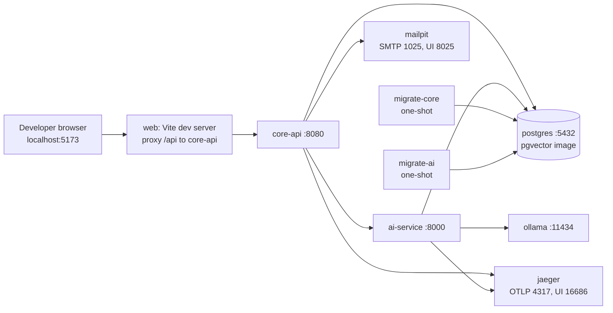

- `postgres` runs `infra/db/init.sql` on first start.
- `migrate-core` and `migrate-ai` run to completion before `core-api` and `ai-service` start
  (`depends_on: condition: service_completed_successfully`).
- `ollama` pulls the configured model on first start. On Windows and macOS it can be replaced by a
  native Ollama install (`OLLAMA_BASE_URL=http://host.docker.internal:11434`) for better speed.
- The Vite dev server proxies `/api` to the Core API, giving the same same-origin setup as
  production.
- Settings come from `.env` (copied from `.env.example`, which holds safe defaults and no real
  secrets).

### 10.2 Demo (production) deployment

Hosting free tiers changed a lot in 2026, so the plan has a primary option and a fallback. Both
keep the AI service off the public internet.

**Primary: one ARM VM + Neon + Vercel**

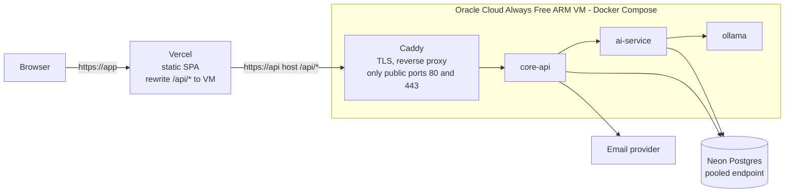

- **Web:** Vercel builds `apps/web` and serves it. `apps/web/vercel.json` rewrites `/api/:path*` to
  the VM's API host name, so the browser only sees one origin and the cookies stay first-party.
- **VM:** an Ampere A1 VM. Oracle's Always Free ARM allowance is reported to have dropped from
  4 OCPU / 24 GB to 2 OCPU / 12 GB in August 2026; 12 GB still fits the Core API, the AI service and
  a 3B–4B model, but chat will be slower than the 4-core reference in NFR-PERF-05. Caddy gets a TLS
  certificate for a domain or free DNS name pointing at the VM. Images are built for `linux/arm64`.
- **Database:** Neon free plan, in the region closest to the VM.
- **Idle reclaim risk:** Oracle may reclaim Always Free VMs that stay under 20 % CPU (95th
  percentile) for 7 days. Mitigation: convert the account to Pay As You Go (still free within the
  limits), which is reported to remove idle reclaim. Do **not** generate fake load. Verify both
  points before relying on this option.

**Fallback: Azure Container Apps + Neon + Vercel**

- `core-api` with external ingress and `ai-service` with **internal** ingress in one Container Apps
  environment (scale to zero, within the monthly free grant).
- The local chat model does not fit the free grant, so the demo runs AI with the Claude profile
  (small budget, cost caps on) or a hosted free-tier model added behind `LlmProvider`. Embeddings
  stay local (ONNX, small).

**Excluded:** hosts that cannot keep the AI service private (for example a single free web service
per account), and Fly.io (no free tier any more).

### 10.3 CI/CD

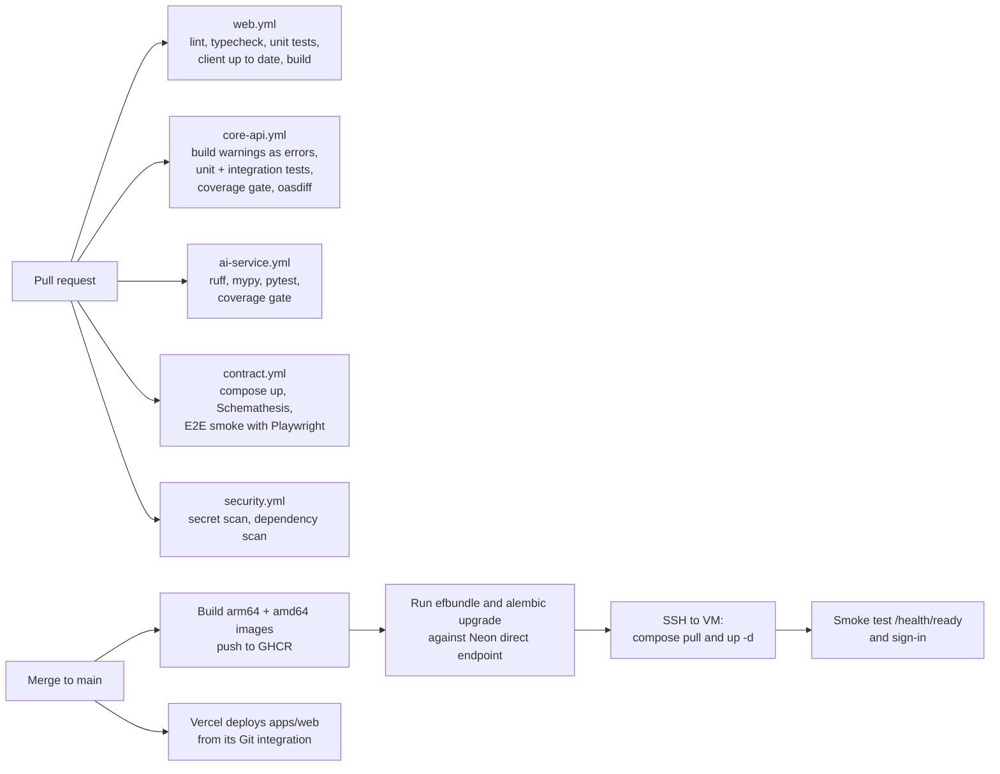

- Path filters run each workflow only when its folder (or `contracts/`) changes.
- Secrets live in GitHub Actions secrets and on the VM in an `.env` file readable only by the
  deploy user (NFR-SEC-09).

---

## 11. Observability

| Signal | Implementation | Requirement |
|---|---|---|
| **Logs** | Structured JSON to stdout. .NET: built-in JSON console logger plus OpenTelemetry log export. Python: `structlog`. Every line has `trace_id`, `span_id` and `user_id` where known. A redaction filter removes cookies, tokens, passwords and content fields, and masks emails. | NFR-OBS-01, NFR-PRIV-04 |
| **Traces** | OpenTelemetry SDKs in both services, exported over OTLP. HTTP calls carry W3C `traceparent`. The outbox stores `traceparent` when an event is written, and the worker starts its job span as a child of it, so one trace covers request → job → AI call. | NFR-OBS-02 |
| **Metrics** | RED per endpoint (`http.server.request.duration`), outbox backlog (`kh.outbox.pending`), dead jobs (`kh.outbox.dead`), job duration, metadata fetch outcomes, AI calls, tokens and estimated cost per operation and provider (`kh.ai.tokens`, `kh.ai.cost_usd`). | NFR-OBS-03 |
| **Health** | `/health/live` (process up) and `/health/ready` (database reachable; for the Core API also the AI service status, reported but not failing readiness). | NFR-OBS-04, IR-17 |
| **Backends** | Development: Jaeger for traces. Demo: any OTLP endpoint set by configuration (for example a free-tier hosted backend), chosen at deployment; without one, only logs are kept. | — |

Sampling: 100 % in development; 20 % of traces in the demo, but always keep traces with errors.

---

## 12. Repository layout

```
Knowledge-Hub/                   repository root
  apps/web/                      React + Vite SPA
    src/routes/                  TanStack Router pages
    src/features/                collections, resources, tags, search, ask, settings
    src/api/                     client generated from contracts/openapi.yaml
    vercel.json                  /api/* rewrite to the Core API, security headers
  services/core-api/             .NET 10 solution (KnowledgeHub.slnx)
    src/KnowledgeHub.Api/        endpoints, auth, rate limiting, Problem Details
    src/KnowledgeHub.Application/  services, DTOs, validators, ports
    src/KnowledgeHub.Domain/     entities, enums, domain rules
    src/KnowledgeHub.Infrastructure/  EF Core (core schema + migrations), outbox worker,
                                 metadata fetcher with SSRF guard, AI service client, email
    tests/KnowledgeHub.UnitTests/         domain, application and architecture tests
    tests/KnowledgeHub.IntegrationTests/  API + database tests (Testcontainers)
    Dockerfile
  services/ai-service/           FastAPI
    app/api/                     summarize, suggest-tags, index, search, chat, usage, users (purge)
    app/providers/base.py        Summarizer, Tagger, Embedder, LlmProvider protocols
    app/providers/free/          extractive, keyword (YAKE), fastembed, Ollama
    app/providers/claude/        Claude, Voyage
    app/retrieval/               chunker, hybrid retriever
    app/guardrails/              source delimiting, citation check
    app/prompts/                 prompt templates
    migrations/                  Alembic (ai schema)
    tests/                       unit, API and eval/ (model evaluation)
    Dockerfile
  contracts/
    openapi.yaml                 API contract
    schemathesis.toml            contract test config
  infra/
    db/init.sql                  schemas, roles, extension, default privileges
    deploy/compose.prod.yaml     demo VM stack (Caddy, core-api, ai-service, Ollama)
    deploy/Caddyfile             TLS and reverse proxy
  compose.yaml                   local stack: Postgres + pgvector, migrations, core-api,
                                 ai-service, Ollama, Mailpit, Jaeger
  .env.example                   safe defaults, no secrets
  plans/                         plans, including greenfield/ drafts
  docs/                          final SRS, architecture and UI/UX docs
    adr/                         architecture decision records
  .github/workflows/             web, core-api, ai-service, contract, security, deploy
```

Compared with the greenfield plan, this adds `infra/deploy/` for the demo VM and `.env.example`.

---

## 13. Architecture decision records

Short summaries. Each becomes a full ADR in `docs/adr/` (context, decision, consequences,
alternatives) when the monorepo is scaffolded.

| ADR | Decision | Why | Consequences | Alternatives considered |
|---|---|---|---|---|
| **001** Modular monolith + AI service | One ASP.NET Core API with internal modules, plus a separate FastAPI AI service | Simple to run and debug; one clear service boundary where the technology really differs | Modules must respect boundaries by convention and tests; two languages to maintain | Microservices per module (too much overhead); AI inside .NET (weaker AI ecosystem) |
| **002** PostgreSQL + pgvector | Store vectors in PostgreSQL | One database to run and back up; transactional with metadata; good enough at this scale | Vector search tuning limited to pgvector options | Qdrant, Pinecone, Weaviate (another system to host and secure) |
| **003** Cookie JWT + refresh rotation | Short access JWT and rotating refresh token, both in `HttpOnly` cookies, plus CSRF token | Tokens not readable by scripts; stateless access checks; theft detection through reuse | Needs CSRF protection and same-origin hosting | Tokens in local storage (XSS risk); server sessions only (fine, but less to learn) |
| **004** Outbox + in-process worker | Background work through an outbox table drained by a `BackgroundService` | Changes and events commit together; no broker to host; retries and dead-letter for free | Polling latency (≈ 2 s); one worker instance in practice | Redis/RabbitMQ queues (extra infrastructure); fire-and-forget tasks (lost on crash) |
| **005** OpenAPI-first contract | `contracts/openapi.yaml` written first; generated client; contract tests | Frontend and backend can be built and tested apart; the contract documents the API | Two artefacts to keep in step (checked by `oasdiff`) | Code-first OpenAPI (contract drifts with code) |
| **006** Provider-agnostic AI layer | `Summarizer`, `Tagger`, `Embedder`, `LlmProvider` interfaces with per-profile implementations | Swap providers by configuration; test with fakes | Lowest-common-denominator features | Calling one SDK directly |
| **007** Hybrid search | Vector + full-text over chunks, merged with reciprocal rank fusion | Vector search misses exact terms and names; keyword search misses meaning | Two queries per search | Vector only; keyword only |
| **008** One database, schema per service | `core` and `ai` schemas, four roles, one migration tool per schema | Fits one free database; the boundary is still enforced by permissions | Both services fail if the database is down; shared capacity | Two databases (two free projects, more to run) |
| **009** Zero-cost default AI profile | `AI_PROFILE=free` uses only local components; Claude optional | Runs with no credit card; privacy by default | Lower quality in free mode; CPU needs for the local model | Paid API by default |
| **010** Single-VM demo hosting | Core API, AI service, Ollama and Caddy on one free ARM VM; Neon; Vercel | Keeps the AI service private and the local model affordable | Single point of failure; idle-reclaim risk; ARM images | Container Apps (fallback, §10.2); paid PaaS |
| **011** Local ONNX embeddings, per-model vector indexes | `fastembed` with `bge-small-en-v1.5` in-process; one `vector` column with a partial HNSW expression index per model | Small, fast on CPU, no PyTorch; semantic search works even when Ollama is down; profiles can switch without a schema change | Re-index needed when switching; index per model to maintain | Embeddings through Ollama (`nomic-embed-text`); `sentence-transformers` with PyTorch (heavier image); fixed-dimension column |

---

## 14. Risks and open issues

| ID | Risk or issue | Impact | Mitigation or next step |
|---|---|---|---|
| AR-01 | Free-tier terms change (Oracle allowance reportedly halved in August 2026; Neon storage limits reported differently by different sources) | Demo hosting breaks or needs a paid tier | Re-check all free-tier terms at deployment; keep the Container Apps fallback |
| AR-02 | Chat on a 2-OCPU ARM VM is slower than NFR-PERF-05 | Slow demo chat | NFR-PERF-05 is measured on the reference laptop; for the demo, a smaller model or the Claude profile |
| AR-03 | SSE through the Vercel rewrite may be buffered or time out | Chat does not stream in the demo | Test early. Fallback: serve the SPA from Caddy on the VM (same origin, no rewrite) |
| AR-04 | Small local models cite poorly or follow injected instructions | Lower chat quality | Evaluation in §4.5; citation check drops invalid citations; no tools |
| AR-05 | Free-profile summaries are only extracts | Users may expect real summaries | Label as "extracted" (FR-AI-11); Claude profile for real summaries |
| OI-04 | Email provider for the demo | Password reset unavailable | Choose at deployment |
| OI-08 | Whether the Oracle Pay As You Go conversion removes idle reclaim | VM could be reclaimed | Verify in Oracle's documentation before choosing the primary option |
