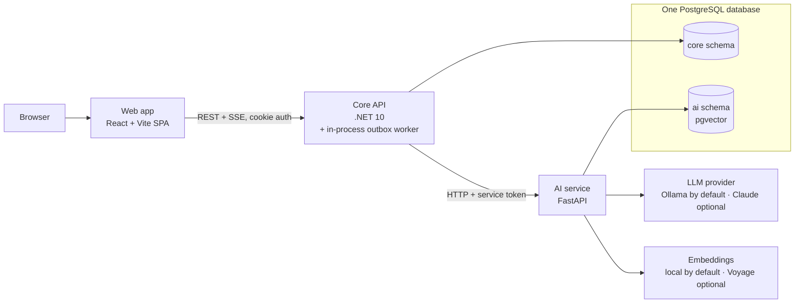

# Knowledge Hub — SRS, Architecture & UI/UX Design (greenfield)

## Context
Knowledge Hub is a personal bookmark and learning-resource manager with AI help. You want to **start from the requirements**:
- a proper **Software Requirements Specification (SRS)**,
- a **system architecture** with the core backend in **ASP.NET Core** and the AI features in a separate service,
- a **UI/UX design plan** for a friendly frontend.

**Deliverable:** three Markdown documents in the repository's `plans/` folder (where plans are kept,
next to this plan), with Mermaid diagrams so they render on GitHub. Paths are relative to the
repository root (`Knowledge-Hub/`):

```
plans/greenfield/
  01-software-requirements-specification.md
  02-system-architecture.md
  03-ui-ux-design-plan.md
```
The plan below is the agreed outline and the key decisions. Each document expands it into full prose,
tables, IDs and diagrams.

---

## Document 1 — SRS (IEEE/ISO 29148 structure)

**1. Introduction:** purpose, scope ("save, organise, find and learn from web resources; AI-assisted"),
definitions (Resource, Collection, Tag, Embedding, RAG, Citation), references, document conventions
(requirement IDs like `FR-RES-03`, MoSCoW priority, "shall" wording).

**Related systems** (listed under References; check each project's current status before citing it):

| System | Type | What to learn from it |
|---|---|---|
| Karakeep (formerly Hoarder) | Open source, self-hosted | AI tagging and summaries with a local Ollama model or a paid provider; background jobs for fetching and tagging |
| Linkwarden | Open source, self-hosted | Collections and tags model, page archiving, AI tagging through Ollama |
| Wallabag | Open source, read-later | Article text and metadata extraction |
| LinkAce / Shiori | Open source, bookmarks | A minimal bookmark data model |
| Omnivore | Open source, shut down (code still public) | A well-built read-later reference |
| Raindrop.io | Commercial | Library layout: collections sidebar, list/grid views, filters, quick add |
| mymind | Commercial | Calm, content-first presentation of AI tags and summaries |
| Readwise Reader | Commercial | Reading, highlights and chat over saved content |

**2. Overall description**
- Product perspective: a web app, a .NET Core API, an AI service, and PostgreSQL.
- User classes: **Member** (main user) and **Admin** (user and AI-usage oversight).
- Personas: a university student collecting course material; a self-taught developer building a
  learning path.
- Constraints: the Core API must implement the OpenAPI contract exactly, so the frontend and API can be
  developed and tested independently. Only the Core API talks to the AI service. PostgreSQL 16+ with pgvector. LLM and embedding providers
  behind interfaces (zero-cost local providers by default; Claude optional).
- Assumptions: single-user libraries (no teams in v1); English UI; modern evergreen browsers.

**3. Functional requirements** (each one gets an ID, a priority and acceptance criteria)

| Module | Requirements (M = Must, S = Should, C = Could) |
|---|---|
| AUTH | register (M), login/logout (M), refresh-token rotation (M), current user (M), password reset by email (S), change password / profile (S), delete account and all data (M), OAuth GitHub/Google (C) |
| COLLECTION | CRUD (M), name + description + colour/emoji icon (S), pin/reorder (S), resource count (M), delete cascades or moves resources (M, user chooses) |
| RESOURCE | CRUD (M), fields: url, title, description, notes (Markdown), type `article/video/pdf/course/repo/website/other`, collection (optional "Inbox"), tags (M); favourite (S); archive (S); duplicate-URL warning (S); bulk move/tag/delete (S); save from the phone's share menu through a PWA share target (C) |
| METADATA | URL preview: fetch title, description, favicon, og:image, guess type (M); runs in the background after save (M); SSRF protection (M) |
| TAG | per-user tags (M), rename/merge/delete (S), usage counts (M) |
| SEARCH | keyword full-text over title/description/notes/url (M); filters: type, tag(s), collection, favourite, date range (M); sort newest/oldest/title/recently updated (M); pagination (M); saved views (C) |
| DASHBOARD | counts, type breakdown, recent items (M); weekly activity (S) |
| AI | runs in zero-cost mode by default, with no paid API required (FR-AI-00, M); Claude is optional and configuration-only; summary on demand and on save (M); tag suggestions that prefer existing tags (M); semantic search (M); **"Ask your library"** chat with streamed answers and citations to your own resources (M); related resources (S); chat history (S); graceful degradation when AI is down (M); per-user AI quota (M) |
| EXPORT | export JSON/CSV (S) |
| ADMIN | list/disable users, AI usage and cost view (C) |

**4. External interface requirements:** UI (refers to Doc 3); REST API (`/api/v1`, JSON snake_case,
lowercase enums, RFC 9457 Problem Details, cookie auth, offset pagination
`{items,page,page_size,total}`); internal AI service API; LLM and embedding providers; SMTP for
password reset (Mailpit in development; a free-tier transactional email provider for the demo,
chosen at deployment).

**5. Non-functional requirements** (each one measurable)
- Performance: CRUD p95 < 300 ms; keyword search p95 < 500 ms on 10k resources.
  Free profile: summary and tags < 1 s (no model call); chat first token < 10 s on a 4-core CPU.
  Claude profile: summary < 10 s; chat first token < 2 s.
- Security: OWASP ASVS L1; Argon2id/bcrypt passwords; httpOnly + Secure + SameSite cookies; CSRF
  protection; strict per-user data isolation (another user's ID → 404); rate limits on auth and AI;
  SSRF guard; prompt-injection handling (fetched content is treated as data, never as instructions);
  secrets only in environment variables.
- Reliability: CRUD keeps working when the AI service or LLM is down; background jobs retry with
  backoff; daily database backups.
- Usability and accessibility: WCAG 2.2 AA; full keyboard use; responsive from 360 px up.
- Privacy: account deletion removes all of the user's data in both schemas (a `user.deleted` outbox
  event tells the AI service to purge its `ai` rows); no user data is used for model training; AI output
  is labelled.
- Maintainability: OpenAPI is the source of truth; ≥ 70 % test coverage on the domain and
  application layers; contract test suite.
- Portability: Docker images; one `docker compose up` for local development.
- Observability: structured logs, OpenTelemetry traces across API → AI service, health endpoints.

**6. Data requirements:** a logical ER diagram (Mermaid) and a data dictionary. Retention and deletion
rules.

**7. Use cases:** main flows with pre- and post-conditions: Quick-add resource, Find a resource, Ask
the library, Delete account.

**8. Appendices:** traceability matrix (requirement → API endpoint → screen → test), glossary, open
issues.

---

## Document 2 — System architecture (C4 + ADRs)

**Style:** a **modular monolith Core API** (ASP.NET Core 10) plus a separate **AI service** (Python
FastAPI, because Python has the best AI/ML ecosystem), connected by HTTP and an outbox table for background work.
This keeps the system simple to run while showing a clear service boundary.



Sections:
1. **Goals and quality drivers:** a clear API contract, AI isolation, privacy, low cost.
2. **C4 L1 Context** and **L2 Containers** (above): Web, Core API (with its in-process outbox worker), AI
   service, PostgreSQL (one database, two schemas, each owned by one service), external LLM, embeddings and SMTP.
3. **C4 L3 Core API components:** Clean-Architecture-lite layers (Presentation → Application →
   Domain ← Infrastructure). Modules: Identity, Library (collections/resources/tags), Search,
   Insights (dashboard), AI Gateway, Export. Each layer maps to a .NET project:
   `KnowledgeHub.Api`, `KnowledgeHub.Application`, `KnowledgeHub.Domain` and
   `KnowledgeHub.Infrastructure`.
4. **AI service components:** API routers; the `Summarizer`, `Tagger`, `Embedder` and `LlmProvider`
   interfaces; chunker,
   hybrid retriever (pgvector + full-text search over `ai.chunks`, merged with reciprocal rank fusion), prompt
   templates, guardrails, a summary cache keyed by content hash, and usage/cost metering per user.
   - **Zero-cost profile (default, ADR-009):** every AI capability sits behind an interface, and the
     default implementation costs nothing to run.
     - `Summarizer`: uses the stored `og:description` / `meta description`, or the first paragraph
       extracted by the metadata step. No model call.
     - `Tagger`: keyword extraction from title and description, matched against the user's existing tags.
     - `Embedder`: a local `sentence-transformers` model, stored in pgvector. Runs on CPU in the container.
     - `LlmProvider`: a local model through Ollama for chat. A hosted free-tier model can be added later.
       Claude is an optional provider, enabled by configuration when credit is available.
     - Background work: the outbox table is polled by the Core API's worker, so Redis is not needed.
     - Switching profiles is configuration only (`AI_PROFILE=free|claude`). No code changes.
5. **Integration design**
   - The web app talks only to the Core API (it acts as a backend-for-frontend), so the AI
     service stays internal.
   - Sync calls to the AI service: summarise, suggest tags, search, chat (SSE stream passed through).
   - Async: a **transactional outbox** emits `resource.created/updated/deleted` and `user.deleted`.
     The in-process worker runs metadata extraction and calls AI `PUT/DELETE /index/{id}` with the
     text, or `DELETE /users/{id}` to purge a deleted user's `ai` rows, so the AI service never reads
     core tables.
   - Service-to-service auth: a short-lived signed service JWT carrying `user_id` (or an
     `X-Service-Key` in development). The AI service is never exposed publicly.
   - Resilience: timeouts, retries with jitter, a circuit breaker, idempotent jobs, and failed outbox
     rows marked as dead after a set number of attempts, so they can be inspected and retried by hand.
6. **Sequence diagrams:** login and refresh; quick-add (save → 201 → background metadata → index →
   UI refreshes); semantic search (AI returns ids → API hydrates them and filters by owner); chat RAG
   streaming with citations.
7. **Data architecture:** the physical schema.
   - `core`: `users`, `refresh_tokens`, `collections`, `resources` (with a `tsvector` column + GIN
     index for the API's keyword search), `tags`, `resource_tags`, `outbox`, `audit_events`.
   - `ai`: `chunks(user_id, text, embedding vector, tsv tsvector)` with an HNSW index on the embedding
     and a GIN index on `tsv` for hybrid retrieval, `summaries` (cache keyed by content hash),
     `chat_sessions` and `chat_messages`, `usage`.
   - UUIDv7 keys and the key indexes.
   - **One database, two services, one schema each (ADR-008):** a single PostgreSQL database (one Neon
     project on a free tier) holds both services' data. The .NET Core API owns the `core` schema and
     the AI service owns `ai`. Each service connects with its own database role, which has grants only
     on its own schema, so the AI service cannot read core tables even if its code tries to.
   - **Migrations, one per schema:** the .NET API manages `core` with EF Core migrations, configured with
     `HasDefaultSchema("core")`. The AI service manages `ai` with Alembic. Each history table lives in its
     own schema (`core.__EFMigrationsHistory`, `ai.alembic_version`), so the two tools never touch the same
     tables. Migrations run as a separate deploy step, not at app startup.
   - **Connection budget:** free plans cap connections, so each service uses a small pool through the
     provider's pooler. Confirm `pgvector` support and the idle-pause rules before choosing a provider.
8. **API contract:** `contracts/openapi.yaml` is the single source of truth (Schemathesis settings
   live next to it in `contracts/schemathesis.toml`). The doc includes the
   endpoint list, conventions, versioning and error catalogue, plus contract tests (Schemathesis)
   that the API must pass.
9. **Security architecture:** the auth token model (15-minute access JWT + 7-day rotating refresh
   token stored hashed, both in httpOnly cookies) and CSRF protection. Threats and their mitigations
   are listed in the threat model below.
10. **Deployment:** Docker Compose for development. For production: web (static build) on Vercel, with `/api/*` rewritten to the Core API; Core API
    and AI service as two containers (Azure Container Apps / Fly / Render); Neon Postgres. The outbox
    worker runs inside the Core API process as a .NET `BackgroundService`, so there is no third
    container to host. No Redis (ADR-009). A CI/CD pipeline diagram.
11. **Observability:** OpenTelemetry with `traceparent` propagated through outbox events, logs,
    RED metrics and AI token and cost metrics.
12. **Repository layout (monorepo):**
    ```
    Knowledge-Hub/                   repository root
      apps/web/                      React + Vite SPA
        src/routes/                  TanStack Router pages
        src/features/                collections, resources, tags, search, ask, settings
        src/api/                     client generated from contracts/openapi.yaml
        vercel.json                  /api/* rewrite to the Core API
      services/core-api/             .NET 10 solution (KnowledgeHub.slnx)
        src/KnowledgeHub.Api/        endpoints, auth, rate limiting, Problem Details
        src/KnowledgeHub.Application/  services, DTOs, validators
        src/KnowledgeHub.Domain/     entities, enums
        src/KnowledgeHub.Infrastructure/  EF Core (core schema + migrations), outbox worker,
                                     metadata fetcher with SSRF guard, AI service client, email
        tests/KnowledgeHub.UnitTests/         domain and application tests
        tests/KnowledgeHub.IntegrationTests/  API + database tests (Testcontainers)
      services/ai-service/           FastAPI
        app/api/                     summarize, suggest-tags, index, search, chat, users (purge)
        app/providers/free/          extractive, keyword, sentence-transformers, Ollama
        app/providers/claude/        Haiku, Sonnet, Voyage
        app/retrieval/               chunker, hybrid retriever
        app/guardrails/              prompt-injection and output checks
        app/prompts/                 prompt templates
        migrations/                  Alembic (ai schema)
        tests/
      contracts/
        openapi.yaml                 API contract
        schemathesis.toml            contract test config
      infra/
        db/init.sql                  creates the core and ai schemas and their database roles
      compose.yaml                   Postgres + pgvector, core-api, ai-service, Ollama, Mailpit, Jaeger
      plans/                         plans, including this one
        greenfield/                  the three documents while they are drafted
      docs/                          final SRS, architecture and UI/UX docs
        adr/                         architecture decision records
      .github/workflows/             CI for web, core-api, ai-service and contract tests
    ```
    `compose.yaml` sits at the repository root so a single `docker compose up` works from there.
    The three documents are written in `plans/greenfield/` first, then move to `docs/` once the
    monorepo code is scaffolded.
13. **ADRs:** 001 modular monolith + AI service; 002 PostgreSQL + pgvector instead of a separate
    vector DB; 003 cookie JWT + refresh rotation; 004 outbox + in-process worker for indexing; 005 OpenAPI-first
    contract; 006 provider-agnostic LLM layer; 007 hybrid search; 008 one PostgreSQL database with a schema per service, separate roles and a migration tool per schema; 009 zero-cost default AI profile with pluggable providers, Claude as an optional paid provider.

### Threat model (STRIDE)

Each row is one threat, grouped by STRIDE category: **S**poofing, **T**ampering, **R**epudiation,
**I**nformation disclosure, **D**enial of service, **E**levation of privilege.

| Category | Threat | Where | Mitigation |
|---|---|---|---|
| S | Attacker guesses passwords or reuses leaked ones | Login | Argon2id or bcrypt hashing, login rate limit per IP, lockout after repeated failures |
| S | Stolen session token used by someone else | Cookies | httpOnly, Secure and SameSite cookies; short-lived access token; rotating refresh tokens stored hashed |
| T | User changes another user's resource by guessing its ID | Resource API | UUIDs, owner filter on every query, validation on all input; another user's ID returns 404 |
| R | User denies deleting or changing data, with no proof | Account actions | Audit log of security events (login, password change, account deletion) with user ID and trace ID |
| I | Search or chat returns another user's content | Search, AI chat | `user_id` filter in every pgvector and full-text query; citations checked against the owner before returning |
| I | Server fetches an internal address and leaks its contents | Metadata extraction | SSRF guard: allow only http/https, block private and metadata IP ranges, re-check redirects |
| I | Error messages reveal internals | All endpoints | Problem Details responses without stack traces in production |
| D | Flooding of login or AI endpoints | All endpoints | Rate limiting, per-user AI quota, request timeouts |
| D | Huge or slow pages exhaust memory or tie up the worker | Metadata extraction | 5-second timeout and response size limit |
| E | Prompt injection in a saved page makes chat reveal data or act outside its role | AI chat | Fetched content treated as data; chat has read-only access to retrieved resources and no write tools |
| E | Attacker calls the AI service directly | AI service | Not exposed publicly; service key checked on every request; only the Core API can reach it |
| E | Regular user reaches admin functions | Admin endpoints | Role check on every admin route, covered by integration tests |

---

## Document 3 — UI/UX design plan

1. **Design principles:** capture in under 5 seconds; find anything fast; AI that helps without
   getting in the way (always labelled, editable, optional); calm and content-first; keyboard-friendly.
2. **Research and personas:** jobs-to-be-done, main user journeys and pain points of today's tools
   (browser bookmarks, Notion, Raindrop, Pocket).
3. **Information architecture and sitemap:** Auth (login/register) · Home (dashboard) · Library
   (all resources) · Collections → Collection · Tags · Ask (AI chat) · Settings · Admin (admins only). The app
   opens straight to login, or to Home when signed in.
4. **Navigation:** a collapsible left sidebar (Home, Library, Ask, collections list, tags), a top bar
   with global search, a **⌘K command palette** (search, quick-add, jump to a page), and a
   bottom tab bar plus floating "+" button on mobile.
5. **Key screens** with ASCII wireframes and their states (empty, loading, error, AI-unavailable):
   - **Quick-add:** paste a URL → live preview card fills in automatically → AI tag chips to accept →
     save with Enter. One field first; more detail is optional.
   - **Library:** a filter bar (type, tags, collection, date) synced to the URL, list/grid
     view toggle, a Keyword/Semantic search switch, bulk-select actions, and saved views (Could).
   - **Resource detail:** a side drawer with preview, AI summary (regenerate, "AI-generated" badge),
     Markdown notes with autosave, tags and related resources.
   - **Home:** recently added, stats, type chart and an onboarding
     checklist.
   - **Ask:** a chat with streamed answers, inline citation chips that open the resource drawer,
     suggested questions, a scope selector (all / one collection) and a list of past chats.
   - **Collections**, **Tags manager** (merge/rename), **Settings** (profile,
     theme, AI preferences, export, delete account).
   - **Admin** (Could, admins only): user list with a disable action, and AI usage per user.
6. **Interaction patterns:** optimistic updates; undo toasts instead of confirm dialogs (confirm only
   for destructive bulk actions and collection deletion); skeleton loaders; inline validation;
   keyboard shortcuts (`N` new, `/` search, `⌘K`, `J/K` to move through the list); drag a resource
   onto a collection.
7. **Design system:** tokens for colour (neutral base + one accent, semantic success/warn/danger, a
   distinct "AI" hue), type scale (Inter or Geist; 12–32 px), 4 px spacing grid, radius, elevation,
   motion (150–250 ms, respects reduced motion), light and dark themes; components from shadcn/Radix
   with Lucide icons; a component inventory.
8. **Responsive behaviour:** breakpoints 360 / 768 / 1024 / 1440; how each key screen adapts; PWA
   share target so people can save from their phone's share menu (Could).
9. **Accessibility:** WCAG 2.2 AA checklist: contrast, focus rings, ARIA for the palette, drawer and
   chat live region, 44 px touch targets, no colour-only meaning.
10. **Content and microcopy:** voice, empty-state copy, error messages mapped from Problem Details,
    AI disclosure text.
11. **Onboarding:** first run: create a first collection; optional sample data;
    a progress checklist.
12. **Frontend technical design:** React 19 + Vite + TypeScript, a single-page app with no server
    rendering (every screen is behind login). Routing with
    TanStack Router (typed routes, filters kept in URL search params). Server data with TanStack
    Query. A typed client generated from OpenAPI (`openapi-typescript` + `openapi-fetch`). React Hook
    Form + Zod for forms. Tailwind + shadcn/ui. SSE handling for chat. Error boundaries.
    **Same-origin setup:** the browser only talks to one origin. The static build is served from the
    frontend host, and `/api/*` is rewritten to the Core API (Vercel rewrites). This keeps the httpOnly
    cookies first-party, so cross-site cookie rules don't apply.
13. **Validation:** a Figma low-fi → hi-fi plan, 5-user usability tests on the main tasks, and UX
    metrics (time-to-first-save, search success rate, AI suggestion acceptance rate).

---

## Out of scope for v1
Teams and multi-user collaboration.

## Execution steps (after approval)
1. Create `plans/greenfield/` in the repository root.
2. Write `01-software-requirements-specification.md` with the full requirement tables (ID, priority,
   description, acceptance criteria), NFRs, ER diagram, use cases and traceability matrix.
3. Write `02-system-architecture.md` with the C4 diagrams, sequence diagrams, schema, endpoint list,
   security, deployment and ADR summaries.
4. Write `03-ui-ux-design-plan.md` with the sitemap, wireframes, design tokens, patterns and
   accessibility checklist.
5. Update the memory note to point to the new greenfield docs.

## Verification
- Every Must requirement in the SRS maps to at least one endpoint in Doc 2 and one screen in Doc 3
  (checked through the traceability matrix).
- The Mermaid diagrams render (GitHub preview or mermaid.live).
- The Core API is specified as .NET 10 (ASP.NET Core, EF Core, PostgreSQL) and the AI service as
  FastAPI. No other backend is in scope.
- Spot-check that the NFRs are measurable (numbers, not "fast" or "secure").
